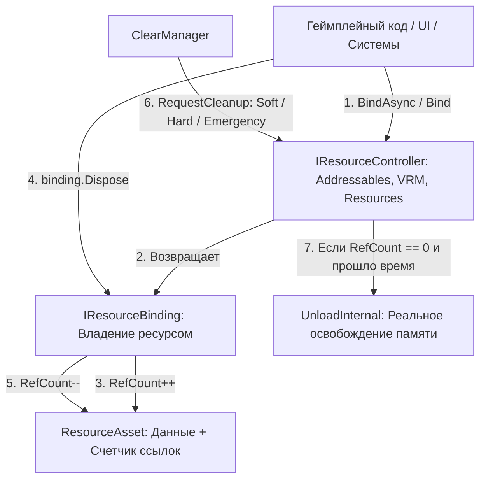

# Документация подсистемы ресурсов (ResourceSystem)

Централизованная система загрузки, кеширования, подсчета ссылок (Ref Counting) и управляемой выгрузки ассетов/ресурсов в игре.

---

## 1. Архитектурный обзор



Все контроллеры ресурсов доступны через единый статический фасад **`ResourceManager`**:
* `ResourceManager.AddressableGameObject` — префабы через Addressables.
* `ResourceManager.ResourcesGameObject` — префабы через `Resources.Load`.
* `ResourceManager.FileVRM` — 3D/VRM модели из файлов.
* `ResourceManager.Profiles` — профили игроков.
* `ResourceManager.Localization` — тексты и словари локализации.
* `ResourceManager.ClearManager` — центральный менеджер очистки памяти.

---

## 2. Что такое `ResourceBinding` и подсчет ссылок (Для новичков)

### Принцип "Библиотечного абонемента"
Когда коду нужен ресурс (модель персонажа, префаб интерфейса, конфиг), он не просто загружает его в память, а **«берет в аренду»** через метод `BindAsync` или `Bind`:

```csharp
// Арендуем ресурс
IResourceBinding<GameObject> binding = await ResourceManager.AddressableGameObject.BindAsync("Prefabs/OrcWarrior");

// Получаем сам объект
GameObject prefab = binding.Resource;
GameObject instance = Object.Instantiate(prefab);

// ... играем с персонажем ...

// Возвращаем абонемент, когда закончили работу
binding.Dispose();
```

### Как работает счетчик ссылок (`RefCount`):
1. При первом вызове `BindAsync("Key")` ресурс загружается с диска/памяти, создается `ResourceAsset`, а его `RefCount` становится равен `1`.
2. Если другой скрипт одновременно запросит тот же `"Key"`, ресурс **не загружается повторно** — возвращается новый `ResourceBinding`, а `RefCount` увеличивается (`RefCount = 2`).
3. При вызове `binding.Dispose()` счетчик уменьшается (`RefCount--`).
4. **Важное правило:** Когда `RefCount` становится равен `0`, ресурс **НЕ удаляется мгновенно** из памяти. Он просто помечается как свободный (`CanUnload == true`) и запоминает время последнего использования (`LastUseTime`). Удалением занимается менеджер очистки.

### Удобная работа с `IDisposable` и `UniRx`:
```csharp
// Вариант 1: using блок (для временных задач)
using (var binding = await ResourceManager.FileVRM.BindAsync(vrmPath))
{
    // Работаем с моделью внутри блока
} // Здесь автоматически вызовется Dispose() и RefCount уменьшится

// Вариант 2: привязка к жизненному циклу GameObject через UniRx
ResourceManager.AddressableGameObject
    .BindAsync("UI/InventoryWindow")
    .ToObservable()
    .Subscribe(binding => 
    {
        // Биндинг автоматически освободится при уничтожении этого MonoBehaviour
        binding.AddTo(this); 
    });
```

---

## 3. Как создать свой контроллер ресурсов

Все контроллеры наследуются от базового класса `ResourceController<T>`.

### Шаг 1: Создание класса контроллера
Реализуйте три `protected` метода: `LoadAsync`, `Load` (если поддерживается синхронная загрузка) и `UnloadInternal`.

```csharp
using System;
using System.Threading.Tasks;
using UnityEngine;
using ResourceSystem;

namespace ResourceSystem
{
    public sealed class AudioResourceController : ResourceController<AudioClip>
    {
        // 1. Асинхронная загрузка
        protected override async Task<AudioClip> LoadAsync(string key)
        {
            var request = Resources.LoadAsync<AudioClip>(key);
            while (!request.isDone)
            {
                await Task.Yield();
            }
            return request.asset as AudioClip;
        }

        // 2. Синхронная загрузка (если не поддерживается, выбросьте NotSupportedException)
        protected override AudioClip Load(string key)
        {
            return Resources.Load<AudioClip>(key);
        }

        // 3. Реальное освобождение памяти при выгрузке ассета
        protected override void UnloadInternal(ResourceAsset<AudioClip> asset)
        {
            Resources.UnloadAsset(asset.Resource);
        }
    }
}
```

> **Автоматическая регистрация:** Базовый конструктор `ResourceController<T>()` сам автоматически регистрирует новый контроллер в `ResourceManager.ClearManager`. Вручную ничего регистрировать не нужно!

### Шаг 2: Добавление в `ResourceManager`
В файле `ResourceSystem.cs` добавьте статическое свойство:

```csharp
public static class ResourceManager
{
    public static readonly ClearManager ClearManager = new();

    // Новый контроллер аудио
    public static IResourceController<AudioClip> Audio = new AudioResourceController();
    
    // ... остальные контроллеры
}
```

---

## 4. Как работает система очистки памяти (`ClearManager`)

Очистка ресурсов разделена на два подхода:

### А. Локальная очистка конкретного контроллера
Вы можете вызвать `Cleanup` напрямую у любого `IResourceController`:
```csharp
// Выгрузить из контроллера VRM только неиспользуемые модели, простаивающие > 60 секунд
ResourceManager.FileVRM.Cleanup(CleanupLevel.Soft, TimeSpan.FromSeconds(60));
```

### Б. Централизованная очистка через `ClearManager`
Обычно очистку запускает `ClearManager`, опрашивая сразу **все** зарегистрированные контроллеры:
```csharp
// Запрос мягкой очистки для всех систем игры
ResourceManager.ClearManager.RequestCleanup(CleanupLevel.Soft);
```

---

## 5. Уровни очистки (`CleanupLevel`) и точки вызова

| Уровень | Что очищается | Когда вызывать (Штатные сценарии) |
| :--- | :--- | :--- |
| **`Soft`** | Только ресурсы с `RefCount == 0`, которые не использовались дольше `unusedThreshold` (по умолчанию **30 сек**). | В моменты, когда игроку не критичен максимальный FPS: **открытие меню паузы**, **открытие инвентаря**, диалоговые окна. |
| **`Hard`** | **Все** ресурсы с `RefCount == 0` мгновенно, без учета времени последнего использования. | При крупных переходах: **смена локации/уровня**, выгрузка сессии в главное меню, завершение большой катсцены. |
| **`Emergency`** | `Hard`-очистка всех контроллеров + вызов `Resources.UnloadUnusedAssets()` + `GC.Collect()`. | При **аварийной нехватке памяти** (события Memory Pressure, порог 90% занятой RAM) для предотвращения краша игры. |

> **Главный геймплейный принцип:** Во время активного боя или бега по открытому миру очистка памяти **не запускается**, чтобы исключить микрофризы (stutters) от сборки мусора и выгрузки текстур. Все тяжелые операции очистки откладываются до пауз или смены сцен.
