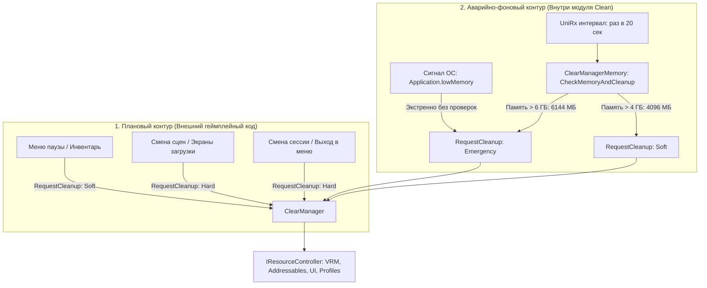
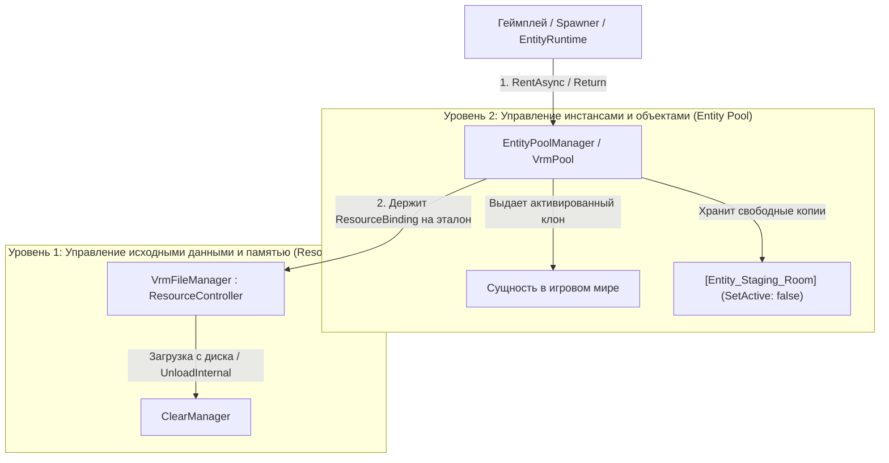

# Архитектурный план: Подсистема ресурсов, Универсальная комната сущностей и Пул объектов

Данный документ описывает целевую архитектуру управления ресурсами, памятью и сущностями игры (включая VRM 1.0 модели, NPC, монстров и интерактивные объекты).

---

## 1. Обзор архитектуры: Управление памятью (`ClearManager`)

Управление ресурсами на ПК (Windows / Linux) с бюджетом **4–6 ГБ RAM** разделено на два независимых контура:



### Контуры очистки:
1. **Плановая очистка (`RequestCleanup`)**:
   - `Soft` (таймаут 300 сек): Вызывается при открытии меню паузы, инвентаря или диалогов. Выгружает ассеты с `RefCount == 0`, которые не использовались дольше порога.
   - `Hard`: Вызывается при смене локаций, завершении миссий или смене сессии. Мгновенно выгружает все ресурсы с `RefCount == 0`.
2. **Аварийно-фоновая очистка (`ClearManagerMemory`)**:
   - `Application.lowMemory` (ОС): Сигнализирует о глобальном дефиците RAM. Вызывает `Emergency` немедленно, спасая процесс от завершения операционной системой.
   - Фоновый страж (интервал 20 сек): Контролирует реальный объем выделенной памяти игры (в МБ):
     - При $\ge 4096\text{ МБ}$ $\rightarrow$ запуск `Soft`.
     - При $\ge 6144\text{ МБ}$ $\rightarrow$ запуск `Emergency` (`GC.Collect()` + `Resources.UnloadUnusedAssets()`).

---

## 2. Проблема прямого использования `Vrm10Instance` в `ResourceSystem`

Текущая реализация `ResourceController<Vrm10Instance>` возвращает один и тот же инстанс:
1. **Конфликт владения объектом в сцене:** `Vrm10.LoadPathAsync` создает живой сценный `GameObject` с иерархией костей, `Animator`, коллайдерами и физикой `SpringBone`. Если две разные сущности (например, два одинаковых гоблина) запросят одну модель через `BindAsync`, они получат ссылку на **один и тот же `GameObject`**.
2. **Цена создания на лету (Микрофризы):** Загрузка и сборка VRM 1.0 с диска включает разбор glTF, генерацию мешей, компиляцию шейдеров MToon, построение рига скелета и костей SpringBone. Это занимает от 200 до 800 мс на модель и вызывает критические просадки кадров во время активного геймплея.
3. **Решение:** Модели необходимо кэшировать как эталоны в скрытой комнате и выдавать в мир их готовые копии через пул.

---

## 3. Универсальная комната сущностей (`Entity Staging Room`)

Комната сущностей — это не физическое пространство на координатах `(0, -2000, 0)`, а **изолированный выключенный контейнер в глобальном контексте игры**.

### Концепция и свойства комнаты:
* **Изоляция:** Корневой объект `GameObject("[Entity_Staging_Room]")` помещается в `DontDestroyOnLoad` и переводится в **`SetActive(false)`**.
* **0% нагрузки на систему:**
  * **GPU / Рендеринг:** Все меши (`MeshRenderer`, `SkinnedMeshRenderer`) не визуализируются, создавая ровно **0 Draw Calls**.
  * **CPU / Обновления:** Все функции `Update()`, `LateUpdate()`, `FixedUpdate()`, аниматоры и физика волос/одежды (`SpringBone`) спят и не потребляют процессорное время.
  * **PhysX / Физика:** Все коллайдеры и `Rigidbody` отключены и полностью исключены из физической симуляции мира.
* **Независимость от сеттинга локаций:** Работает везде одинаково надежно — в открытом космосе, в вертикальных шахтах или в процедурных подземельях (нет риска случайного пересечения с триггерами или лучами `Raycast`).

### Структура иерархии комнаты:
```text
[Entity_Staging_Room] (DontDestroyOnLoad, SetActive: false)
 ├── 📁 Templates/               <-- Эталонные оригиналы моделей/сущностей
 │    ├── Vrm_Goblin_Original
 │    ├── Vrm_Hero_Original
 │    └── Prefab_Chest_Original
 └── 📁 Pools/                   <-- Спящие прогретые инстансы, готовые к выдаче
      ├── 📁 VRM/
      │    ├── Vrm_Goblin_Clone_01
      │    └── Vrm_Goblin_Clone_02
      ├── 📁 Monsters/
      └── 📁 VFX_Projectiles/
```

---

## 4. Двухуровневая архитектура: Ресурсы + Пул сущностей

Для разделения ответственности система разделяется на два взаимосвязанных слоя:



### Уровень 1: Поставщик шаблонов (`ResourceSystem.VrmFileManager`)
* Загружает файл `.vrm` с диска один раз в качестве эталонного шаблона (`Template`).
* Помещает оригинальный инстанс внутрь `[Entity_Staging_Room]/Templates/`.
* Управляет подсчетом ссылок `RefCount`. Пока хотя бы один клон модели используется в мире или хранится в пуле, `RefCount > 0`.
* При `UnloadInternal` вызывает `instance.DisposeRuntime()` для полного освобождения нативной памяти мешей и текстур.

### Уровень 2: Универсальный пул объектов (`EntityPoolManager`)
* Управляет пулом любых типов сущностей: VRM 1.0, префабы Unity (`Addressables` / `Resources`), монстры, снаряды.
* Предоставляет публичный API аренды и возврата:
  - `RentAsync<T>(string key)`: проверяет наличие готовой копии в пуле; если нет — клонирует эталон из комнаты.
  - `Return(GameObject instance)`: сбрасывает состояние сущности и возвращает ее в комнату (`SetActive(false)`).

---

## 5. Жизненный цикл сущности и сброс состояния (Reset)

При возврате объекта в пул крайне важно вернуть его в исходное "чистое" состояние перед повторным использованием:

1. **Интерфейс сброса `IPoolable`:**
   ```csharp
   public interface IPoolable
   {
       void OnSpawn();  // Вызывается при выдаче из пула в мир
       void OnDespawn(); // Вызывается перед возвратом в комнату
   }
   ```
2. **Обязательные шаги при вызове `OnDespawn()`:**
   - **Физика:** Сброс скоростей `Rigidbody.linearVelocity = Vector3.zero`, `angularVelocity = Vector3.zero`.
   - **Анимации:** Перевод `Animator` в дефолтное состояние (`Play("Idle", 0, 0f)`), сброс всех триггеров.
   - **VRM-специфика:**
     - Сброс выражений лица (BlendShapes / Expressions) к 0.
     - Сброс физики волос и одежды (`Vrm10Instance.Runtime.SpringBone.Reset()`).
   - **Иерархия:** Открепление от внешних родителей (`transform.SetParent(roomContainer)`), перевод в `SetActive(false)`.

---

## 6. Прогрев (Warmup) и интеграция с экранами загрузки

Чтобы исключить любые подергивания при первом спавне группы врагов:
* В моменты загрузки сцены (`LoadingScene` / `ScenesManager`) спавнер вызывает предпрогрев:
  ```csharp
  await EntityPoolManager.WarmupAsync("Models/Goblins/Warrior.vrm", count: 5);
  ```
* Пул заранее создает 5 спящих копий внутри комнаты.
* Во время боя выдача каждого гоблина происходит **мгновенно за 0 кадров** простым включением `SetActive(true)` и сменой позиции `transform.position`.

---

## 7. Интеграция пула с `ClearManager`

При наступлении событий глубокой очистки памяти (`CleanupLevel.Hard` или `Emergency`):
1. `EntityPoolManager` очищает неактивные инстансы, скопившиеся в пуле комнаты (например, уничтожает лишних спящих гоблинов через `Object.Destroy`).
2. Освобождаются соответствующие `IResourceBinding` эталонов в `VrmFileManager`.
3. Если счетчик ссылок модели упал до 0, `ClearManager` безопасно выгружает сам эталон и его текстуры из видеопамяти.

---

## 8. Этапы реализации

- [ ] **Этап 1: Корневая комната (`EntityStagingRoom`)**
  - Создание синглтона/сервиса скрытой комнаты в `DontDestroyOnLoad` с `SetActive(false)`.
- [ ] **Этап 2: Контроллер эталонов VRM (`VrmFileManager`)**
  - Обновление логики загрузки: помещение оригинального инстанса в комнату шаблонов как неизменяемого эталона.
- [ ] **Этап 3: Универсальный пул объектов (`EntityPoolManager`)**
  - Реализация очереди свободных объектов `Queue<GameObject>`.
  - Реализация интерфейса `IPoolable` и логики сброса для VRM и обычных сущностей.
  - Методы `RentAsync`, `Return`, `WarmupAsync`.
- [ ] **Этап 4: Интеграция с существующим кодом**
  - Перевод [SpawnVrm.cs](file:///d:/unity/LunaticMagicV3/Assets/Scripts/VRM/RunGame/SpawnVrm.cs) и логики спавна сущностей на использование пула.
  - Подключение очистки свободных объектов пула к `ClearManager.Register(ICleanable)`.
