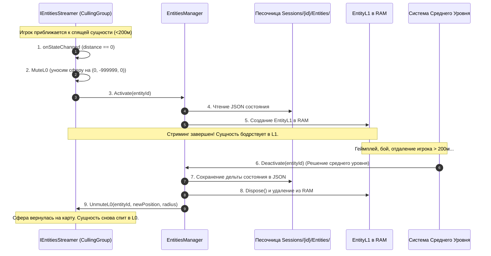

# Архитектура и Спецификация Системы Стриминга (Streaming Engine)

**Проект:** LunaticMagicV3  
**Путь к подсистеме:** `Assets/Scripts/Entities/Streaming/`  
**Файл документации:** `plan.md`  
**Дата фиксации:** 20 ноября 2026

---

## 1. Фундаментальный Принцип и Граница Ответственности

> [!IMPORTANT]
> **Задача стриминга — ИСКЛЮЧИТЕЛЬНО РАСПАКОВКА (L0 $\rightarrow$ L1).**  
> Стриминг существует только потому, что процессор не может каждый кадр перебирать 10 000 сущностей из реестра сессии для проверки дистанции.  
> Как только сущность распакована в оперативную память (L1) — **система низкоуровневого стриминга больше не имеет к ней никакого отношения**.

* **Стриминг НЕ занимается выгрузкой в L0:**  
  Когда игрок отходит дальше 200 метров, сущность **не выгружается автоматически обратно на диск**. Она остается в оперативной памяти (L1) как чистый C# объект.
* **Кто занимается выгрузкой (L1 $\rightarrow$ L0):**  
  За выгрузку отвечает **система среднего уровня (Lifecycle & Tier Management)** по своей независимой логике: завершение сценариев A-Life, отсутствие боя/квестов, превышение лимитов памяти пула сессии. Именно она вызывает `EntitiesManager.Deactivate(entityId)`.

---

## 2. Двойная Архитектура Стриминга (`IEntitiesStreamer`)

Подсистема спроектирована по паттерну «Стратегия» под единым интерфейсом [IEntitiesStreamer.cs](file:///D:/unity/LunaticMagicV3/Assets/Scripts/Entities/Streaming/IEntitiesStreamer.cs). В проекте сосуществуют два равноправных стримера:

```
                          ┌───────────────────────────┐
                          │    IEntitiesStreamer      │
                          └─────────────┬─────────────┘
                                        │
                 ┌──────────────────────┴──────────────────────┐
                 ▼                                             ▼
  ┌─────────────────────────────┐               ┌─────────────────────────────┐
  │    CullingGroupStreamer     │               │     SpatialGridStreamer     │
  │     (ОСНОВНОЙ РЕЖИМ)        │               │      (ЗАПАСНОЙ РЕЖИМ)       │
  │ • Нативный C++ SIMD в ядре  │               │ • Чистый C# без Unity Scene │
  │ • BoundingSphere[] массив   │               │ • 2D Spatial Hash Grid      │
  │ • События onStateChanged    │               │ • Опрос по таймеру 0.25 сек │
  └─────────────────────────────┘               └─────────────────────────────┘
```

Переключение между режимами выполняется в [EntitiesManager.cs](file:///D:/unity/LunaticMagicV3/Assets/Scripts/Entities/EntitiesManager.cs) в любой момент:
```csharp
entitiesManager.SetStreamer(StreamerType.CullingGroup); // Нативный C++
// или
entitiesManager.SetStreamer(StreamerType.SpatialGrid);   // Запасной C#
```

---

## 3. Детальное Устройство `CullingGroupStreamer` (Основной режим)

Стример [CullingGroupStreamer.cs](file:///D:/unity/LunaticMagicV3/Assets/Scripts/Entities/Streaming/CullingGroupStreamer.cs) опирается на нативный движковый компонент `UnityEngine.CullingGroup`.

### 3.1. Структуры данных и память
1. **Плоский массив сфер (`BoundingSphere[] _spheres`):**
   * Массив структур (16 байт на сферу).
   * Инициализируется на 1024 элемента, при необходимости динамически расширяется в 2 раза (`Array.Resize`).
   * Для 10 000 сущностей занимает всего **~160 КБ** оперативной памяти.
2. **Двусторонний индекс за $O(1)$:**
   * `string[] _indexToId` — по числовому `evt.index` от Unity мгновенно возвращает `EntityId`.
   * `Dictionary<string, int> _idToIndex` — по `EntityId` находит индекс слота в массиве.
3. **Пул свободных слотов (`Stack<int> _freeSlots`):**
   * Хранит индексы удаленных сущностей для их повторного использования.

---

### 3.2. Паттерн «Muted Sphere» (Заглушение сфер при L1)

> [!WARNING]
> **Проблема нативного C++ в Unity:**  
> Коллбэк `onStateChanged` вызывается **внутри** нативного цикла обхода сфер. Если во время этого события попытаться изменить размер массива сфер или выполнить перемешивание (Swap-with-Last), Unity выбросит предупреждение или пропустит обработку событий для смещенной сферы.

#### Решение:
Константа координат заглушения:
```csharp
public static readonly Vector3 MutedPosition = new Vector3(0, -999999f, 0);
```

1. **Распаковка (L0 $\rightarrow$ L1):**
   Когда точка фокуса пересекает границу зоны интереса, в `OnCullingGroupStateChanged`:
   * Сфера мгновенно «глушится»:
     ```csharp
     _spheres[idx] = new BoundingSphere(MutedPosition, 0f);
     ```
   * Дистанция до сферы становится около 1 000 000 метров с радиусом 0.
   * **Результат:** C++ ядро считает сферу бесконечно далекой и **больше никогда не шлет по ней событий**. Слот сохраняется за сущностью, массив не меняет размер.
   * Вызывается распаковка: `_entitiesManager.Activate(entityId)`.
2. **Засыпание обратно на диск (L1 $\rightarrow$ L0):**
   Когда система среднего уровня вызывает `EntitiesManager.Deactivate(entityId)`:
   * Вызывается `Streamer.UnmuteL0(entityId, position, radius)`:
     ```csharp
     _spheres[idx] = new BoundingSphere(position, radius);
     ```
   * Сфера мгновенно возвращается на свои актуальные координаты в мире и снова встает на мониторинг стриминга.

---

### 3.3. Паттерн «Free-List Pool» (Удаление неуникальных сущностей)

Когда сущность уничтожается навсегда (убит временный моб, подобран лут со спавнера):
```csharp
public void UnregisterL0(string entityId)
{
    if (_idToIndex.TryGetValue(entityId, out int idx))
    {
        // 1. Глушим сферу за пределы мира
        _spheres[idx] = new BoundingSphere(MutedPosition, 0f);
        _indexToId[idx] = null;
        _idToIndex.Remove(entityId);

        // 2. Отправляем освободившийся индекс в пул
        _freeSlots.Push(idx);
    }
}
```

Когда спавнится новый моб или создается новая сущность (`RegisterL0`):
1. Если `_freeSlots.Count > 0` $\rightarrow$ забираем `int idx = _freeSlots.Pop();` и записываем новую сущность прямо в освободившийся слот.
2. Если свободных слотов нет $\rightarrow$ берем новый слот в конце: `int idx = _count++;`.

> [!TIP]
> **Профит:** Массив `_spheres` никогда не раздувается бесконечно и не фрагментируется. Старые слоты циклически переиспользуются.

---

### 3.4. Перезагрузка сессии и Сейв/Лоад

При загрузке сейва (F9), старте новой игры или выходе в главное меню:
```csharp
public void Clear()
{
    _count = 0;
    _freeSlots.Clear();
    _idToIndex.Clear();
    Array.Clear(_indexToId, 0, _indexToId.Length);

    _cullingGroup?.Dispose();
    _cullingGroup = null;

    InitCullingGroup();
}
```
* **Зачем пересоздавать:** `CullingGroup.Dispose()` и создание нового объекта занимает меньше 1 миллисекунды, но на 100% гарантирует, что в нативной памяти C++ не останется «призрачных» сфер и старых слушателей из прошлой сессии.

---

## 4. Детальное Устройство `SpatialGridStreamer` (Запасной режим)

Стример [SpatialGridStreamer.cs](file:///D:/unity/LunaticMagicV3/Assets/Scripts/Entities/Streaming/SpatialGridStreamer.cs) работает на базе чистого C# класса [SpatialHashGrid.cs](file:///D:/unity/LunaticMagicV3/Assets/Scripts/Entities/Streaming/SpatialHashGrid.cs).

### 4.1. Принцип работы
* Мир разбивается на плоские квадратные ячейки $100 \times 100$ метров:
  ```csharp
  int cellX = Mathf.FloorToInt(x / CellSize);
  int cellZ = Mathf.FloorToInt(z / CellSize);
  GridCellKey key = new GridCellKey(cellX, cellZ);
  ```
* Каждая ячейка хранит `HashSet<string> entityIds`.
* Двусторонний индекс `_entityToCell` позволяет за $O(1)$ находить и перемещать сущность между ячейками при смене координат.

### 4.2. Опрос и Заглушение
* Проверка выполняется раз в 0.25 секунды (`UpdateInterval`).
* Опрашиваются только ячейки в радиусе внимания (например, квадрат $5 \times 5$ ячеек вокруг точки фокуса).
* При переходе в L1 метод `MuteL0(entityId)` просто временно удаляет сущность из сетки, чтобы она не тратила время на проверки в циклах.
* При возврате в L0 метод `UnmuteL0(entityId, pos, radius)` вставляет её обратно в актуальную ячейку сетки.

---

## 5. Взаимодействие с `EntitiesManager`

Связующим звеном выступает [EntitiesManager.cs](file:///D:/unity/LunaticMagicV3/Assets/Scripts/Entities/EntitiesManager.cs):



---

## 6. Карта Файлов Подсистемы

* [IEntitiesStreamer.cs](file:///D:/unity/LunaticMagicV3/Assets/Scripts/Entities/Streaming/IEntitiesStreamer.cs) — базовый интерфейс и перечисление `StreamerType`.
* [CullingGroupStreamer.cs](file:///D:/unity/LunaticMagicV3/Assets/Scripts/Entities/Streaming/CullingGroupStreamer.cs) — основной нативный SIMD стример (CullingGroup, Muted Sphere, Free-List Pool).
* [SpatialGridStreamer.cs](file:///D:/unity/LunaticMagicV3/Assets/Scripts/Entities/Streaming/SpatialGridStreamer.cs) — запасной чистый C# стример на 2D хэш-сетке.
* [SpatialHashGrid.cs](file:///D:/unity/LunaticMagicV3/Assets/Scripts/Entities/Streaming/SpatialHashGrid.cs) — структура данных 2D хэш-сетки с ячейками $100 \times 100$ м.
* [EntitiesStreamer.cs](file:///D:/unity/LunaticMagicV3/Assets/Scripts/Entities/Streaming/EntitiesStreamer.cs) — класс-адаптер для обратной совместимости.
* [EntitiesManager.cs](file:///D:/unity/LunaticMagicV3/Assets/Scripts/Entities/EntitiesManager.cs) — координатор реестра L0, активных L1 и управления стримером.
