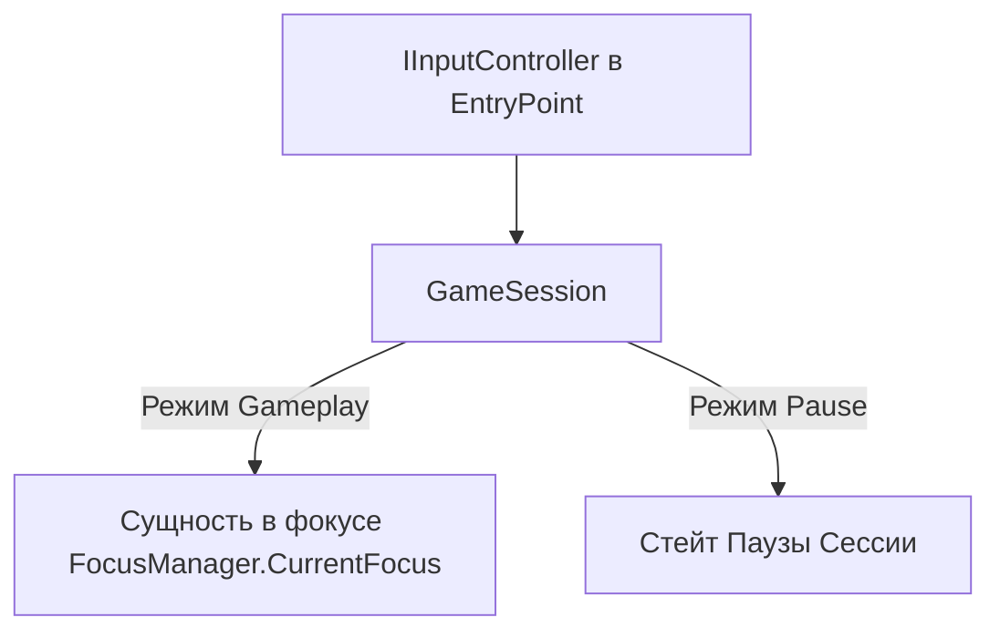

# Архитектура GameSession

**Проект:** LunaticMagicV3  
**Путь:** `Assets/Scripts/Game/Session/plan.md`  
**Дата обновления:** 12 ноября 2026

---

## 1. Фундаментальный Стейт Сессии

В `GameSession` существует **ровно два глобальных состояния**:
1. **`Gameplay`** — мир активен, симуляция тикает, управление отдано сущности в фокусе.
2. **`Pause`** — симуляция и физика движка заморожены (`Time.timeScale = 0`).

Никаких других глобальных состояний сессия не имеет.

> **Важное архитектурное разграничение:**
> - **Главное меню** — это НЕ состояние сессии. Это полноправная часть игры (отдельная сцена со своими сущностями и `MainMenuEntity`).
> - **Смерть игрока** — это НЕ состояние сессии. Это геймплейное событие сущности: фокус переходит `DeathEntity`, камера облетает тело, симуляция мира продолжается.
> - **Консоль разработчика (`~`)** — вынесена **выше сессии в Точку Входа (EntryPoint)**. Она слушает хоткей `~` независимо, живёт на системном Canvas приложения и может открываться даже тогда, когда сессия ещё не создана.

---

## 2. Маршрутизация Инпута

Глобальный `IInputController` находится в **Точке Входа (EntryPoint)**. Все команды ввода передаются в активную `GameSession`:



1. **`Gameplay`** $\rightarrow$ ввод передаётся **сущности в фокусе**.
2. **`Pause`** $\rightarrow$ ввод передаётся **активному подстейту паузы** (если это `PauseScreen`, он обрабатывает навигацию по меню; при переходе и загрузке ввод блокируется).

---

## 3. Стейт Паузы Сессии (3 режима)

Когда сессия переходит в `Pause`, активен ровно один из трёх взаимоисключающих подстейтов:

```
┌────────────────────────────────────────────────────────────────────────┐
│                        РЕЖИМЫ ПАУЗЫ СЕССИИ                             │
├────────────────────────────────────────────────────────────────────────┤
│ 1. FocusTransition  │ Технический переход для дальней смены фокуса     │
│                     │ • Тёмный экран (Fade). Инпут заблокирован.       │
│                     │ • Музыка геймплея НЕ прерывается (Слот 1).       │
├─────────────────────┼──────────────────────────────────────────────────┤
│ 2. PauseScreen      │ UI экран паузы сессии                            │
│                     │ • Самостоятельная UI-единица (внутри: настройки, │
│                     │   попапы подтверждения, дебаг-меню сессии).      │
│                     │ • Инпут обрабатывается экраном паузы.            │
│                     │ • Музыка геймплея на паузе (с сохранением time). │
│                     │ • Играет музыка паузы (Слот 2, тишина = музыка). │
├─────────────────────┼──────────────────────────────────────────────────┤
│ 3. InitialLoading   │ Экран первоначальной загрузки сессии из сейва    │
│                     │ • Распаковка сейва, пространственный барьер.     │
│                     │ • Инпут заблокирован.                            │
│                     │ • Играет музыка загрузки (Слот 3).               │
└─────────────────────┴──────────────────────────────────────────────────┘
```

### 3.1. Технический переход (`FocusTransition`)
- Активируется при передаче фокуса на далёкую сущность или телепорте (когда требуется скрыть подгрузку мира и смену ракурса).
- Экран затемнён, мир стоит.
- **Музыка геймплея продолжает играть** без прерывания и заикания.

### 3.2. Экран паузы (`PauseScreen`)
- Единая самостоятельная UI-система. В ней нет «глобальных попапов» — все всплывающие окна, подтверждения («Выйти без сохранения?») и панель настроек являются **внутренними компонентами** этого экрана.
- Музыка геймплея ставится на паузу (запоминается таймкод `PlaybackTime`).
- Включается музыка паузы (Слот 2). Тишина — это тоже валидный аудио-трек для этого слота.

### 3.3. Первоначальная загрузка (`InitialLoading`)
- Активируется при старте сессии из сохранения или новой игры.
- Геймплейной музыки ещё нет. Играет музыка загрузки (Слот 3).

---

## 4. Подсистема Музыки и Эмбиента Сессии

Центральный аудиоконтроллер живёт на системном объекте `GameSession`. Перед ним расположен **буфер из 3 слотов**:

```
┌────────────────────────────────────────────────────────────────────────┐
│                      БУФЕР МУЗЫКИ СЕССИИ                               │
├────────────────────────────────────────────────────────────────────────┤
│ Слот 1: GameplayTrack │ Трек геймплея (задаётся сущностями и зонами)   │
│ Слот 2: PauseTrack    │ Трек паузы (занят всегда; тишина = трек)       │
│ Слот 3: LoadingTrack  │ Трек загрузки (занят всегда)                   │
└────────────────────────────────────────────────────────────────────────┘
```

### 4.1. Правила работы со слотами
1. **Слоты 2 (`PauseTrack`) и 3 (`LoadingTrack`)** заполнены всегда дефолтными системными треками (или тишиной). По ходу игры они также могут модифицироваться, если меняется глава или биом.
2. **Слот 1 (`GameplayTrack`)** заполняется динамически сущностями из геймплея (например, пересечение границы локации или вход в бой).
3. **Автоматическая реакция на стейт сессии:**
   - `Gameplay` $\rightarrow$ играет Слот 1.
   - `Pause` (`FocusTransition`) $\rightarrow$ продолжает играть Слот 1.
   - `Pause` (`PauseScreen`) $\rightarrow$ Слот 1 паузится (запоминается таймкод), включается Слот 2. При возврате в геймплей Слот 1 возобновляется с сохранённой секунды.
   - `Pause` (`InitialLoading`) $\rightarrow$ играет Слот 3.

### 4.2. Сериализация и хранение треков
- Музыка идентифицируется строкой-путём к ассету в системе Addressables (например, `"Assets/MyFiles/Sound.prefab"` или адрес ресурса), связывается через `ResourceManager`.
- Все 3 слота сериализуются в файл сохранения сессии.
- Сериализуется также **время воспроизведения (`PlaybackTime`)** текущего трека, чтобы после загрузки или возврата из меню музыка продолжалась с той же секунды, а не начиналась заново.

---

## 5. Геймплейные Оверлеи (Журнал, Книга, Колесо магии)

Все игровые оверлеи (инвентарь, книга заклинаний, колесо способностей) **НЕ относятся к стейту сессии**:
1. Сессия остаётся в режиме `Gameplay`.
2. Изменение масштаба времени (например, сильное замедление Bullet-Time `scale = 0.05f` при открытии колеса заклинаний) регулируется **самой сущностью в фокусе через её `ITimeState`**.
3. Пауза сессии предназначена только для ситуаций, когда система стоит *над сущностями* (Esc, загрузка, синхронизация).
