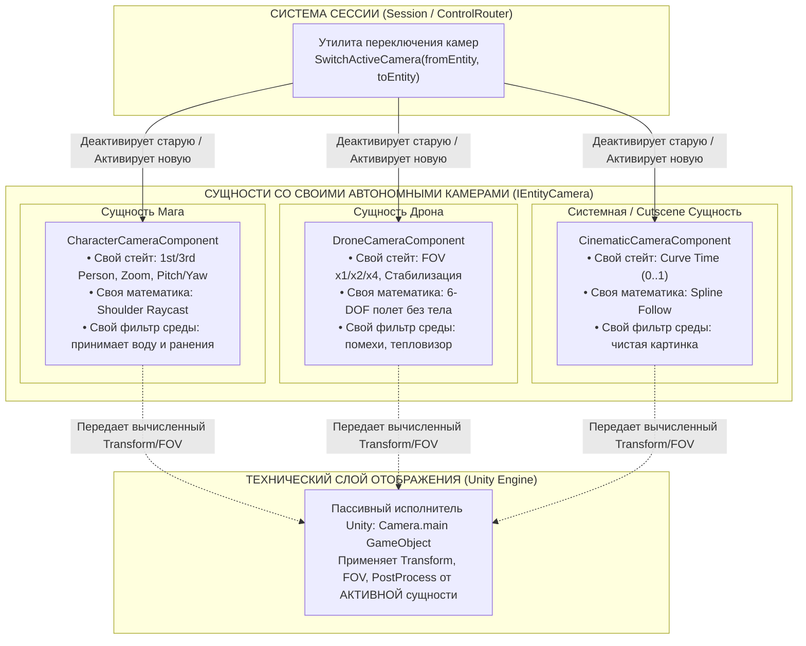
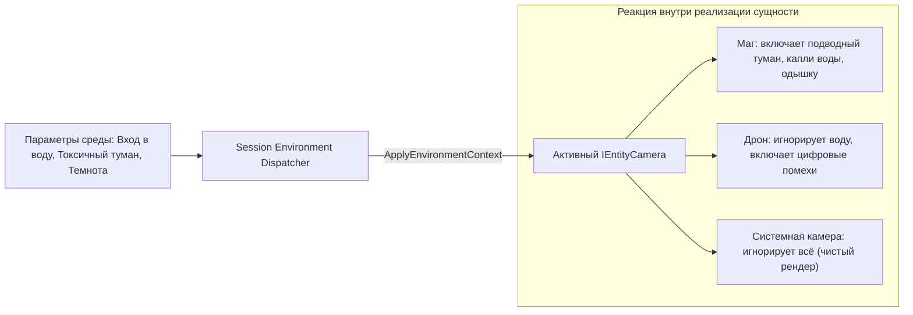

# Архитектурная спецификация системы Камер (Camera System Design Doc)

**Мой изначальный промпт, который я дал Antigravity НЕ ВЫРЕЗАТЬ БЕЗ МОЕЙ КОМАНДЫ!!!: 
Камера это компонент сущности. У игрока есть камера состоящая из Камера 1 и Камера 3 лица, но всё это одна камера игрока. У дрона своя камера. Стейт камеры зависит от сущности, потому что у нас компонент камера на сущности. 
По сути все что мы делаем это переключаем активыне камеры (я сейчас не про механизм самого GO камеры юнити, а про камеры в сущностях. Можно сделать утилиту -метод смены камер принимающую 2 сущности у одной из кот орых камера щас активна или другие способы переключения...).
Также камера может поучать параметры из среды, если камера сущности может их принять, например туман под водой - камеры на игроке принимают данные от воды. На системной камере можно их не примнимать.**


**Изначальный авторский замысел:**
> Камера — это компонент сущности. У игрока есть камера, состоящая из камеры 1-го и 3-го лица, но всё это одна камера игрока. У дрона своя камера. Стейт камеры зависит от сущности, потому что у нас компонент камера на сущности. 
> По сути всё, что мы делаем — это переключаем активные камеры (не сам физический GO камеры Unity, а камеры в сущностях через утилиту смены камер, принимающую 2 сущности). 
> Также камера может получать параметры из среды, если камера сущности может их принять (например, туман под водой — камеры на игроке принимают данные от воды, а системная камера может их не принимать).

---

## 1. Главная архитектурная идея (Core Emphasis)

> **КЛЮЧЕВОЙ АКЦЕНТ:**
> 1. **Единый интерфейс камеры сущности (`IEntityCamera`):** Для игровой сессии любая камера в мире — это просто компонент на сущности с унифицированным портом управления. Всё, что делает внешняя система (при вселении, катсцене, смене режима) — это **переключает активность камеры с одной сущности на другую** (`SwitchActiveCamera(fromEntity, toEntity)`).
> 2. **Полная автономия реализации внутри Сущности:** То, **как именно устроена камера, какие данные она хранит и как вычисляет ракурс** — это исключительно **внутреннее дело самой сущности**. Внешний мир ничего не знает про внутренности:
>    * Для **Гуманоида (Маг/NPC):** камера внутри себя объединяет 1-е и 3-е лицо с рейкастами от плеча и зумом колесика.
>    * Для **Дрона:** камера внутри себя реализует 6-DOF полет, сетку визора и оптический зум.
>    * Для **Турели / Камеры наблюдения:** фиксированный угол обзора и поворот по шарниру.
>    * Для **Катсцены:** движение по сплайну или таймлайну.

---

## 2. Архитектурная модель: Контракт, Автономия и Проектор



---

## 3. Унифицированный контракт (`IEntityCamera`)

Внешней системе не нужно знать детали реализации. Контракт минималистичен и универсален:

```csharp
public interface IEntityCamera
{
    /// <summary>
    /// Сущность-владелец этой камеры
    /// </summary>
    IEntity Owner { get; }

    /// <summary>
    /// Вызывается при передаче камере статуса активной (главной)
    /// </summary>
    void OnActivated();

    /// <summary>
    /// Вызывается при снятии статуса активной (камера засыпает, сохраняя свой стейт)
    /// </summary>
    void OnDeactivated();

    /// <summary>
    /// Передача ввода мыши / геймпада (Look Input)
    /// </summary>
    void HandleLookInput(Vector2 lookDelta);

    /// <summary>
    /// Передача ввода колесика мыши (Scroll Input)
    /// </summary>
    void HandleScrollInput(float scrollDelta);

    /// <summary>
    /// Передача параметров окружающей среды (погружение в воду, туман, пост-эффекты)
    /// </summary>
    void ApplyEnvironmentContext(EnvironmentData environment);

    /// <summary>
    /// Итоговые параметры, которые считывает физический Camera.main для рендера кадра
    /// </summary>
    CameraFrameOutput GetFrameOutput();
}
```

---

## 4. Инкапсуляция состояния внутри Сущности (State Isolation)

Поскольку камера — это компонент конкретной сущности, **весь стейт изолирован внутри неё**:
1. **Маг:** Вы настроили камеру мага на 3-е лицо с дистанцией 3.5 метра и небольшим углом наклона вверх.
2. **Вселение в Гоблина:** Система переключает активную камеру на гоблина. У гоблина активируется его личная камера (например, от 1-го лица с низким ростом).
3. **Возврат в Мага:** При возврате управления камера мага активируется снова — **с теми же 3.5 метрами дистанции и тем же ракурсом**, которые были у мага до вселения. Никакие глобальные переменные не сбиваются.

---

## 5. Утилита переключения камер (Camera Switcher)

Переключение активной камеры — это стандартный высокоуровневый метод:

```csharp
public static class CameraSwitcher
{
    public static void SwitchCamera(
        IEntity fromEntity, 
        IEntity toEntity, 
        CameraTransitionStyle transition = CameraTransitionStyle.SmoothBlend)
    {
        var sourceCamera = fromEntity?.GetComponent<IEntityCamera>();
        var targetCamera = toEntity.GetComponent<IEntityCamera>();

        sourceCamera?.OnDeactivated();
        targetCamera.OnActivated();

        if (transition == CameraTransitionStyle.SmoothBlend && sourceCamera != null)
        {
            // Запускаем интерполяцию физического Camera.main от позиции source к target
            CameraBlender.StartBlend(sourceCamera.GetFrameOutput(), targetCamera);
        }
        else
        {
            // Мгновенный срез (Cut)
            CameraBlender.SnapTo(targetCamera);
        }
    }
}
```

---

## 6. Прием параметров окружающей среды (Environmental Context)

Камера сущности сама решает, как интерпретировать окружение:



### Примеры изоляции поведения:
* **Под водой:** 
  * `CharacterCameraComponent` мага видит, что точка обзора находится ниже уровня водного меша, и включает подводную каустику, синий туман и звуковой low-pass фильтр.
  * `SystemFreeCamera` разработчика полностью игнорирует данные о воде, позволяя свободно летать сквозь воду без искажений.
* **Ранения и урон:**
  * Здоровье — это параметр тела мага. Его камера сама считывает HP своего тела и накладывает виньетку ранения.
  * Когда вы вселились в дрон, у дрона нет биологического здоровья, поэтому камера дрона никогда не покажет кровавую виньетку.
