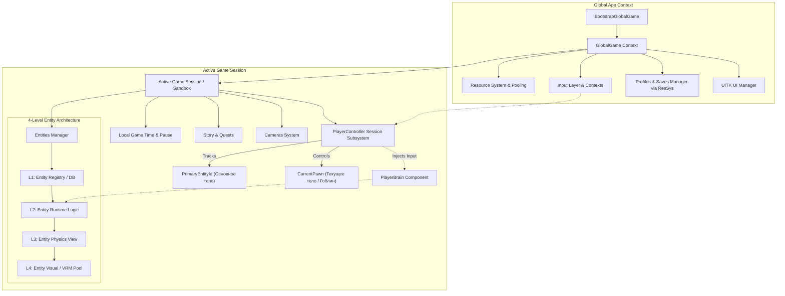
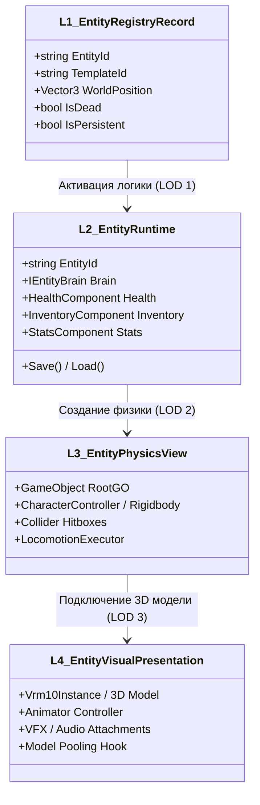
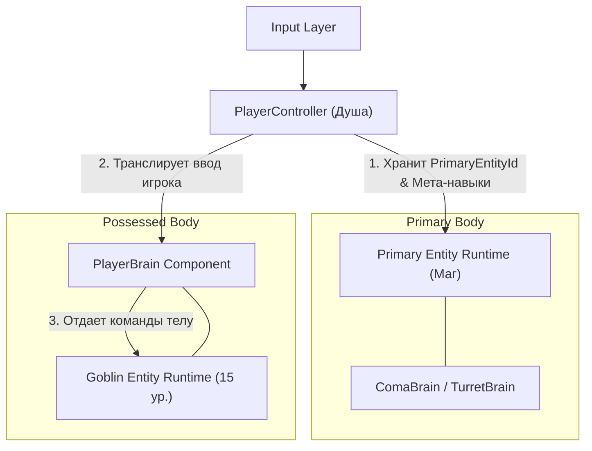
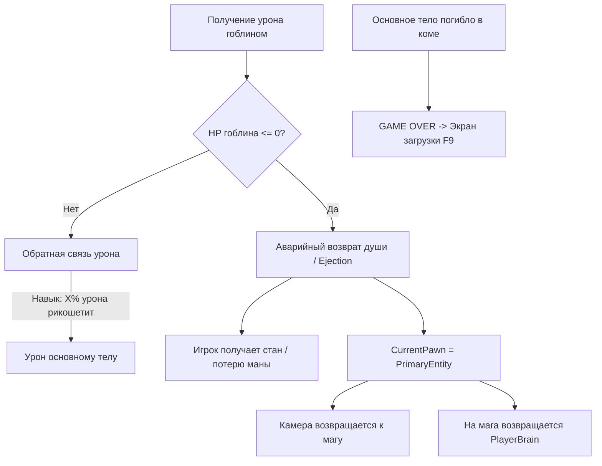

# Дизайн-документ базовой архитектуры (Core Architecture Design Doc)
**Проект:** LunaticMagic2  
**Жанр/Стиль:** Одиночная RPG в открытом мире (в духе The Elder Scrolls V: Skyrim)  
**Ключевые особенности:** Быстрые сохранения/загрузки (F6 / F9), глубокая модульность, 4-уровневая система сущностей, отделение Контроллера от Тела (Pawn/Entity) и механика вселения (Possession).

---

## 1. Архитектурные принципы и философия

1. **Разделение Ответственности (SoC - Separation of Concerns):**
   * Данные (Data) отделены от логики (Simulation/Logic).
   * Логика полностью изолирована от визуализации и физики Unity (View/Presentation).
   * Логическая симуляция может жить и обсчитываться в чистом C# без существования `GameObject` в сцене.
2. **Изолированная песочница сессии (Session Sandbox):**
   * В реальном геймплее существует и изменяется **только одна активная сессия**.
   * Сохранение (включая F6 Quicksave) — это атомарный снимок активной папки сессии в файл/папку профиля.
   * Загрузка (F9 Quickload) — это очистка текущей сессии и мгновенное развертывание мира из снимка сохранения.
3. **Разделение Контроллера (Player / Душа) и Тела (Pawn / Сущность):**
   * **Тело (Pawn):** Обладает физическими характеристиками, инвентарем и уровнем. Пассивно исполняет команды от установленного `Brain`.
   * **Контроллер (PlayerController):** Олицетворяет "душу" игрока в сессии. Хранит данные об основном теле (`PrimaryEntityId`), навыки вселения, журнал заданий и мета-прогресс.
   * **Ограничение функционала во вселении:** В чужом теле функционал урезан — системные/квестовые триггеры не срабатывают, NPC реагируют на монстра/NPC, а лут остается в теле (если не прокачан навык переноса).
4. **Контроль ресурсов через Scopes и Binding:**
   * Ресурсы управляются ссылками `ResourceBinding`. `ResourceScope` — это потребитель/держатель ссылок, обеспечивающий их автоматическое освобождение при завершении жизненного цикла (сцена, квест, сессия).
   * Тяжелые ассеты (VRM 3D модели, префабы) управляются через пулинг.

---

## 2. Разделение систем: Core (Ядро) vs Feature (Геймплей)

| Уровень | Подсистема | Назначение |
| :--- | :--- | :--- |
| **CORE** | **1. Bootstrap & App Lifecycle** | Точка входа, инициализация глобальных сервисов, управление состояниями приложения (Boot -> Menu -> Session). |
| **CORE** | **2. Resource & Asset System** | Управление памятью через `ResourceBinding`, Scopes, пулинг VRM/GameObject, асинхронная загрузка (Addressables/Resources/Files). |
| **CORE** | **3. Input Layer** | Агностический слой ввода, контексты ввода (Gameplay, UI, Dialogue, Cutscene), маппинг клавиш. |
| **CORE** | **4. Profiles, Saves & Session Sandbox** | Ленивая загрузка профилей/сейвов через ResourceSystem, изолированная файловая сессия, F6 QuickSave / F9 QuickLoad. |
| **CORE** | **5. 4-Level Entity Architecture** | Реестр сущностей мира (Registry) -> Логика (Runtime) -> Физика (View) -> 3D Модель/Анимации (Visual/VRM). |
| **CORE** | **6. PlayerController & Brains (Possession)** | Разделение Controller и Pawn, сменные мозги (`PlayerBrain`, `AIBrain`, `ComaBrain`), защита основного тела и обработка урона/смерти. |
| **FEATURE** | **7. Camera System** | 1-st / 3-rd person / Free Camera, следование за активным Target (Pawn), изоляция настроек на один Camera GO. |
| **FEATURE** | **8. Quest & Story Engine** | Состояние мира, цепочки квестов, триггеры, реакция на события сущностей. |
| **FEATURE** | **9. Dialogue System** | Диалоговые деревья, проверка условий (статы, квесты), выдача реплик и наград. |
| **FEATURE** | **10. UI Layer (UITK)** | Реактивный интерфейс (UniRx/R3), HUD текущего тела, глобальный инвентарь/журнал, меню паузы. |

---

## 3. Детальное описание подсистем ядра (Core)



---

### 3.1. Точка входа и жизненный цикл (Bootstrap & App Lifetime)

#### Назначение:
Обеспечить предсказуемую инициализацию систем без статического спагетти и гонок инициализации:
1. **`AppBootstrap` (MonoBehaviour, `DontDestroyOnLoad`):**
   * Единственная точка входа на сцене инициализации (`[RuntimeInitializeOnLoadMethod]`).
   * Регистрирует глобальные сервисы (Resources, Audio, Localization, Input, Profiles).
2. **`GameStateMachine`:**
   * Управляет глобальными переходами:
     * `BootState` — загрузка базовых настроек, аудио, языка.
     * `MainMenuState` — показ главного меню, выбор профиля/сохранения.
     * `LoadSessionState` — распаковка сохранения в Session Sandbox, загрузка сцены.
     * `GameplayState` — обновление активной сессии (`FixedUpdate`, `Update`, `LateUpdate`).
     * `UnloadSessionState` — очистка рантайм-папки сессии, возврат в меню.

---

### 3.2. Система ресурсов, Scopes и Bindings (Resource System)

#### Принцип работы `ResourceBinding` и `ResourceScope`:
* **`ResourceBinding`:** Базовая единица владения ресурсом (`IResourceBinding<T> : IDisposable`). Запрос ресурса (`Bind` / `BindAsync`) возвращает ссылку на ресурс и увеличивает счетчик ссылок (Ref Count). Вызов `binding.Dispose()` уменьшает счетчик.
* **`ResourceScope`:** Это подсистема, которая **просто получает ссылки (`ResourceBinding`) и является их обычным пользователем/держателем**.
  * Концептуально это эквивалентно созданию на сцене системной сущности, которая запрашивает и держит ссылки на все ресурсы, которые могут понадобиться на этой сцене/в этой сессии.
  * При уничтожении сцены (или завершении квеста) вызывается `scope.Dispose()` — и все удерживаемые ссылки автоматически освобождаются, инициируя выгрузку неиспользуемой памяти.

#### Пулинг моделей, VRM и "Комната для моделей" (Model Staging Room):
1. **Специфика VRM-моделей:**
   * Загрузка и инстанцирование VRM — ресурсоемкая операция (парсинг мешей, шейдеров MToon, скелета костей, систем физики волос/одежды `VRMSpringBone` и `Vrm10Instance`).
   * Создание VRM "на лету" во время бега игрока приводит к микрофризам (Spike / GC Lag).
2. **"Комната для моделей" (Model Staging Room):**
   * Все предзагруженные или освобожденные VRM-модели **всегда физически присутствуют на сцене** в специальной скрытой системной зоне (например, в скрытом контейнере `[MODEL_STAGING_ROOM]` далеко под сценой `(0, -2000, 0)`).
   * В этой комнате модели уже прогреты (шейдеры скомпилированы, скелет инициализирован), но их физика и аниматоры отключены для экономии CPU.
3. **Мгновенная выдача и возврат (1 кадр):**
   * Когда NPC входит в радиус видимости, модель **не инстанцируется с диска**, а мгновенно за 1 кадр перемещается из "Комнаты моделей" и привязывается к `EntityPhysicsView`.
   * При удалении NPC модель возвращается обратно в "Комнату моделей" в пул ожидания.
4. **Очистка ресурсов (Cleanup Policy):**
   * Периодический фоновый сборщик проверяет неиспользуемые модели в "Комнате моделей" с таймаутом (`LastAccessTime > ExpirationThreshold`) и выгружает лишние инстансы из памяти.

---

### 3.3. Слой ввода (Input Layer & Action Contexts)

1. **Абстракция `IInputLayer`:**
   * Транслирует сырые нажатия клавиатуры/мыши/геймпада в высокоуровневые события (`MoveVector`, `LookVector`, `Attack`, `Jump`, `Interact`, `F6_QuickSave`, `F9_QuickLoad`, `Esc_Pause`).
2. **Стековые контексты ввода:**
   * `GameplayContext` — ввод направляется в `PlayerController` и камеру.
   * `UI/MenuContext` — геймплейный ввод блокируется, работает навигация UITK.
   * `DialogueContext` — блокируются прыжки/атаки, активен выбор реплик.

---

### 3.4. Профили, Сессии и Сохранения (F6 / F9 Sandbox Pipeline)

#### Роль Профилей (Profiles):
* У профиля **только одно назначение**: изоляция сохранений разных персонажей/прохождений.
* Если у игрока 100 профилей и в каждом по 1000 сохранений, система не должна держать их в памяти.
* **Список сохранений профиля — это ресурс в `ResourceSystem`**, который запрашивается по требованию (`ResourceManager.Profiles.Bind("profiles") -> profiles.LoadSaves(profileId)`).

#### Роль Сессии (Session Sandbox) — Единственный источник истины:
В реальности в процессе игры важна **только одна вещь: текущая активная сессия**.

```
[Директория AppData / SavedGames]
│
├── GlobalGameData.json           <-- Общие настройки игры (видео, звук, язык)
├── Profiles/
│   ├── Profile_Mage_01/          <-- Папка профиля (метаданные, имя, дата)
│   │   ├── Profile.json          
│   │   └── Saves/                <-- Список сохранений профиля (загружается как ресурс)
│   │       ├── QuickSave.sav     <-- Файл/папка F6 быстрого сейва
│   │       ├── AutoSave_01.sav   <-- Автосейв
│   │       └── Manual_01.sav     <-- Ручной сейв
│
└── RuntimeSessions/              <-- Рабочая системная директория (Sandbox)
    └── Session_Active/           <-- ТЕКУЩИЙ МИР (Сюда пишут все системы в рантайме)
        ├── SessionData.json      <-- Игровое время, флаги квестов, ID основного тела
        └── Entities/
            ├── entity_player_main.json
            ├── entity_guard_01.json
            └── ...
```

#### Процесс загрузки игры (Load / F9 QuickLoad):
1. Выбранный сейв (например, `QuickSave.sav`) **копируется/распаковывается** в системную папку `RuntimeSessions/Session_Active/`.
2. Инициализируется `GameSession`, читая данные из `Session_Active/`.
3. Все дальнейшие изменения мира, здоровья NPC, квестов и инвентаря происходят **исключительно внутри `Session_Active`**.

#### Процесс сохранения игры (Save / F6 QuickSave):
1. Игрок нажимает **F6**.
2. Активные системы (`EntitiesManager`, `StoryManager`, `TimeManager`) сбрасывают состояние в файлы внутри `Session_Active/`.
3. Содержимое папки `Session_Active/` атомарно упаковывается/копируется в `Profiles/{ProfileId}/Saves/QuickSave.sav`.
4. UI выводит уведомление: *"Быстрое сохранение выполнено"*.

---

### 3.5. Архитектура сущностей (4 уровня)

Сущность разделена на 4 независимых уровня:



1. **`EntityRegistryRecord` (Словарь / Реестр мира):**
   * Легковесная запись в памяти обо всех сущностях в мире (тысячи объектов).
   * Хранит: `EntityId`, `TemplateId`, `Position`, `IsDead`, `IsPersistent`.
   * Позволяет квестам и симуляции знать состояние мира без создания объектов в сцене.
2. **`EntityRuntime` (Логическая симуляция):**
   * Чистый C# объект без `MonoBehaviour`. Хранит RPG-компоненты (`Health`, `Inventory`, `Stats`, `Faction`) и слот под `IEntityBrain`.
   * Пока сущность бодрствует в памяти, **диск не перезаписывается** при каждом изменении (RAM — единственный авторитет).
3. **`EntityPhysicsView` (Физическое тело):**
   * `GameObject` с коллизиями, `CharacterController` и триггерами.
   * Перемещается по миру, ловит попадания стрел/магии и передает урон в `HealthComponent`.
4. **`EntityVisualPresentation` (3D Модель, VRM, Аниматор):**
   * Дочерний визуальный слой. Вынесен отдельно для поддержки **пулинга моделей**, быстрой смены скинов/одежды и LOD-отсечения анимаций.

#### 5. Система замораживания сущностей и персистентность (Entity Hibernation & Persistence):
* **Принцип авторитета памяти (In-Memory Authority):**
  * Для всех активных `EntityRuntime` актуальное состояние живет исключительно в оперативной памяти.
  * Запись сущности на диск (`Session_Active/Entities/{Id}.json`) происходит только в двух случаях:
    1. **Засыпание/выгрузка (Hibernation):** Когда сущность переходит из активного `EntityRuntime` в спящий `EntityRegistryRecord`.
    2. **Сохранение игры (F6 QuickSave / AutoSave / Manual Save):** Все активные сущности сбрасывают снапшот на диск.
* **Отдельная система замораживания (`EntityHibernationSystem`):**
  * Отвечает за выгрузку заснувших сущностей (удаление из RAM и сохранение на диск).
  * **Оптимизация фреймрейта:** Процесс сериализации и записи на диск батчится и может срабатывать в моменты, когда FPS не критичен (открытие меню инвентаря/паузы, экран загрузки, или распределяться по 1-2 сущности за кадр в фоне), исключая микрофризы во время активного боя.

---

### 3.6. Контроллер игрока (PlayerController), Тела (Pawn) и Механика Вселения (Possession)

#### 1. Разделение ответственности: PlayerController ("Душа") vs Pawn ("Тело")
* **PlayerController ("Душа" игрока в сессии):**
  * Не привязан к физическому мешу в сцене, живет на уровне `GameSession`.
  * Хранит **все мета-данные игрока**:
    * `PrimaryEntityId` — неизменная ссылка на истинное тело мага.
    * Навыки вселения (уровни прокачки, длительность, защита тела, перенос опыта/лута).
    * Журнал заданий и сюжетный прогресс.
  * Управляет текущим аватаром (`CurrentPawn`): транслирует команды ввода в установленный на теле `PlayerBrain`.
* **Pawn (Сущность / Тело):**
  * Обладает локальными статами: уровень тела, запас HP/MP, скорость, локальный инвентарь, анимации.
  * Пассивно исполняет команды от `IEntityBrain` (будь то `PlayerBrain` или `AIBrain`).



---

#### 2. Механика Вселения и Ограничения в чужом теле:
Когда игрок вселяется в чужое тело (например, в гоблина 15 уровня):
1. **Переключение контроля:**
   * С основного тела снимается `PlayerBrain` и ставится `ComaBrain` (или `TurretBrain` / уход в астрал в зависимости от навыка).
   * На гоблина устанавливается `PlayerBrain`, а его исходный `AIBrain` уходит в буфер.
   * `CurrentPawn` переключается на гоблина, камера и HUD переходят на новое тело.
2. **Ограничение функционала в чужом теле (Pawn Restrictions):**
   * **Системные триггеры:** Квестовые зоны и триггеры катсцен для мага **не срабатывают** от чужого тела.
   * **Диалоги и фракции:** NPC реагируют на расу/фракцию гоблина (стража атакует, гоблины нейтральны).
   * **Инвентарь и опыт:** Все собранные предметы и опыт остаются в теле гоблина (переносятся в основное тело только при наличии соответствующих прокачанных перков).

---

#### 3. Обработка урона, смерти и защита основного тела



1. **Как не потерять основное тело программно?**
   * `PlayerController` всегда держит неизменный `PrimaryEntityId`.
   * Сущность с этим ID зарегистрирована в `EntitiesManager` и файле сессии. Она никогда не уничтожается сборщиком мусора, пока существует игровая сессия.
2. **Что происходит при получении урона во вселении?**
   * Урон получает текущее тело (гоблин).
   * Если у игрока есть пассивный штраф (например, *"Астральная отдача: 20% урона передается телу мага"*), `PlayerController` находит `PrimaryEntity` по ID и отнимает соответствующее HP.
3. **Что происходит при смерти гоблина?**
   * Гоблин погибает (`Health <= 0`).
   * `PlayerBrain` перехватывает событие гибели и запускает **Аварийный возврат (Emergency Ejection)**:
     * Вселение мгновенно прерывается.
     * Игрок получает дебафф (оглушение на 3 секунды, сжигание маны).
     * `CurrentPawn` сбрасывается на `PrimaryEntityId`.
     * На основное тело возвращается `PlayerBrain`.
     * Камера с визуальным эффектом возвращается к магу.
4. **Что происходит при гибели основного тела (пока маг в теле гоблина)?**
   * Если маг оставил тело в коме посреди поля боя и его убили:
   * Фиксируется гибель `PrimaryEntity` -> Немедленный **Game Over** с предложением нажать **F9 (Быстрая загрузка)**.

---

## 4. Камеры (1st / 3rd Person & Drone)

* В сцене присутствует **только один `Camera GameObject`**.
* Контроллеры камер (1st person, 3rd person, Drone) лишь изменяют параметры позиционирования, сглаживания и дистанции этой единственной камеры.
* Точкой привязки (Camera Target) всегда является текущий управляемый `CurrentPawn` (`EntityPhysicsView`). При вселении камера автоматически интерполирует фокус на новое тело.

---

## 5. Потоки данных (Data Flow) в ключевых сценариях

### Сценарий: Вход NPC в зону видимости (Streaming In)
1. Игрок приближается к точке спавна стражника.
2. `EntitiesManager` определяет дистанцию:
   * **Дистанция < 100м:** Находится `EntityRegistryRecord(Guard_01)`. Создается `EntityRuntime(Guard_01)`, загружаются статы и экипировка из файла/шаблона. Навешивается `AIBrain`.
   * **Дистанция < 50м:** Создается `EntityPhysicsView` (GameObject с коллизиями и CharacterController).
   * **Дистанция < 30м:** Из "Комнаты моделей" (`[MODEL_STAGING_ROOM]`) мгновенно за 1 кадр извлекается готовая и прогретая 3D/VRM модель стражника, прикрепляется к PhysicsView, запускается `Animator`.

### Сценарий: Выход NPC из зоны видимости (Streaming Out)
1. Игрок уходит далеко от стражника.
2. 3D модель отсоединяется от PhysicsView и возвращается в "Комнату моделей" в пул ожидания.
3. `PhysicsView` уничтожается со сцены.
4. `EntityRuntime` сохраняет текущее состояние в `Session_Active/Entities/Guard_01.json` и выгружается из памяти, оставаясь легкой записью `EntityRegistryRecord`.

---

## 6. План поэтапной реализации

1. **Этап 1: Core Lifecycle, Profiles & Session Sandbox**
   * Рефакторинг `Bootstrap` и интеграция `ResourceBinding`/`ResourceScope`.
   * Загрузка списка сохранений профиля как ресурса.
   * Реализация изолированной папки сессии (`RuntimeSessions/Session_Active`).
   * Реализация конвейера F6 QuickSave и F9 QuickLoad.

2. **Этап 2: 4-Уровневая система сущностей**
   * Разделение сущности: `EntityRegistryRecord` -> `EntityRuntime` -> `EntityPhysicsView` -> `EntityVisualPresentation`.
   * Сериализация компонентов сущности в JSON-файлы сессии.

3. **Этап 3: PlayerController, Brains & Possession**
   * Выделение `PlayerController` как сессионной подсистемы с фиксацией `PrimaryEntityId`.
   * Реализация `PlayerBrain`, `AIBrain`, `ComaBrain`.
   * Механика вселения (Possession), аварийный возврат при смерти подконтрольного тела и переключение камеры/HUD.

4. **Этап 4: Пулинг ресурсов и оптимизация**
   * Реализация `ModelPool` (VRM/FBX) с автоматической очисткой памяти по таймаутам.
