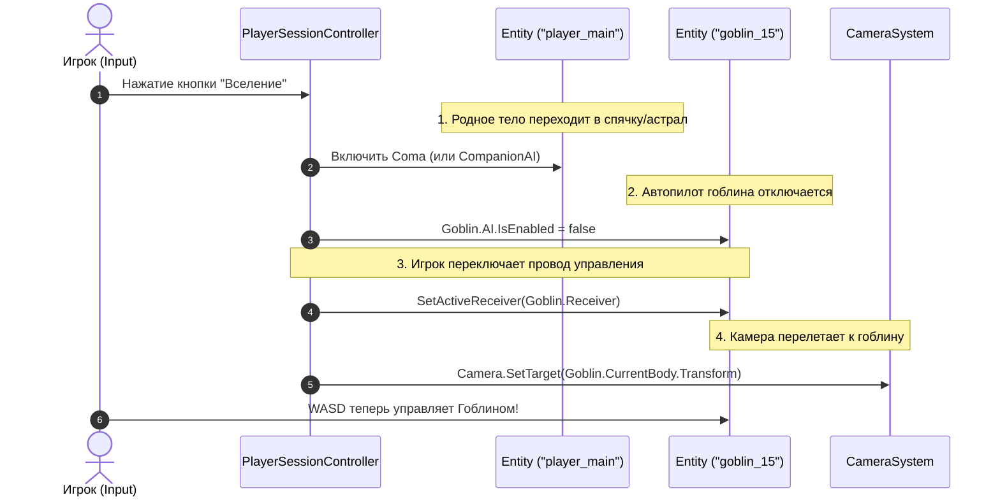

# Базовая архитектура: Пайплайн управления, Сессия и Камеры (Core Architecture Doc 3)
**Проект:** LunaticMagic2  
**Назначение:** Четкая спецификация конвейера передачи управления от Игрока/ИИ к Сущностям, работа Камер, Сессии и Точки входа.

---

## 1. Точка входа (Кратко)

1. **`AppBootstrap` (MonoBehaviour, `DontDestroyOnLoad`):**
   * Запускается при старте игры (`[RuntimeInitializeOnLoadMethod]`).
   * Инициализирует глобальные синглтоны/сервисы: `ResourceSystem`, `InputLayer`, `GlobalSettings`, `ProfilesManager`, `UIManager`.
2. **`GameStateMachine`:**
   * Управляет переходами: `Boot` → `MainMenu` → `LoadSession` → `Gameplay` → `UnloadSession`.

---

## 2. Игровая Сессия (Кратко)

* **Изолированная песочница (`RuntimeSessions/Session_Active/`):**
  * При старте новой игры или загрузке сохранения (F9) файлы сейва распаковываются в системную папку `Session_Active/`.
  * Все системы во время игры работают и изменяют данные **только внутри этой папки**.
  * F6 QuickSave атомарно упаковывает состояние `Session_Active/` в файл сейва активного профиля.
* **Подсистемы Сессии:**
  1. `TimeManager` — игровое время, календарь, пауза (`IsPaused`).
  2. `StoryManager` / `QuestManager` — сюжетные флаги, журнал заданий.
  3. `EntitiesManager` — реестр всех сущностей мира.
  4. `CameraSystem` — управление единственной камерой Unity.
  5. `PlayerSessionController` — проводник ввода игрока к активной сущности.

---

## 3. Архитектура Управления: "Машина, Автопилот и Внешний Пилот"

Чтобы не перегружать сущности лишними сущностями-пустышками и сложными контроллерами, используется модель **"Приемника команд (Порт управления)"**.

```
                      [ ИГРОК (Внешний Пилот) ]
                         • Слушает InputLayer (Клавиатура/Мышь)
                         • Живет в GameSession
                                   │
                                   │ Транслирует сигналы ввода
                                   ▼
┌────────────────────────────────────────────────────────────────────────┐
│                        СУЩНОСТЬ (Entity / Машина)                      │
│                                                                        │
│  • EntityId ("player_main", "goblin_15")                               │
│  • Quests & Stats                                                      │
│                                                                        │
│  ┌──────────────────────────────────────────────────────────────────┐  │
│  │ Приемник команд / Руль (ICommandReceiver):                       │  │
│  │   • Move(Vector2 dir)                                            │  │
│  │   • Attack()                                                     │  │
│  │   • Jump()                                                       │  │
│  │   • UseSkill(int id)                                             │  │
│  └──────────────────────────────────▲───────────────────────────────┘  │
│                                     │                                  │
│             ┌───────────────────────┴────────────────────────┐         │
│             │                                                │         │
│   [ AIControllerComponent ]                       [ Тело / Двигатель ] │
│   (Встроенный Автопилот)                          (BodyComponent)      │
│   • Крутит дерево поведений                       • 3D Модель / VRM    │
│   • Вызывает Receiver.Move(...)                   • CharacterController│
│   • Отключается, когда рулит Игрок                • Позиция X, Y, Z    │
└────────────────────────────────────────────────────────────────────────┘
```

### Как разделены обязанности:
1. **Приемник команд (`ICommandReceiver` / Руль):**
   * Является компонентом внутри **каждой сущности** (включая тело игрока, гоблина или дрона).
   * Принимает стандартные команды: `Move`, `Look`, `Attack`, `Jump`, `Interact`, `CastSkill`.
   * Передает эти команды физическому мотору тела (`BodyComponent.Locomotion`).
2. **ИИ Сущности (`AIControllerComponent` / Автопилот):**
   * Компонент, висящий на сущности NPC/монстра.
   * Вычисляет решения (патруль, погоня, атака) и сам вызывает `entity.Receiver.Move(...)`.
   * Имеет флаг `IsEnabled`: при вселении игрока автопилот выключается (`IsEnabled = false`).
3. **Игрок (`PlayerSessionController` / Внешний Пилот):**
   * **Не вшит жестко в сущность:** Это сессионный контроллер, который слушает `InputLayer` и транслирует команды в `activeEntity.Receiver`.
   * **Поведение при Катсценах:** Внешний пилот отключается (`activeReceiver = null`), на сущность мага на время катсцены вешается скриптовый `CutsceneAIController`, который ведет тело по точкам.
   * **Поведение при Смерти:** При `HP <= 0` приемник `ICommandReceiver` перестает принимать команды ввода, тело падает в рэгдолл/анимацию смерти — поведение становится абсолютно одинаковым как для игрока, так и для NPC.

---

## 4. Камеры (Camera System)

* В сцене всегда присутствует **только один объект `Camera.main`**.
* `CameraSystem` живет на уровне сессии и управляет тремя контейнерами/режимами:
  1. `FirstPersonView` (От 1-го лица).
  2. `ThirdPersonView` (От 3-го лица с орбитальным вращением и collision spring-arm).
  3. `FreeDroneView` (Свободный полет / режим разведки).
* **Связка с сущностью:** Камера следит за `Transform` физического тела активной сущности (`ActiveEntity.CurrentBody.Transform`).

---

## 5. Полный пошаговый пайплайн: Старт игры и захват контроля

### Этап 1: Загрузка игры (Инициализация)
```
[Запуск сейва] 
  │
  ├── 1. Сессия распаковывает сейв в `Session_Active/`
  ├── 2. `EntitiesManager` поднимает сущности:
  │      - Находит `"player_main"` (наше тело)
  │      - Находит `"goblin_15"` (враг с AIControllerComponent.IsEnabled = true)
  │
  ├── 3. Сессия читает: `ActiveControlledEntityId = "player_main"`
  ├── 4. `PlayerSessionController` подключается: `activeReceiver = player_main.Receiver`
  └── 5. `CameraSystem.SetTarget(player_main.CurrentBody.Transform)`
```
**Результат:** Игрок нажимает WASD → команды идут в тело мага → камера вращается вокруг мага.

---

### Этап 2: Каст "Вселения" (Possession / Дрон / Катсцена)
Игрок кастует вселение в `"goblin_15"` (или садится за дрон / начинается катсцена):



---

### Этап 3: Завершение вселения (Возврат контроля)
Вселение заканчивается (по кнопке, таймеру или гибели гоблина):

1. **Гоблин:** Если жив — включается автопилот `Goblin.AI.IsEnabled = true`. Если мертв — проигрывается смерть.
2. **Игрок:** `PlayerSessionController` переключает провод управления обратно: `activeReceiver = Mage.Receiver`.
3. **Маг:** Снимается режим `Coma`, тело мага снова активно.
4. **Камера:** `CameraSystem.SetTarget(Mage.CurrentBody.Transform)` — камера плавно возвращается к магу.

---

## 6. Почему эта архитектура идеальна?

1. **Сущность не захламлена кодом игрока:** Сущность мага и сущность гоблина имеют одинаковый простой интерфейс `ICommandReceiver`.
2. **Игрок независим:** `PlayerSessionController` существует в единственном экземпляре и просто переключает целевой `ICommandReceiver` (на мага, гоблина, турель, лошадь, дрон или лодку).
3. **Катсцены работают бесплатно:** Чтобы запустить катсцену, достаточно переключить `activeReceiver` на `null` (или на скриптовый автопилот), а камеру направить по срежиссированному пути.

---

## 7. Стейт-система: Фундаментальное правило "Вход vs Восстановление"

Стейт-система разделена на 2 уровня:
1. **Глобальные стейты:** Сессия, Игрок, Катсцены, Пауза.
2. **Локальные стейты:** Сущность (Локомоция, Боевка, Атака, Замах, Оглушение).

### Золотое правило стейт-машины (Enter Invariant):
* **`Enter()` выполняется строго 1 раз и в 1 кадр** исключительно в момент *реального перехода* во время живого геймплея. В нем стартуют анимации замаха, играют звуки взмаха меча, спавнятся вспышки магии.
* **При загрузке сохранения (F9 / Восстановление мира): мы НИКОГДА не вызываем `Enter()`!**
  * Состояние сущности однозначно вычисляется и восстанавливается из сериализованных данных сейва (`StateType = Attacking`, `TimeProgress = 0.4s`).
  * Игра **сразу начинает вызывать `Update()`** со следующего кадра без вызова `Enter()`.
  * **Результат:** При загрузке игры нет спама звуков/эффектов, анимации встают в актуальную позу, а таймеры не сбрасываются в начало.

