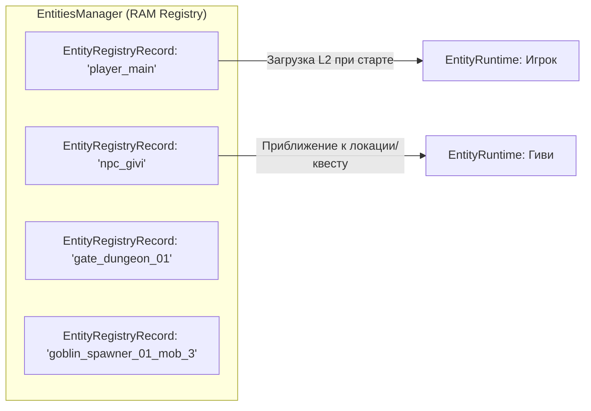
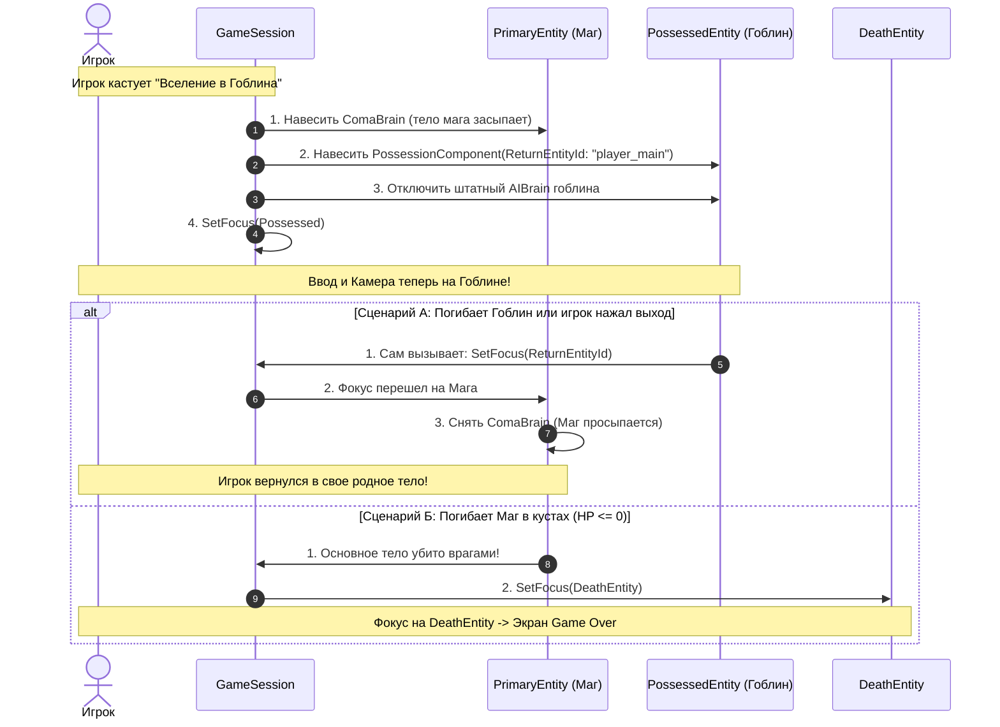

# Всеобъемлющая спецификация системы сущностей (Entity System Specification)
**Проект:** LunaticMagic2 / LunaticMagicV3  
**Назначение:** Полная архитектурная спецификация системы сущностей, уровней виртуализации (A-Life, замороженная и активная физика, 3D визуал), многокилометровой системы координат локаций, конвейера 5-зонного стриминга и модульной компонентной модели.

---

## Содержание
1. [Общая концепция и архитектурные столпы](#1-общая-концепция-и-архитектурные-столпы)
2. [Реестр сущностей (Entity Registry)](#2-реестр-сущностей-entity-registry)
3. [Система координат: ID локаций и Origin Shifting](#3-система-координат-id-локаций-и-origin-shifting)
4. [Четыре уровня сущности (Existence & Simulation Tiers)](#4-четыре-уровня-сущности-existence--simulation-tiers)
5. [Конвейер стриминга и 5 дистанционных зон](#5-конвейер-стриминга-и-5-дистанционных-зон)
6. [Компонентная модель сущности (Modular Component Architecture)](#6-компонентная-модель-сущности-modular-component-architecture)
7. [Системные стейты Сессии vs Единая Архитектура Фокуса Сущностей](#7-системные-стейты-сессии-vs-единая-архитектура-фокуса-сущностей)
8. [Парадигма "Все есть Сущность с Фокусом": Смерть и Катсцены](#8-парадигма-все-есть-сущность-с-фокусом-смерть-и-катсцены)
9. [Механика Вселения (Possession): Контекст, Триггеры и Смерть двух тел](#9-механика-вселения-possession-контекст-триггеры-и-смерть-двух-тел)
10. [Жизненный цикл, Песочница Сессии и Сохранения (F6 / F9)](#10-жизненный-цикл-песочница-сессии-и-сохранения-f6--f9)
11. [Децентрализованное переключение фокуса (Без стеков и глобальных контроллеров)](#11-децентрализованное-переключение-фокуса-без-стеков-и-глобальных-контроллеров)
12. [Система Камер Сущностей (Entity-Hosted Cameras)](#12-система-камер-сущностей-entity-hosted-cameras)
13. [Спецификация Служебных Сущностей: DeathEntity и CutsceneEntity](#13-спецификация-служебных-сущностей-deathentity-и-cutsceneentity)
14. [Программные интерфейсы и архитектурные контракты (C#)](#14-программные-интерфейсы-и-архитектурные-контракты-c)

---

## 1. Общая концепция и архитектурные столпы

Традиционный подход Unity ("один монстр = один префаб с `MonoBehaviour`, `Rigidbody`, `Animator` и 3D-моделью") категорически не подходит для масштабных RPG с открытым миром:
* **Просадка PhysX:** Сотни активных `Rigidbody` и `CharacterController` мгновенно перегружают физический поток, даже если NPC находятся далеко от игрока.
* **Просадка рендеринга и аниматоров:** Обработка скелетов (SkinnedMeshRenderer, Animator, VRM SpringBones) утилизирует львиную долю CPU/GPU кадра.
* **Проблема потери точности float:** При размерах карты > 5000 метров физика и рендеринг Unity начинают страдать от эффекта "плавающей запятой" (jittering, дрожание вершин, провалы коллизий).
* **Смешение личности и тела:** Невозможно реализовать вселение в другое существо или смену тел, если квесты и личность намертво привязаны к коллайдеру.

### Архитектурные столпы целевой системы:
```
┌─────────────────────────────────────────────────────────────────────────────┐
│ 1. ЖЕСТКОЕ РАЗДЕЛЕНИЕ СИМУЛЯЦИИ И ПРЕДСТАВЛЕНИЯ                             │
│    Логика (EntityRuntime) — чистый C# без MonoBehaviour.                    │
│    Физика и Рендеринг (Unity Scene) — лишь временная проекция.              │
├─────────────────────────────────────────────────────────────────────────────┤
│ 2. ПОШАГОВАЯ МАТЕРИАЛИЗАЦИЯ (4 УРОВНЯ СУЩНОСТИ)                             │
│    Данные (RAM) ──> Kinematic Body ──> Dynamic Physics ──> 3D/VRM Модель.   │
├─────────────────────────────────────────────────────────────────────────────┤
│ 3. ЛОКАЛЬНЫЕ СИСТЕМЫ КООРДИНАТ (Location Spaces / Floating Origin)          │
│    Каждая локация позиционируется в (0, 0, 0), исключая float jitter.       │
├─────────────────────────────────────────────────────────────────────────────┤
│ 4. СМЕННЫЕ ТЕЛА И ПРИЕМНИКИ КОМАНД (ICommandReceiver)                       │
│    Сущность надевает Тело как скафандр. Игрок и ИИ подключаются к одному    │
│    интерфейсу управления.                                                   │
└─────────────────────────────────────────────────────────────────────────────┘
```

---

## 2. Реестр сущностей (Entity Registry)

Реестр сущностей — это глобальная база данных всех объектов мира, существующих в текущей сессии. Он хранится в оперативной памяти в `EntitiesManager` и не требует создания объектов на сцене Unity.



### 2.1. Структура дескриптора (`EntityRegistryRecord`)
Легковесная структура (~64-96 байт на сущность), позволяющая держать в памяти десятки тысяч сущностей мира:
```csharp
public struct EntityRegistryRecord
{
    public string EntityId;         // Уникальный ID ("player_main", "npc_givi", "chest_042")
    public string TemplateId;       // Ссылка на Blueprint ("goblin_warrior", "human_merchant")
    public string LocationId;       // ID локации, к которой привязана сущность ("Forest1", "Castle1")
    public Vector3 LocalPosition;   // Локальные координаты внутри пространства локации
    public Quaternion LocalRotation;// Локальный поворот
    public EntityStatus Status;     // Alive, Dead, Destroyed, InLimbo
    public bool IsPersistent;       // true — сюжетная/именная сущность; false — временный спавн
    public string SpawnerId;        // Ссылка на спавнер (для неуникальных сущностей)
}
```

### 2.2. Типы сущностей
1. **Уникальные (Persistent Entities):**
   * Сюжетные NPC, квестовые боссы, уникальные сундуки, двери, рычаги.
   * Всегда присутствуют в реестре сессии, имеют постоянный ID (`"npc_givi"`, `"main_gate"`).
   * Их состояние фиксируется в персональных дельта-файлах сессии: `Session_Active/Entities/{EntityId}.json`.
2. **Динамические (Transient / Spawned Entities):**
   * Обычные монстры, патрули, случайный лут.
   * Порождаются спавнерами (`SpawnerId`), получают динамический ID (`"goblin_spawner_forest1_03"`).
   * При удалении на большое расстояние могут полностью уничтожаться или возвращаться в пул спавнера без захламления файла сохранения.

### 2.3. Авторитет RAM и Hibernation
* Пока игра запущена, реестр и активные сущности живут в оперативной памяти.
* Изменение здоровья или флагов NPC **не пишет на диск в ту же миллисекунду**. Авторитетна RAM.
* Синхронизация с файловой системой песочницы (`Session_Active`) происходит только при **засыпании сущности (Hibernation)** или при **сохранении игры (F6 QuickSave)**.

---

## 3. Система координат: ID локаций и Origin Shifting

Одной из главных проблем больших миров в Unity является потеря точности чисел с плавающей запятой (`float32`):
* При координатах $> 5\,000$ м вертексы 3D моделей начинают дрожать при движении камеры.
* При координатах $> 10\,000$ м PhysX начинает пропускать лучи `Physics.Raycast`, коллайдеры персонажей проваливаются сквозь землю.

```
       Проблема больших абсолютных координат:
       (X: 15420.5, Y: 12.0, Z: 28430.2)  ──>  Дрожание вершин, глитчи физики
                                    ▼
       Решение через составные координаты:
       LocationId: "Desert2" + LocalPosition: (X: 12.5, Y: 1.0, Z: 45.3) ──> Идеальная точность!
```

### 3.1. Архитектура составных координат (Composite World Coordinates)
Позиция любой сущности в мире выражается кортежем:
$$\mathbf{P}_{\text{world}} = \langle \text{LocationId}, \mathbf{p}_{\text{local}} \rangle$$

* **`LocationId`:** Идентификатор многокилометровой зоны (`"Forest1"`, `"Desert2"`, `"Castle_Dungeon"`).
* **`LocalPosition`:** Координаты внутри этой локации, где центр локации находится в `(0, 0, 0)`.

```csharp
public struct EntityWorldCoordinate
{
    public string LocationId;
    public Vector3 LocalPosition;
    public Quaternion LocalRotation;

    public EntityWorldCoordinate(string locationId, Vector3 localPosition, Quaternion localRotation)
    {
        LocationId = locationId;
        LocalPosition = localPosition;
        LocalRotation = localRotation;
    }
}
```

### 3.2. Спавн локаций на `(0, 0, 0)` и Floating Origin
В LunaticMagic используется модульная сетка локаций (`GameLocations` / `GameChunks`):
1. **Изолированный спавн:** При перемещении игрока в подземелье или отдельную локацию сцена локации загружается и центрируется вокруг Unity-координат `(0, 0, 0)`. Сущности спавнятся относительно этого нуля.
2. **Бесшовный открытый мир (World Origin Shift / Floating Origin):**
   * Когда игрок перемещается по глобальной карте и удаляется от центра мира более чем на допустимый порог (например, 2000 м), система смещения начала координат (`FloatingOriginSystem`) смещает весь загруженный физический мир так, чтобы игрок снова оказался в точке `(0, 0, 0)`.
   * При этом в `EntityRegistryRecord` сохраняются глобальные координаты локации, а все физические `Transform` в Unity синхронно сдвигаются на дельту `-\Delta \mathbf{P}`.

---

## 4. Четыре уровня сущности (Existence & Simulation Tiers)

Сущность не загружается бинарно ("нет в мире" / "есть полностью"). Она существует на одном из четырех уровней материализации в зависимости от расстояния до игрока и важности для геймплея:

```
┌─────────────────────────────────────────────────────────────────────────────┐
│ УРОВЕНЬ 1 (L1): Данные и Виртуальная симуляция (Pure Data & A-Life)        │
│   • Чистый C# (EntityRegistryRecord + EntityRuntime при симуляции)          │
│   • Здоровье, квесты, инвентарь, расчет расписания (A-Life)                 │
│   • НЕТ GameObject на сцене Unity, НЕТ физики, НЕТ рендеринга               │
└──────────────────────────────────────┬──────────────────────────────────────┘
                                       │ Вход в Зону физ. тела (~100м)
                                       ▼
┌─────────────────────────────────────────────────────────────────────────────┐
│ УРОВЕНЬ 2 (L2): Замороженное физическое тело (isKinematic = true)           │
│   • Появляется легкий Unity GameObject с коллайдером                        │
│   • Rigidbody.isKinematic = true (физический движок не считает гравитацию)  │
│   • Занимает место в пространстве, доступен для триггеров и дальних лучей   │
│   • Гарантирует, что моб не провалится в террейн до включения полной физики │
└──────────────────────────────────────┬──────────────────────────────────────┘
                                       │ Вход в Зону активной физики (~50м)
                                       ▼
┌─────────────────────────────────────────────────────────────────────────────┐
│ УРОВЕНЬ 3 (L3): Размороженная активная физика (isKinematic = false)         │
│   • Rigidbody.isKinematic = false / активен CharacterController             │
│   • Включается локальный NavMeshAgent / физическое расталкивание            │
│   • Обработка гравитации, получение ударов, толчков, падение в рэгдолл      │
└──────────────────────────────────────┬──────────────────────────────────────┘
                                       │ Вход в Зону видимости (~30м)
                                       ▼
┌─────────────────────────────────────────────────────────────────────────────┐
│ УРОВЕНЬ 4 (L4): Полное визуальное представление (Visuals & 3D Model)       │
│   • Подключение 3D меша / VRM 1.0 из пула Staging Room                      │
│   • Включение Animator, шейдеров MToon, SpringBones (волосы, плащи)         │
│   • Отображение оружия в руках, VFX частиц и плашки здоровья (HUD/UI)       │
└─────────────────────────────────────────────────────────────────────────────┘
```

---

### 4.1. Уровень 1: Виртуальные данные и A-Life симуляция (Data Tier)
* **Форма в памяти:** Чистый C# класс `EntityRuntime` (или спящая запись `EntityRegistryRecord`).
* **Что доступно:**
  * RPG-характеристики: текущее и максимальное здоровье (`HealthComponent`), выносливость, мана, уровень, фракция.
  * Инвентарь: экипировка, надетые артефакты, предметы в сумке.
  * Квестовые флаги и диалоговый статус: состояние заданий, память об обидах.
* **Геймплейные возможности уровня:**
  * **Виртуальное убийство:** Квестовый менеджер или заклинание на расстоянии может уменьшить HP сущности до 0:
    ```csharp
    var entity = entitiesManager.GetEntity("npc_bandit_boss");
    entity.EntityRuntime.GetComponent<HealthComponent>().TakeDamage(9999);
    // Босс мертв! Никакой GameObject даже не спавнился на сцене.
    ```
  * **Фоновая A-Life симуляция (в стиле S.T.A.L.K.E.R. / Skyrim):**
    * Виртуальные NPC живут по расписанию (AI Packages / Routines): днем работают на кузнице, ночью спят в таверне.
    * Перемещение между точками за пределами видимости рассчитывается математической интерполяцией:
      $$\mathbf{P}(t) = \text{Lerp}(\mathbf{P}_A, \mathbf{P}_B, \frac{t - t_{\text{start}}}{t_{\text{duration}}})$$
    * Если два враждебных каравана сталкиваются в неактивной зоне, система A-Life может провести математический автобой на основе статов за один тик, не требуя работы аниматоров и сцены.

---

### 4.2. Уровень 2: Замороженное физическое тело (`isKinematic = true`)
* **Форма в памяти:** Легковесный `GameObject` (`EntityPhysicsView`) в иерархии сцены.
* **Содержимое:**
  * `CapsuleCollider`, `BoxCollider` или базовые хитбоксы.
  * `Rigidbody` с установленным флагом `isKinematic = true` (или неактивный `CharacterController`).
  * НЕТ 3D модели, нет аниматора.
* **Зачем это нужно:**
  1. **Исключение провалов под карту:** Если сразу заспавнить активную физику на террейне, пока меши высот или детали коллизий сцены не до конца стабилизировались, персонаж улетит в бесконечность под карту.
  2. **Решение проблемы «Пирамиды ящиков» (Structural Stability):** 
     * *Сценарий без L2:* Представим пирамиду из 10 ящиков. Если спавнить их сразу с включенной физикой, нижние 5 ящиков упадут или сдвинутся раньше, чем стриминг догрузит верхние 5 ящиков. В итоге верхние заспавнятся внутри упавших нижних, что вызовет взрыв физики PhysX.
     * *Решение через L2:* Все ящики спавнятся как кинематические неподвижные тела (`isKinematic = true`). Вся пирамида гарантированно собирается в идеальном покое до того, как игрок подойдет на дистанцию разморозки физики (L3).
  3. **Регистрация в пространственных структурах:** Триггеры зон, дальнобойные сканеры игрока, магия по области (AoE Detection) и стрелы из лука могут регистрировать присутствие врага.
  4. **Минимальное потребление CPU:** Кинематические тела не тратят ресурсы на интеграцию сил гравитации, проверку скольжения по склонам и расчет контактов в PhysX.

---

### 4.3. Уровень 3: Размороженная активная физика (`isKinematic = false`)
* **Форма в памяти:** `EntityPhysicsView` переводится в активный режим.
* **Содержимое:**
  * `Rigidbody.isKinematic = false` (или включение `CharacterController.enabled = true`).
  * Активация `NavMeshAgent` (для NPC) или прямого мотора движения `LocomotionController`.
* **Что начинает работать:**
  * Силы, гравитация, импульсы от взрывов.
  * Локальное физическое расталкивание между телами персонажей (Avoidance).
  * Реакция на попадание снарядов: импульс отдачи, стан, сбивание с ног.
  * При `Health <= 0` тело может мгновенно переключиться в Ragdoll (физический скелет).

---

### 4.4. Уровень 4: Полное визуальное представление (3D / VRM Model)
* **Форма в памяти:** Дочерний `GameObject` с 3D мешем, прикрепленный к `EntityPhysicsView`.
* **Содержимое:**
  * VRM 1.0 модель с материалами `MToon`.
  * Компоненты динамики костей: `VRMSpringBone` (физика волос, ткани, элементов брони).
  * `Animator` со стейт-машиной анимаций (`LocomotionState`, `AttackState`).
  * Точки крепления оружия в руках (`WeaponSockets`).
  * Навесной UI-компонент (World Space Canvas / Floating Health Bar).
* **Архитектурный трюк (Model Staging Room):**
  * Чтобы избежать микрофризов при парсинге VRM и компиляции шейдеров прямо перед носом у игрока, модели достаются из скрытой **"Комнаты для моделей"** `[MODEL_STAGING_ROOM]` (расположенной под сценой в `(0, -2000, 0)`).
  * Модель мгновенно переносится (Reparent) на физическое тело за 1 кадр.

---

## 5. Конвейер стриминга и 5 дистанционных зон

Материализация сущностей управляется сессионным стримером на основе концентрических зон дистанции вокруг активного наблюдателя (Игрока / Текущей Камеры):

```
                   [ ЦЕНТР: ИГРОК / КАМЕРА ]
                               │
 0м ... 30м   ═════════════════╪═════════════════  ЗОНА 5: Визуальная модель (L4 VRM)
                               │
30м ... 50м   ─────────────────┼─────────────────  ЗОНА 4: Разморозка физики (L3 Dynamic)
                               │
50м ... 100м  ┄ ┄ ┄ ┄ ┄ ┄ ┄ ┄ ┄┼┄ ┄ ┄ ┄ ┄ ┄ ┄ ┄ ┄  ЗОНА 3: Загрузка физ. тела (L2 Kinematic)
                               │
100м ... 250м · · · · · · · · ·┼· · · · · · · · ·  ЗОНА 2: Спавн симуляции (L1 A-Life / RAM)
                               │
> 250м        ................ ┼ ................  ЗОНА 1: Вся Локация (L1 Dormant Registry)
```

### 5.1. Таблица дистанционных зон

| Зона | Радиус входа / выхода (Гистерезис) | Уровень сущности | Что происходит при входе | Что происходит при выходе |
| :--- | :--- | :---: | :--- | :--- |
| **1. Локация** | Вся сцена / Чанк мира | **L1 (Dormant)** | Реестр локации загружается в память сессии (`EntitiesManager`). | Реестр локации выгружается, изменения пишутся в сейв. |
| **2. Спавн симуляции** | $R_{\text{in}} = 250$м / $R_{\text{out}} = 300$м | **L1 (Simulating)** | Создается `EntityRuntime` в RAM. Загружаются компоненты статов, запускается фоновый A-Life. | `EntityRuntime` сохраняет дельту данных в `Session_Active/Entities/` и выгружается из памяти в спящую запись. |
| **3. Загрузка физ. тела** | $R_{\text{in}} = 100$м / $R_{\text{out}} = 120$м | **L2 (Kinematic)** | Создается легкий `GameObject` с коллайдером. Физика заморожена (`isKinematic = true`). Тело ставится на грунт. | `GameObject` тела уничтожается (или возвращается в GO-пул). Сущность остается только в C# симуляции. |
| **4. Разморозка физики** | $R_{\text{in}} = 50$м / $R_{\text{out}} = 65$м | **L3 (Dynamic)** | `isKinematic = false`, включается `CharacterController` и NavMesh. Включается тактический AI боевого поиска. | Физика замораживается (`isKinematic = true`). Остановка инерции, отключение тяжелых физических расчетов. |
| **5. Загрузка 3D модели** | $R_{\text{in}} = 30$м / $R_{\text{out}} = 40$м | **L4 (Presentation)** | Из `[MODEL_STAGING_ROOM]` берется 3D/VRM модель, привязывается к телу, стартует `Animator` и физика волос. | 3D модель отсоединяется от тела и возвращается в `[MODEL_STAGING_ROOM]`. Аниматор и кости засыпают. |

### 5.2. Принцип Гистерезиса (Hysteresis Buffer)
Если бы радиус входа и выхода был одинаковым (например, ровно 30 метров), то игрок, стоящий на границе 30м и шагающий вперед-назад, вызывал бы катастрофический "дребезг" (thrashing): модель каждую секунду прикреплялась бы и возвращалась в пул, вызывая лаги.
* Буфер гистерезиса в 10–15 метров гарантирует, что сущность разгрузится только тогда, когда игрок гарантированно отдалился.

### 5.3. Многоуровневый радиус по размеру сущности (Size-Based Streaming Tiers)
Не все объекты должны иметь одинаковые радиусы стриминга. Радиус привязан к **физическому размеру (Bounding Size)** и **важности объекта**:

| Категория сущности | Примеры | Радиус L2 (Тело) | Радиус L4 (Визуал) | Зачем такой радиус |
| :--- | :--- | :---: | :---: | :--- |
| **Huge / Terrain** | Террейн, горы, крепости | 1500–3000 м | 1000–2500 м | Гарантирует, что земля и скалы всегда готовы под ногами задолго до спавна NPC. |
| **Large / Vehicles** | Корабли, дирижабли, повозки | 300–600 м | 250–500 м | Видны издалека на горизонте, формируют силуэт мира. |
| **Standard / Actors** | Игрок, NPC, монстры, стражники | 100–150 м | 30–40 м | Оптимальный баланс между плотностью населения и производительностью. |
| **Small / Props** | Ящики, бочки, мелкий лут, трава | 40–60 м | 20–30 м | Спавнятся только вблизи, не засоряют физику на дальних дистанциях. |

### 5.4. Исключения из стриминга (`IsStreamingExempt` / `AlwaysLoaded`)
Для особых глобальных сущностей стриминг по дистанции полностью отключается:
* **Флаг `IsStreamingExempt = true`:** Сущность никогда не выгружается стримером, пока активна сцена.
* **Примеры использования:**
  * Парящий сюжетный дракон, летающий по всему небу континента.
  * Сюжетный поезд или караван, идущий через несколько локаций по жесткому таймлайну.
  * Флагманский корабль игрока в открытом море.

### 5.5. Золотое правило масштаба честной физики (Dynamic Physics Sizing Rule)
Одно из важнейших правил стабильности стриминга физического мира:
> **Любой объект с честной динамической физикой (который может падать, катиться и сдвигаться игроком), обязан иметь габариты меньше, чем ширина буфера между Зоной спавна физ. тела (L2) и Зоной разморозки физики (L3):**
> $$\text{BoundingSize}_{\text{dynamic}} < (R_{\text{spawn}} - R_{\text{unfreeze}})$$

#### Почему это математически исключает физические глитчи:
* Пусть $R_{\text{spawn}} = 100$ м (зона спавна кинематического тела), а $R_{\text{unfreeze}} = 50$ м (зона включения активного PhysX). Ширина буферной зоны составляет:
  $$\Delta R = 100\text{м} - 50\text{м} = 50\text{м}$$
* Если объект с честной физикой имеет диаметр меньше 50 м, то в момент, когда его край пересекает границу 50 м и включает физику, всё пространство под ним и вокруг него на 50 метров вперед **уже гарантированно материализовано в L2 (кинематика)**.
* **Следствие:** Ситуация, при которой под включившимся физическим телом ещё не заспавнилась опора (земля, пол, ящик под ним), становится **физически и геометрически невозможной**!
* **Правило для гигантских объектов:** Если объект превышает $\Delta R$ (крепостные ворота, корабль, огромный мост, падающая башня), он **не имеет права быть чистым динамическим Rigidbody**. Он обязан управляться кинематически скриптом/анимацией.

---

### 5.6. Движущиеся платформы и Лифты: Объемный триггер захвата (Platform Capture Volume)
Рассмотрим пример огромного лифта или летающей платформы, на которой стоят ящики и бочки:
1. **Сама платформа не имеет честной динамики:** Она управляется кинематически (`isKinematic = true`) по скрипту или сплайну высоты $Y(t)$.
2. **Проблема груза вдалеке:** Ящики на платформе вдалеке находятся в L2 (`isKinematic = true`, физика отключена, силы трения о пол нет). Если платформа поедет вниз — ящики повиснут в воздухе; если поедет вверх — платформа пройдет сквозь них.
3. **Решение — Объемный триггер захвата (`PlatformCaptureVolume`):**
   * На платформе размещается невидимый триггер-коллайдер, охватывающий полезный объем палубы/кабины лифта.
   * **Правило синхронизации:** Любой физический объект, попавший в этот триггер, у которого выключена честная физика (`isKinematic == true`):
     * Автоматически привязывается к платформе (становится дочерним `Transform` в локальном пространстве или получает смещение платформы $\Delta \mathbf{P}$ каждый тик).
     * Движется синхронно с лифтом бесплатно по CPU, как единое целое.
   * **Переход в зону L3 (Игрок рядом):**
     * Если игрок подходит вплотную и пинает ящик — ящик может временно включить честную динамику (`isKinematic = false`).
     * Но пока ящик стоит спокойно, он остается в кинематическом зацеплении с объемом платформы, исключая соскальзывания и застревания при движении лифта.

---

## 6. Компонентная модель сущности (Modular Component Architecture)

Архитектура сущности построена по композиционному принципу: сущность собирается из независимых компонентов. Компоненты строго разделены на два типа:
1. **Логические компоненты (`IEntityComponent`):** Живут внутри `EntityRuntime` (чистый C#).
2. **Компоненты представления и физики (`MonoBehaviour`):** Живут на сцене Unity внутри `EntityPhysicsView`.

```
┌─────────────────────────────────────────────────────────────────────────────┐
│                          СУЩНОСТЬ: EntityRuntime                            │
│                                                                             │
│  ┌──────────────────────────┐  ┌──────────────────────────────────────────┐ │
│  │     ХАРАКТЕРИСТИКИ       │  │                УПРАВЛЕНИЕ                │ │
│  │ • HealthComponent        │  │ • ICommandReceiver (Руль: Move/Attack)   │ │
│  │ • StatsComponent (MP/St) │  │ • AIBrainComponent (Штатный автопилот)   │ │
│  │ • LevelComponent         │  │ • ComaBrainComponent (Спячка)            │ │
│  └──────────────────────────┘  └──────────────────────────────────────────┘ │
│  ┌──────────────────────────┐  ┌──────────────────────────────────────────┐ │
│  │         КВЕСТЫ           │  │              ИНВЕНТАРЬ                   │ │
│  │ • DialogueStateComponent │  │ • InventoryComponent (Карманы/Предметы)  │ │
│  │ • FactionComponent       │  │ • EquipmentComponent (Слоты брони/оружия)│ │
│  └──────────────────────────┘  └──────────────────────────────────────────┘ │
│                                │                                            │
│                                ▼ держит ссылку                              │
│  ┌────────────────────────────────────────────────────────────────────────┐ │
│  │                       ТЕЛО: BodyComponent                              │ │
│  │  • BodyId, Координаты (X, Y, Z, LocationId)                            │ │
│  │  • LocomotionController (Исполнитель физического движения)             │ │
│  │  • PhysicsView (Ссылка на GameObject сцены при L2/L3)                  │ │
│  │  • VisualPresentation (Ссылка на VRM модель при L4)                    │ │
│  │  • CameraTarget (Точка фиксации камеры от 1/3 лица)                   │ │
│  └────────────────────────────────────────────────────────────────────────┘ │
└─────────────────────────────────────────────────────────────────────────────┘
```

### 6.1. Ключевые логические компоненты (Pure C#)
* **`EntityInfoComponent`:** Базовые метаданные (имя сущности, фракция, тип гуманоид/монстр).
* **`HealthComponent`:**
  * Хранит `CurrentHealth`, `MaxHealth`, флаг `IsDead`.
  * Предоставляет реактивные события `OnDamaged`, `OnHealed`, `OnDied` (UniRx/C# Actions).
* **`StatsComponent`:** Сила, ловкость, скорость бега, сопротивления стихиям.
* **`InventoryComponent`:** Список предметов в карманах, расчет переносимого веса.
* **`DialogueStateComponent`:** Пройденные диалоговые ветки, текущие сюжетные флаги общения с NPC.

### 6.2. Компоненты тела и представления (Unity-связка)
* **`BodyComponent`:**
  * Представляет собой "костюм", надетый на сущность.
  * Именно Тело имеет пространственные координаты в мире, а не разум сущности.
* **`EntityPhysicsView` (`MonoBehaviour`):**
  * Висит на корневом `GameObject` сущности в сцене.
  * Содержит `CharacterController`, коллайдеры хитбоксов (`HeadHitbox`, `TorsoHitbox`).
  * Транслирует физические столкновения (снаряды, удары) в C# логику:
    ```csharp
    public class EntityPhysicsView : MonoBehaviour
    {
        public EntityRuntime Runtime { get; private set; }
        public Rigidbody Rigidbody;
        public CharacterController CharacterController;

        public void TakeHit(DamageInfo damage)
        {
            Runtime.GetComponent<HealthComponent>()?.ApplyDamage(damage);
        }
    }
    ```

---

## 7. Системные стейты Сессии vs Единая Архитектура Фокуса Сущностей

Вся логика геймплея строится на строгом разделении **системных состояний сессии** и **фокуса на сущностях (Entity Focus Architecture)**.

```
┌─────────────────────────────────────────────────────────────────────────────┐
│ 1. СИСТЕМНЫЕ СОСТОЯНИЯ СЕССИИ (Session States — Над миром)                  │
│    • PauseState (пауза)                                                     │
│    • ConsoleState (отладочная консоль)                                      │
│    • LoadingState (экран загрузки)                                          │
│                                                                             │
│    * Это состояния и UI над сущностями. Они перекрывают игровой мир поверх   │
│      всех окон. Здесь НЕ имеет значения, на какой сущности сейчас фокус.    │
└──────────────────────────────────────┬──────────────────────────────────────┘
                                       │ управление передается в мир
                                       ▼
┌─────────────────────────────────────────────────────────────────────────────┐
│ 2. ЕДИНЫЙ ФОКУС СУЩНОСТЕЙ В ИГРЕ (Entity Focus System)                      │
│                                                                             │
│    В любой момент времени в сессии есть только одна FOCUSED ENTITY.         │
│    Фокус определяет:                                                        │
│      1. Куда направляется ввод игрока (Input Router).                       │
│      2. Чья камера сейчас активна (Camera inside/on that Entity).           │
│      3. Чей интерфейс (HUD / Окна) отображается на экране.                  │
│                                                                             │
│  ┌───────────────────────────┐         ┌─────────────────────────────────┐  │
│  │   PlayerEntity (Игрок)    │         │      DeathEntity (Смерть)       │  │
│  │ • Ввод в персонажа        │         │ • Фокус при гибели героя        │  │
│  │ • Активна камера игрока   │         │ • Камера облета трупа           │  │
│  │ • Активен игровой HUD     │         │ • Меню "Загрузить / Выйти"      │  │
│  └───────────────────────────┘         └─────────────────────────────────┘  │
│  ┌───────────────────────────┐         ┌─────────────────────────────────┐  │
│  │ CutsceneEntity (Катсцена) │         │ PossessedEntity (Вселение)      │  │
│  │ • Фокус на сцене / рельсах│         │ • Фокус на чужом теле (гоблин)  │  │
│  │ • Режиссерская камера     │         │ • Камера чужого тела            │  │
│  │ • Игроку выдается ИИ      │         │ • Ссылка на PrimaryBody         │  │
│  └───────────────────────────┘         └─────────────────────────────────┘  │
└─────────────────────────────────────────────────────────────────────────────┘
```

---

## 8. Парадигма "Все есть Сущность с Фокусом": Смерть и Катсцены

### 8.1. Смерть без глобального стейта (Death via `DeathEntity`)
* **Смерть — это локальный стейт сущности:** У сущности игрока (как и у любого гоблина или стражника) при `Health <= 0` просто срабатывает переход в локальное состояние смерти (`ActionState = Dead`, падение в Ragdoll или анимация гибели).
* **Никакого глобального "GameOverState" в сессии нет:** Смерть персонажа сама по себе не ломает сессию, не сбрасывает мир и не перегружает сцену.
* **Переключение фокуса на `DeathEntity`:**
  1. При смерти истинного тела игрока система переключает фокус сессии на специальную **`DeathEntity`** (отдельный GameObject в сцене).
  2. **Ввод:** Теперь ввод игрока идет в `DeathEntity` (WASD заблокирован, активны клавиши меню, пробел для возрождения или мышь для орбитального осмотра).
  3. **Камера:** Активируется камера, принадлежащая `DeathEntity` (орбитальный облет тела, отдаление наверх или фокус на убийце).
  4. **UI:** `DeathEntity` активирует свой интерфейс ("Вы погибли", таймер до респавна, кнопка быстрой загрузки F9).

---

### 8.2. Катсцены как Сущности (`CutsceneEntity`)
Катсцена работает абсолютно по той же схеме, что и смерть:
1. **Смена фокуса:** Фокус сессии переключается с игрока на **`CutsceneEntity`**.
2. **Игрок получает ИИ:** Сущности игрока на время катсцены вешается временный скриптовый ИИ (`CutsceneAIController`), который ведет персонажа в нужную точку, заставляет слушать диалог или стоять в позе.
3. **Поведение `CutsceneEntity`:**
   * **Свободная камера (Free Camera):** Если катсцена требует облета или режима наблюдения — `CutsceneEntity` имеет собственное управление полетом (WASD/Мышь), свою активную камеру и коллайдер (чтобы не пролетать сквозь стены).
   * **Кинематографичная камера (Rails / Cinematic):** `CutsceneEntity` перехватывает команды внешнего ввода и глушит их (`return false`), а сама камера двигается по заранее заданной траектории (сплайн/рельсы, как у движущейся платформы) или управляется внутренним скриптом таймлайна.

---

## 9. Механика Вселения (Possession): Контекст, Триггеры и Смерть двух тел

Механика Вселения работает как специализированное переключение фокуса между сущностями с сохранением контекста владения:



### 9.1. Ссылка на Основное тело (`PrimaryEntity`)
* При вселении в `PossessedEntity` передается ссылка на **`PrimaryEntity`** (истинное тело мага).
* Если вселение многоуровневое (вселились из мага в волка, а из волка в орла), ссылка `PrimaryEntity` всегда указывает на изначальное истинное тело мага.

### 9.2. Поведение Триггеров во время вселения
1. **Физические триггеры мира:**
   * Нажимные плиты, растяжки, ловушки, зоны урона (лава, вода), триггеры обнаружения враждебности стражи — **срабатывают нормально** на любое тело, в том числе на тело гоблина.
2. **Сюжетные и квестовые триггеры:**
   * Проверяют условие авторства:
     ```csharp
     public void OnTriggerEnter(Collider other)
     {
         var entity = other.GetComponentInParent<EntityPhysicsView>()?.Runtime;
         if (entity == null) return;

         // Если это не основное тело игрока или сейчас идет вселение — сюжетный триггер игнорируется!
         if (entity.IsPossessed || entity.EntityId != session.PrimaryEntityId)
         {
             return; 
         }

         StartMainQuestCutscene();
     }
     ```
   * Гоблин не может случайно запустить разговор о спасении королевства или активировать личный квест мага.

---

### 9.3. Смерть во вселении: Разбор двух исходов

#### Сценарий 1: Погибает захваченное тело (`PossessedEntity`)
* **Что происходит:** Гоблин получает смертельный урон (`HP <= 0`).
* **Результат:**
  1. Это **НЕ** является смертью игрока!
  2. Тело гоблина падает в свой локальный стейт смерти / рэгдолл.
  3. Срабатывает скрипт завершения вселения: фокус сессии переключается обратно на **`PrimaryEntity`**.
  4. С мага снимается `ComaBrain` (тело мага выходит из спячки, возможно с дебаффом стана/потери маны).
  5. Камера и ввод мгновенно возвращаются к магу.

#### Сценарий 2: Погибает основное тело (`PrimaryEntity`)
* **Что происходит:** Пока игрок бегал в теле гоблина, патруль врагов наткнулся на оставленное в кустах тело мага и убил его (`Primary.Health <= 0`).
* **Результат:**
  1. Вселение **мгновенно аварийно прерывается**.
  2. Запускается скрипт смены фокуса на **`DeathEntity`** с пометкой, что погибло `PrimaryEntity`.
  3. Камера переключается на камеру `DeathEntity`, нацеленную на мертвое тело мага.
  4. Активируется интерфейс смерти и поражения (предложение загрузить последний сейф F9).

---

## 10. Жизненный цикл, Песочница Сессии и Сохранения (F6 / F9)

### 10.1. Изолированная песочница (`Session_Active`)
* Все операции во время игры происходят исключительно внутри папки:
  `RuntimeSessions/Session_Active/Entities/`
* Каждая измененная уникальная сущность имеет свой JSON-файл:
  * `player_main.json`
  * `npc_givi.json`
  * `dungeon_gate_01.json`

### 10.2. Формат сериализации сущности
```json
{
  "EntityId": "npc_givi",
  "TemplateId": "goblin_merchant",
  "LocationId": "Forest1",
  "LocalPosition": { "x": 124.5, "y": 0.0, "z": -42.1 },
  "LocalRotation": { "x": 0.0, "y": 90.0, "z": 0.0, "w": 1.0 },
  "CurrentHealth": 85,
  "IsDead": false,
  "QuestFlags": {
    "knows_secret_pass": true,
    "traded_with_player": true
  },
  "Inventory": [
    { "ItemId": "magic_ring_01", "Count": 1, "IsEquipped": true },
    { "ItemId": "gold_coin", "Count": 150, "IsEquipped": false }
  ]
}
```

### 10.3. Конвейеры F6 (QuickSave) и F9 (QuickLoad)
1. **F6 Быстрое сохранение (QuickSave):**
   * Все бодрствующие `EntityRuntime` сбрасывают текущее состояние компонентов в память/файлы `Session_Active/Entities/`.
   * Папка `Session_Active/` атомарно упаковывается в архив сейва активного профиля (`Profiles/{ProfileId}/Saves/QuickSave.sav`).
   * Игра не замирает и не блокирует кадр на долгие дисковые операции.
2. **F9 Быстрая загрузка (QuickLoad):**
   * Текущие активные сущности сцены мгновенно уничтожаются (`Dispose()`).
   * Папка `Session_Active/` очищается и распаковывается из `QuickSave.sav`.
   * `EntitiesManager` считывает реестр мира, поднимает истинное тело игрока (`PrimaryEntityId`) и ближайшие к нему сущности в пределах дистанций стриминга.

---

## 11. Децентрализованное переключение фокуса (Без стеков и глобальных контроллеров)

Архитектура полностью **отказывается от Стека Фокуса (`FocusStack`)**, сессионных контроллеров игрока и абстрактных "Душ".
На уровне `GameSession` нет никакого сложного менеджера состояний — есть только один **плоский указатель на текущую активную сущность (`CurrentFocusedEntity`)**.

```
┌─────────────────────────────────────────────────────────────────────────────┐
│                          GameSession (Уровень сессии)                       │
│                                                                             │
│   • CurrentFocusedEntity: ссылка на того, кто прямо сейчас держит руль      │
│   • Метод: session.SetFocus(newEntity)                                      │
│                                                                             │
│   НИКАКИХ СТЕКОВ! НИКАКИХ СЕССИОННЫХ КОНТРОЛЛЕРОВ ИГРОКА!                   │
└──────────────────────────────────────┬──────────────────────────────────────┘
                                       │
            Прямое переключение фокуса самими сущностями
                                       │
        ┌──────────────────────────────┼──────────────────────────────┐
        ▼                              ▼                              ▼
┌──────────────────────┐    ┌──────────────────────┐    ┌─────────────────────┐
│  PossessionComponent │    │    CutsceneEntity    │    │     DeathEntity     │
│ (висит на гоблине)   │    │  (висит на катсцене) │    │  (посмертный экран) │
│                      │    │                      │    │                     │
│ • ReturnEntityId     │    │ • ReturnEntityId     │    │ • Слушает F9        │
│   ("player_main")    │    │   ("player_main")    │    │   (перезагрузка)    │
│                      │    │                      │    │ • Выход в меню      │
│ При выходе/смерти    │    │ По окончании видео:  │    │                     │
│ сам вызывает:        │    │ сам вызывает:        │    │ Никуда фокус        │
│ SetFocus(ReturnId)   │    │ SetFocus(ReturnId)   │    │ не возвращает       │
└──────────────────────┘    └──────────────────────┘    └─────────────────────┘
```

### 11.1. Почему это решение превосходит стек:
1. **Автономность сущностей:** Знание о том, куда вернуть управление, принадлежит **локальному контексту действия**, а не глобальной сессии.
2. **Нет рассинхронизации стека:** В классическом стеке фокуса (`Push`/`Pop`), если сущность в фоне была уничтожена стримингом или убита скриптом, стек ломается и указывает на мертвый объект (`null pointer`). В плоской системе сущность просто хранит строку `ReturnEntityId`.
3. **Нет сущности "Душа":** Вселение не требует перемещения невидимого контроллера игрока по сцене. Игрок — это просто тот, кто нажимает клавиши, а клавиши идут в ту сущность, на которую указывает `session.CurrentFocusedEntity`.

### 11.2. Как работает атомарный вызов `session.SetFocus(newEntity)`:
1. `oldEntity = session.CurrentFocusedEntity;`
2. `oldEntity?.OnFocusLost();` — закрывает свой HUD/окна, отключает активный риг камеры, останавливает чтение ввода.
3. `session.CurrentFocusedEntity = newEntity;`
4. `newEntity.OnFocusGained();` — активирует свой HUD, аппаратно подключает свой `EntityCameraRig` к главному вьюпорту, начинает принимать команды ввода.

---

## 12. Система Камер Сущностей (Entity-Hosted Cameras)

Важнейший нюанс архитектуры: **камера принадлежит не абстрактному миру, а конкретной активной сущности**. В игре не "внешняя камера летает за игроком", а **активируется камера, встроенная в саму сущность**.

```
┌─────────────────────────────────────────────────────────────────────────────┐
│                            ЕДИНАЯ ВЬЮПОРТ-КАМЕРА                            │
│                       (Camera.main / Физический сенсор)                     │
│                                      │                                      │
│                снапится и копирует параметры активного рига                 │
│                                      ▼                                      │
│ ┌────────────────────────┐ ┌────────────────────────┐ ┌───────────────────┐ │
│ │  Player Camera Rig     │ │  Goblin Camera Rig     │ │ Death Camera Rig  │ │
│ │ • Глаза (1st Person)   │ │ • Низкий рост (0.8м)   │ │ • Орбита вокруг   │ │
│ │ • Плечо (3rd Person)   │ │ • Орбита от 3-го лица  │ │   точки гибели    │ │
│ │ • FOV: 75, Spring-Arm  │ │ • Тряска при ходьбе    │ │ • Ч/Б виньетка    │ │
│ └────────────────────────┘ └────────────────────────┘ └───────────────────┘ │
└─────────────────────────────────────────────────────────────────────────────┘
```

### 12.1. Как это устроено:
1. **Физический `Camera.main`:** В Unity-сцене всегда существует один физический объект камеры (для исключения двойного рендеринга и пересоздания буферов постобработки).
2. **Локальный риг камеры сущности (`EntityCameraRig`):**
   * Каждая сущность, способная получать фокус, несет свой `EntityCameraRig` (`Transform` глаз, кости головы, точки выноса spring-arm, параметры FOV и клиппинга).
   * При получении фокуса `Camera.main` аппаратно переключается на риг активной сущности:
     ```csharp
     public void OnFocusGained()
     {
         session.CameraSystem.AttachToRig(this.CameraRig);
     }
     ```
3. **Преимущества подхода:**
   * У гоблина камера расположена на высоте 80 см от земли с жестким шагом.
   * У мага — на высоте 175 см с плавной пружиной.
   * У дрона — вид через визор с широкоугольным объективом (FOV 90).
   * У `CutsceneEntity` — кинематографическая оптика с фиксированным фокусным расстоянием.
   * Никаких громоздких условий и костылей в глобальном контроллере камер!

---

## 13. Спецификация Служебных Сущностей: `DeathEntity` и `CutsceneEntity`

### 13.1. `DeathEntity` (Сущность Смерти)
`DeathEntity` — это специализированная сущность в сцене, предназначенная для управления посмертным состоянием:
* **Компоненты:**
  * `DeathCameraRig` — орбитальная камера, нацеленная на координаты павшего тела. Поддерживает плавное вращение мышью вокруг трупа или зум к убийце.
  * `DeathInputHandler` — блокирует движение персонажа. Слушает клавиши:
    * `F9` — быстрая загрузка последнего сохранения.
    * `Space` / `Enter` — возрождение на ближайшем алтаре/чекпоинте (если предусмотрено геймдизайном).
    * `Escape` — открытие меню выхода.
  * `DeathUIComponent` — выводит затемнение экрана, сообщение "Вы погибли" и кнопки взаимодействия.
* **Изоляция:**
  * Обычные NPC при гибели не создают и не трогают `DeathEntity` (их `HealthComponent` просто вызывает локальный рэгдолл).
  * `DeathEntity` получает фокус **только при гибели истинного тела игрока (`PrimaryEntity`)**.

---

### 13.2. `CutsceneEntity` (Сущность Катсцены)
`CutsceneEntity` реализует режиссерское управление сценой:
* Хранит строковое поле: `public string ReturnEntityId;` (ID сущности игрока).
* **Режим 1: Свободная камера (FreeCam / Spectator):**
  * `CutsceneEntity` содержит `CharacterController` или сферу коллизий, чтобы камера не проваливалась сквозь террейн и стены.
  * Принимает стандартный ввод WASD + Мышь для свободного полета и осмотра сцены.
* **Режим 2: Кинематографические рельсы (Cinematic Rails / Spline):**
  * При получении ввода от игрока метод `ProcessInput()` возвращает `false` (пользовательский ввод полностью глушится).
  * Движение камеры осуществляется по контрольным точкам / сплайну (точно так же, как движущаяся платформа или лифт в физическом мире):
    $$\mathbf{P}_{\text{cam}}(t) = \text{SplineEvaluate}(t)$$
  * Ориентация камеры рассчитывается по вектору направления или фиксируется на активных актерах катсцены (`LookAt(targetActor)`).
* **По окончании катсцены:** `CutsceneEntity` напрямую вызывает:
  ```csharp
  session.SetFocus(ReturnEntityId);
  ```

---

## 14. Программные интерфейсы и архитектурные контракты (C#)

```csharp
namespace Entities.Focus
{
    /// <summary>
    /// Контракт сущности, способной принимать фокус ввода, камеры и UI.
    /// </summary>
    public interface IFocusableEntity : IEntity
    {
        EntityCameraRig CameraRig { get; }
        
        void OnFocusGained();
        void OnFocusLost();
        
        /// <summary>
        /// Обработка пользовательского ввода. Возвращает true, если ввод поглощен.
        /// </summary>
        bool ProcessInput(InputData input);
    }

    /// <summary>
    /// Управление активным фокусом на уровне GameSession (плоское, без стеков).
    /// </summary>
    public interface ISessionFocusManager
    {
        IFocusableEntity CurrentFocus { get; }
        string PrimaryEntityId { get; }

        void SetPrimaryEntityId(string entityId);
        void SetFocus(IFocusableEntity targetEntity);
        void SetFocus(string entityId);
    }

    /// <summary>
    /// Компонент Вселения, который вешается на захваченное тело (например, гоблина).
    /// </summary>
    public class PossessionComponent : IEntityComponent
    {
        public string ReturnEntityId { get; set; } // ID мага ("player_main")
        private readonly ISessionFocusManager _focusManager;

        public PossessionComponent(string returnEntityId, ISessionFocusManager focusManager)
        {
            ReturnEntityId = returnEntityId;
            _focusManager = focusManager;
        }

        /// <summary>
        /// Завершение вселения (по кнопке игрока или при гибели гоблина).
        /// </summary>
        public void ReleasePossession()
        {
            // Прямой возврат фокуса на истинное тело без всяких стеков!
            _focusManager.SetFocus(ReturnEntityId);
        }
    }
}
```


