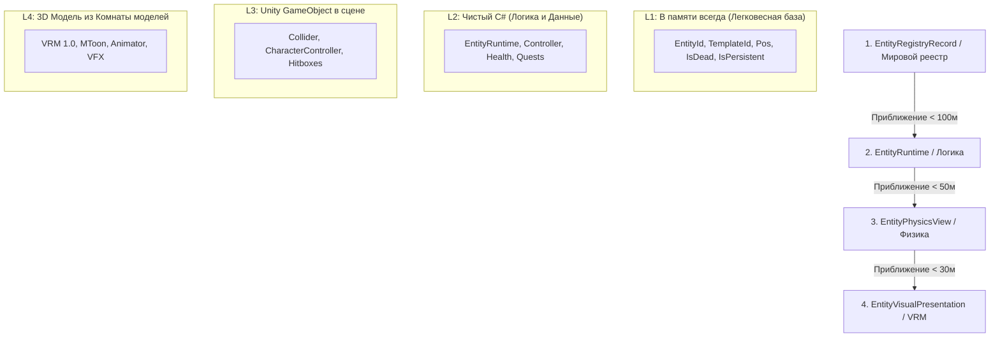
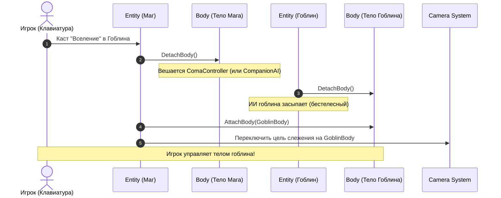

# Архитектура и нюансы системы сущностей (Entity System Design Doc)
**Проект:** LunaticMagic2  
**Назначение:** Полная спецификация переработанной системы сущностей, устранение архитектурных косяков старого кода (`Assets/MyFiles/Scripts/Entities`), разделение Сущности и Тела, компонентная модель, шаблоны и вселение.

---

## 1. Разбор проблем старой архитектуры и ключевые решения

| Старый подход (`Assets/MyFiles/Scripts/Entities`) | Проблема | Новый подход (Целевая архитектура) |
| :--- | :--- | :--- |
| **Взрыв классов (Class Explosion):** `EntityGivi : EntityGoblin : Entity` | Создание отдельного C# класса на каждого уникального NPC. Не масштабируется для сотен персонажей. | **Шаблоны данных (Entity Blueprints):** Единый класс `Entity`, конфигурация задается через ScriptableObject/JSON (`TemplateId`) + уникальные дельта-данные. |
| **Рефлексия на старте (`EntitiesLoader`):** Сканирование сборки `Assembly.GetExecutingAssembly()` по атрибутам `[UniqueEntity]`. | Медленный старт игры, зависимость от рефлексии, невозможность модифицировать данные в рантайме. | **Декларативный реестр базы мира:** Список уникальных сущностей загружается как статический JSON/SO каталог без рефлексии. |
| **Ненадежная сериализация компонентов:** Хранение `TypeName` и `Activator.CreateInstance(type)`. | Ломается при переименовании классов, смене сборок или пространств имен. | **Явная типизированная фабрика компонентов / Enum Id:** Сериализация через понятные строковые/enum идентификаторы компонентов. |
| **Смешение Сущности и Тела:** Тело жестко зашито в сущность. Нельзя легко сменить тело или вселиться. | Невозможно реализовать механику вселения и гибкий стриминг. | **Разделение Сущности (`Entity`) и Тела (`BodyComponent`):** Тело — это сменяемый "костюм", который сущность надевает на себя. |

---

## 2. Разделение: Сущность (`Entity`) vs Тело (`Body`)

```
┌────────────────────────────────────────────────────────┐
│                   СУЩНОСТЬ (Entity)                    │
│  "Разум, Личность, Сюжетный прогресс"                   │
│                                                        │
│  • EntityId ("player_main", "npc_givi")                │
│  • TemplateId ("goblin_scout", "mage_player")          │
│  • Quests & Dialogue Flags (Журнал заданий)            │
│  • ControllerComponent (PlayerInput / AI / Coma)       │
│  • CurrentBody (Ссылка на надетое тело)                │
│  • OriginalBodyId (Ссылка на родное тело)              │
└───────────────────────────┬────────────────────────────┘
                            │ надевает / снимает
                            ▼
┌────────────────────────────────────────────────────────┐
│                    ТЕЛО (BodyComponent)                │
│  "Физический костюм / Скафандр"                        │
│                                                        │
│  • BodyId ("body_player_01", "body_goblin_15")         │
│  • Transform & Position (Координаты в мире X, Y, Z)    │
│  • BodyStats (Текущее HP, выносливость, скорость)      │
│  • PhysicsView (GameObject, CharacterController)       │
│  • VisualPresentation (3D/VRM модель из комнаты пула)  │
│  • BodyInventory (Надетое оружие и броня в руках)      │
│  • Locomotion (Move, Jump, Attack методы исполнения)   │
└────────────────────────────────────────────────────────┘
```

### Главный принцип:
* **Сущность (`Entity`)** существует всегда (в памяти сессии или файле).
* **Тело (`Body`)** существует в физическом мире только тогда, когда оно находится в радиусе стриминга игрока.
* Координаты в мире принадлежат **Телу**, а не Сущности.

---

## 3. Четыре уровня сущности (4-Level Architecture)



1. **`EntityRegistryRecord` (L1):**
   * Легковесный дескриптор (занимает ~64 байта в памяти).
   * Позволяет квестам спросить: *"Мертв ли Гиви?"* без создания самого гоблина в 3D.
2. **`EntityRuntime` (L2):**
   * Чистый C# объект без `MonoBehaviour`.
   * Содержит набор компонентов логики (`ControllerComponent`, `DialogueStateComponent`, `FactionComponent`).
   * **Авторитет RAM:** Пока сущность активна, диск не перезаписывается.
3. **`EntityPhysicsView` (L3):**
   * `GameObject` на сцене. Отвечает за коллизии, физическое перемещение и получение ударов/стрел.
4. **`EntityVisualPresentation` (L4):**
   * 3D/VRM модель. Достается из скрытой **"Комнаты для моделей"** за 1 кадр.

---

## 4. Контроллеры и Управление (Controller Component)

Контроллер — это компонент, который решает, **куда идти и кого атаковать**, и передает эти команды в надетое тело (`CurrentBody`):

```csharp
public interface IEntityController : IEntityComponent
{
    void UpdateController(EntityRuntime entity, BodyComponent currentBody);
}
```

### Виды контроллеров:
1. **`PlayerInputController`:** Читает ввод с `InputLayer` (WASD, Мышь, Пробел) и вызывает `currentBody.Locomotion.Move(...)`.
2. **`AIController`:** Крутит дерево поведений (Behavior Tree / FSM) для NPC и монстров.
3. **`ComaController`:** Полная неподвижность (тело стоит в Idle или лежит без сознания).
4. **`CompanionFollowController`:** Простой ИИ, который идет за лидером и обороняет его.

---

## 5. Механика Вселения (Possession Pipeline): Смена Тел

Когда игрок кастует вселение в гоблина:



### Завершение вселения (по кнопке, таймеру или при смерти гоблина):
1. `PlayerEntity.DetachBody()` — игрок отпускает тело гоблина.
2. `GoblinEntity.AttachBody(GoblinBody)` — гоблин возвращается в свое тело (на его новых координатах).
3. `PlayerEntity.AttachBody(PlayerBody)` — игрок возвращается в свое родное тело (на тех координатах, где его оставил).
4. Камера переключается обратно на мага.

---

## 6. Шаблоны сущностей (Blueprints) вместо классов

Вместо создания десятков C# файлов (`EntityGivi.cs`, `EntityZhorik.cs`) используется единая структура данных:

```json
{
  "TemplateId": "goblin_warrior",
  "BaseStats": {
    "MaxHealth": 120,
    "MoveSpeed": 4.5,
    "BaseDamage": 15
  },
  "DefaultModelKey": "vrm_goblin_green",
  "DefaultController": "AI_MeleeFighter",
  "DefaultInventory": [
    { "ItemId": "rusty_dagger", "Quantity": 1 }
  ]
}
```

* **Для обычного моба:** Берется шаблон `goblin_warrior`, генерируется динамический ID `"goblin_warrior_104"`.
* **Для уникального NPC (Гиви):** Берется тот же шаблон `goblin_warrior`, задается фиксированный ID `"npc_givi"`, имя `"Гиви Хитрый"` и уникальный квестовый диалог.

---

## 7. Сериализация и Сохранение (Session Sandbox)

Файл сущности в рабочей папке `RuntimeSessions/Session_Active/Entities/player_main.json`:

```json
{
  "EntityId": "player_main",
  "TemplateId": "mage_hero",
  "CurrentBodyId": "body_goblin_15",
  "OriginalBodyId": "body_player_main",
  "IsPossessing": true,
  "QuestFlags": {
    "quest_dungeon_cleared": true
  },
  "BodyData": {
    "BodyId": "body_player_main",
    "Position": { "x": 10.5, "y": 0.0, "z": -42.1 },
    "Rotation": { "x": 0.0, "y": 90.0, "z": 0.0 },
    "CurrentHealth": 250,
    "CurrentStamina": 100
  }
}
```

* При F6 QuickSave состояние активных сущностей атомарно сбрасывается в JSON.
* При F9 QuickLoad игра считывает `CurrentBodyId` и сразу знает, в каком теле находится игрок после загрузки.
