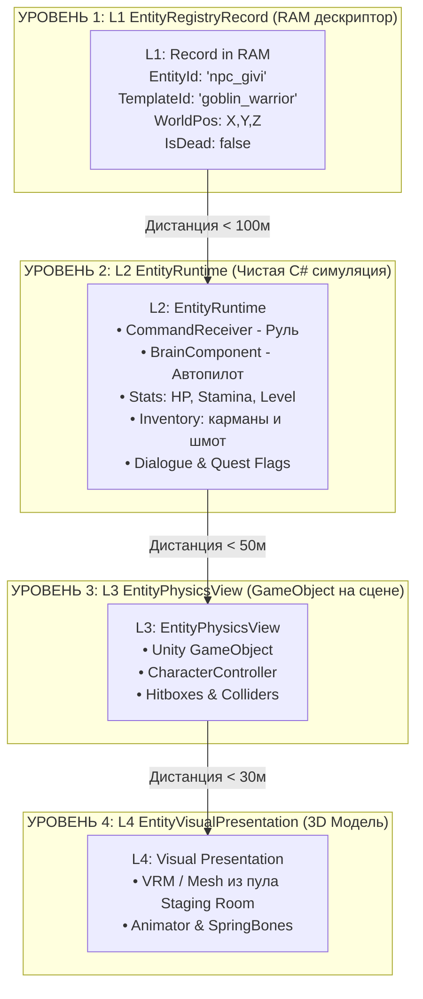
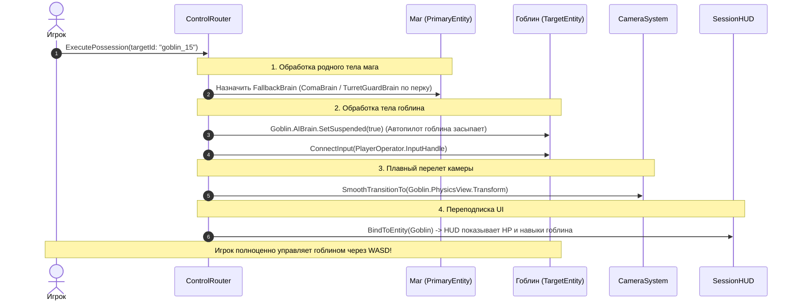

# Фундаментальная спецификация: Игрок, Сущности, Камеры и Пайплайн Управления (Unified Architecture & Control Design Doc)

> **Назначение документа:** Устранение архитектурных разрывов, выстраивание стройной 3-уровневой системы стейтов, четкое определение сущности Игрока (Player Operator), разграничение 4-уровневой модели Сущности и формализация единого конвейера управления (Геймплей, Вселение, Дроны, Катсцены).

---

## 1. Трёхуровневая модель стейтов (Three-Tier State Architecture)

Одна из главных проблем текущего кода — смешение понятий "состояние игры", "режим работы игрока" и "анимационный стейт персонажа". Архитектура жестко разделяет их на 3 независимых слоя:

```
┌─────────────────────────────────────────────────────────────────────────────┐
│ 1. GLOBAL / SESSION STATE (Глобальный контекст сессии)                      │
│    • BootState -> MainMenuState -> SessionActiveState -> UnloadState        │
│    • Знает: Мир запущен, мир на паузе, сессия выгружается.                 │
└──────────────────────────────────────┬──────────────────────────────────────┘
                                       │ содержит
                                       ▼
┌─────────────────────────────────────────────────────────────────────────────┐
│ 2. PLAYER OPERATOR STATE (Режим взаимодействия игрока с миром)              │
│    • FreePlayState (исследование/бой)                                      │
│    • DialogueState (диалоговое окно, блокировка ходьбы, выбор реплик)       │
│    • InventoryMenuState (инвентарь / карта / журнал)                        │
│    • CutsceneState (катсцена, ввод заблокирован кроме Esc/Skip)             │
│    • PossessionTransitionState (плавный перелет камеры к новому телу)       │
└──────────────────────────────────────┬──────────────────────────────────────┘
                                       │ транслирует команды через ControlRouter
                                       ▼
┌─────────────────────────────────────────────────────────────────────────────┐
│ 3. ENTITY / CHARACTER STATE (Локальное физическое состояние тела)            │
│    • LocomotionState (Idle, Walk, Run, Sprint, Fall)                        │
│    • ActionState (Attacking, CastingSpell, Stunned, Knockdown, Dead)        │
│    • Знает: текущее действие тела. Ему плевать, кто нажал атаку — Игрок,    │
│      ИИ гоблина или таймлайн катсцены.                                      │
└─────────────────────────────────────────────────────────────────────────────┘
```

---

## 2. Кто такой "Игрок" (Player Operator) и чистка `UIGlobalState`

### Ошибка старого подхода:
* Считать игрока "сущностью мага в 3D мире".
* Использовать `UIGlobalState` как глобальную свалку флагов (`MainMenu`, `Console`, `DebugMenu`, прямой спавн VRM).

### Целевая архитектура:
**Игрок (`PlayerOperator` / `PlayerSessionController`) — это "Пилот за пультом управления" в рамках текущей сессии:**
1. **Он не имеет своего 3D-тела.** Он держит виртуальный провод ввода (`InputCable`) и направляет его в ту сущность, которой сейчас управляет.
2. **Мета-данные Игрока:**
   * `PrimaryEntityId` — ID истинного тела мага (за ним закреплен сюжет, квесты, гибель мага = Game Over).
   * `CurrentPossessedEntityId` — ID сущности, в которую сейчас воткнут провод (по умолчанию равен `PrimaryEntityId`).
3. **Разделение UI:**
   * **`GlobalUIManager`:** Только системные окна вне сессии (Главное меню, Настройки, Выбор профиля).
   * **`SessionUIManager`:** Подписывается на `PlayerOperatorState`:
     * В `FreePlayState` $\rightarrow$ активен HUD (здоровье, прицел, компас).
     * В `DialogueState` $\rightarrow$ всплывает Dialogue Box.
     * В `InventoryMenuState` $\rightarrow$ открывается экран инвентаря.
     * При вселении в гоблина $\rightarrow$ HUD автоматически реактивно (UniRx) переключает источник данных на здоровье гоблина.

---

## 3. Четырехуровневая модель Сущности (4-Level Entity Breakdown)



### Где живут Контроллеры?
Контроллер — это **`BrainComponent` внутри L2 `EntityRuntime`**.
* Каждая сущность обязана иметь:
  1. **`ICommandReceiver` (Порт управления / Руль):** Имеет методы `Move(Vector2)`, `Look(Vector2)`, `Attack()`, `Jump()`, `Interact()`, `CastSkill(id)`.
  2. **`BrainComponent` (Штатный мозг / Автопилот):**
     * У NPC/Гоблина: `AIBrainComponent` (крутит дерево поведений и дергает свой `Receiver`).
     * У пассивного дрона: `PassiveDroneBrain`.
     * У союзника: `CompanionAIBrain`.

---

## 4. Промежуточный слой: Диспетчер управления (`ControlRouter` / `PossessionService`)

Чтобы код не превращался в спагетти ручных проверок (`if (isPlayer) ... else ...`), вводится промежуточный сервисный слой — **`ControlRouter`**.

```
                           [ PlayerOperator (Ввод с клавиатуры/мыши) ]
                                                │
                                                ▼
                                    [ ControlRouter (Диспетчер) ]
                                                │
                 ┌──────────────────────────────┴──────────────────────────────┐
                 │ Переключает провод ввода                                    │ Переключает цель камеры
                 ▼                                                             ▼
     [ TargetEntity.Receiver ]                                      [ CameraSystem.SetTarget ]
```

### Сценарий 1: Обычный геймплей (Маг)
1. `ControlRouter` подключает `PlayerOperator` к `MageEntity.Receiver`.
2. Штатный мозг мага спит (потому что провод игрока активен).
3. `CameraSystem.SetTarget(MageEntity.PhysicsView.Transform)`.

---

### Сценарий 2: Вселение в Гоблина (`Possession Pipeline`)
Единый алгоритм, одинаковый как для игрока, так и для союзных NPC-магов:



#### Защитные механики Вселения:
1. **Смерть чужого тела (Emergency Ejection):**
   * Если гоблина убили $\rightarrow$ `ControlRouter` ловит событие `OnDeath` гоблина.
   * Накладывает стан/дебафф на игрока.
   * Мгновенно возвращает провод и камеру на `Mage (PrimaryEntity)`.
2. **Смерть оставленного родного тела:**
   * Если враги нашли и убили спящего мага $\rightarrow$ **Game Over** (экран смерти и предложение загрузить сейв F9).

---

### Сценарий 3: Управление Дроном (Разведка)
* Дрон — это точно такая же сущность `Entity`, но без гуманоидного тела:
  * L2: `EntityRuntime` со статами прочности и батареи.
  * L3: Физический шар/квадрокоптер с `SphereCollider`.
  * `Receiver`: команды `Move(Vector3)` переводятся в полет по 6 осям.
* Вселение в дрон происходит по ровно такому же пайплайну `ControlRouter.ExecutePossession("drone_01")`.
* Камера переключается в контейнер `FreeDroneView`.

---

### Сценарий 4: Катсцены как частный случай маршрутизации
Катсцена не ломает общую архитектуру:
1. `PlayerOperator` переходит в `PlayerOperatorState.CutsceneState`.
2. Провод ввода игрока переключается на пустой виртуальный `CutsceneInputReceiver` (активна только кнопка `Esc / Skip`).
3. На тело мага вешается временный `CutsceneDirectorBrain` (или привязка к Unity Playable Director / Timeline).
4. Камера переключается в режим `CinematicTrackCamera`.
5. По завершении катсцены: `ControlRouter.RestoreControlToPrimaryEntity()` возвращает игрока в тело мага и режим `FreePlayState`.

---

## 5. Итоговая матрица слоев управления

| Сценарий | Куда подключен ввод Игрока | Что делает родное тело Мага | Что делает целевая Сущность | Камера |
| :--- | :--- | :--- | :--- | :--- |
| **Обычный геймплей** | `Mage.Receiver` | Исполняет команды игрока | Живет своей жизнью (свой `AIBrain`) | 1st / 3rd Person на Маге |
| **Вселение (Ур. 1)** | `Target.Receiver` | Спит (`ComaBrain`) | Исполняет команды игрока (родной `AIBrain` спит) | 3rd Person на Цели |
| **Вселение (Ур. 2)** | `Target.Receiver` | Защищает точку (`TurretGuardAIBrain`) | Исполняет команды игрока | 3rd Person на Цели |
| **Управление Дроном** | `Drone.Receiver` | Спит (`ComaBrain`) | Летит по командам игрока | FreeDroneView |
| **Диалог с NPC** | `DialogueUI.Receiver` | Стоит в `Idle`, слушает реплики | Смотрит на игрока (LookAt) | Диалоговая камера (на уровне глаз) |
| **Катсцена** | `CutsceneUI.Receiver` (Skip) | Идет по рельсам (`CutsceneBrain`) | Идет по рельсам | Режиссерская камера / Timeline |

---

## 6. Что делать с текущим кодом (План наведения порядка)

1. **Удалить/переработать `UIGlobalState`:**
   * Убрать флаги меню и хардкод-спавн VRM из `UIGlobalState`.
   * Перенести глобальные флаги в `GlobalUIManager`, а сессионные экраны — в `SessionUIManager`.
2. **Внедрить `ControlRouter` в `GameSession`:**
   * Заменить прямое дергание стейтов на маршрутизацию команд ввода через `ControlRouter`.
3. **Разграничить 3 машины состояний:**
   * Глобальная сессионная FSM (`SessionActive` / `Paused`).
   * FSM Игрока-Оператора (`FreePlay`, `Dialogue`, `Inventory`, `Cutscene`).
   * FSM Локомоции и Экшенов Тела (`Idle`, `Move`, `Attack`, `Stunned`).
