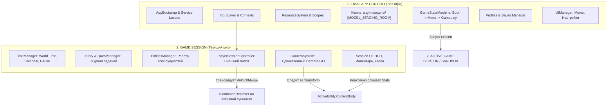
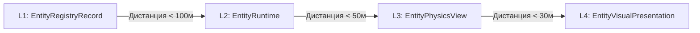
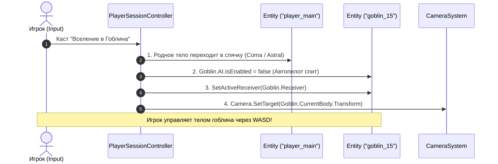

# Генеральная архитектурная спецификация (Master Architecture Manifest)
**Проект:** LunaticMagic2  
**Жанр/Тип:** Одиночная сюжетная RPG в открытом мире (Skyrim-like)  
**Ключевые фичи:** Быстрые сейвы F6/F9 через Session Sandbox, 4-уровневый стриминг сущностей, механика Вселения (Possession), пулинг VRM 3D моделей через комнатную буферизацию, универсальный порт управления `ICommandReceiver`.

---

## 1. Архитектурные столпы (Core Principles)

1. **Разделение Логики, Данных и Отображения (SoC):**
   * Логическая симуляция мира (`EntityRuntime`) — это чистый C# без `MonoBehaviour`. Она может жить и тикать в памяти без физических объектов на сцене.
   * `Unity GameObject`, коллайдеры и аниматоры — это лишь временная физическая и визуальная оболочка (View/Presentation), которая может спавниться и уничтожаться стримингом в любой момент.
2. **Изолированная песочница сессии (Session Sandbox):**
   * В реальном времени игра работает и пишет данные исключительно в одну временную системную папку `RuntimeSessions/Session_Active/`.
   * Сохранение (F6) — атомарный снимок папки сессии в слот профиля.
   * Загрузка (F9) — очистка мира и мгновенное развертывание сессии из снимка.
3. **Разделение Сущности (`Entity`) и Тела (`BodyComponent`):**
   * **Сущность:** Разум, личность, квесты, диалоговые флаги, статы души.
   * **Тело:** Физический скафандр (координаты X,Y,Z, CharacterController, 3D/VRM модель, текущее HP/выносливость, надетый шмот).
   * Сущность может надевать и снимать тела (`AttachBody` / `DetachBody`).
4. **Управление через "Приемник команд" (`ICommandReceiver`):**
   * Все сущности (игрок, гоблин, дрон, лошадь) имеют одинаковый интерфейс руля (`Move`, `Attack`, `Jump`, `Interact`).
   * ИИ NPC (`AIControllerComponent`) — это автопилот, встроенный в сущность.
   * Игрок (`PlayerSessionController`) — это внешний пилот сессии, который транслирует ввод в активный руль.

---

## 2. Глобальная структура слоев и контекстов



---

## 3. Точка входа и машина состояний (Bootstrap & Lifecycle)

### `AppBootstrap` (MonoBehaviour, `DontDestroyOnLoad`):
* Запускается автоматически через `[RuntimeInitializeOnLoadMethod(RuntimeInitializeLoadType.BeforeSceneLoad)]`.
* Регистрирует глобальные модули: ресурсы, локализацию, профили, ввод.
* Запускает `GameStateMachine`.

### `GameStateMachine` (Глобальные переходы):
1. `BootState` — чтение базовых настроек игры, шрифтов, аудио.
2. `MainMenuState` — выгрузка предыдущей сессии, показ главного меню.
3. `LoadSessionState` — распаковка выбранного сейва в `RuntimeSessions/Session_Active/`, инициализация систем сессии, загрузка сцены.
4. `GameplayState` — тикание сессии (`FixedUpdate`, `Update`, `LateUpdate`).
5. `UnloadSessionState` — сохранение, очистка сущностей и памяти, возврат в меню.

---

## 4. Система ресурсов, Scopes и "Комната для моделей"

### `ResourceBinding` и `ResourceScope`:
* **`ResourceBinding`:** Ссылка владения ресурсом (`IResourceBinding<T> : IDisposable`) со счетчиком ссылок (Ref Counting).
* **`ResourceScope`:** Потребитель/держатель ссылок. При уничтожении сцены/квеста/сессии вызов `scope.Dispose()` автоматически освобождает все связанные ресурсы.

### "Комната для моделей" (Model Staging Room):
* **Проблема VRM:** Создание VRM с диска в рантайме вызывает жесткие микрофризы (парсинг мешей, шейдеров MToon, костей SpringBone).
* **Решение:** Все активные и предзагруженные 3D/VRM модели **всегда физически существуют на сцене** в скрытом системном контейнере `[MODEL_STAGING_ROOM]` под картой `(0, -2000, 0)`.
* В комнате модели полностью прогреты (шейдеры скомпилированы, скелет привязан), но их физика и аниматоры отключены.
* При спавне NPC модель перемещается из комнаты за **1 кадр** и прикрепляется к `EntityPhysicsView`. При выходе NPC из радиуса модель возвращается обратно в комнату.

---

## 5. Профили, Сохранения и Песочница Сессии (F6 / F9 Pipeline)

### Изоляция профилей:
* Профиль нужен **только для группировки сохранений**. Список сохранений профиля — это ленивый ресурс, загружаемый через `ResourceSystem`.

### Структура директорий:
```
[Директория AppData / SavedGames]
├── GlobalGameData.json           <-- Общие настройки (видео, звук, язык)
├── Profiles/
│   └── Profile_01/
│       ├── Profile.json          <-- Метаданные профиля (имя героя, наигранное время)
│       └── Saves/
│           ├── QuickSave.sav     <-- F6 быстрый сейв (упакованная папка/архив)
│           └── AutoSave_01.sav
└── RuntimeSessions/
    └── Session_Active/           <-- ТЕКУЩИЙ АКТИВНЫЙ МИР (Single Source of Truth)
        ├── SessionData.json      <-- Игровое время, квесты, ID управляемой сущности
        └── Entities/
            ├── player_main.json  <-- Состояние мага
            └── goblin_15.json    <-- Состояние гоблина
```

### Конвейеры F6 и F9:
* **F6 (QuickSave):** Бодрствующие `EntityRuntime` сбрасывают состояние в память/файлы `Session_Active/Entities/` -> папка `Session_Active/` атомарно пакуется в `QuickSave.sav`.
* **F9 (QuickLoad):** Текущий мир уничтожается (`GameSession.Dispose()`), `QuickSave.sav` распаковывается в `Session_Active/`, инициализируется новая сессия, спавнятся сущности.

### Авторитет RAM и `EntityHibernationSystem`:
* Пока сущность активна в памяти (`EntityRuntime`), **диск не перезаписывается при каждом изменении HP**. Авторитетна только оперативная память.
* Запись на диск происходит строго в 2 случаях:
  1. При засыпании/выгрузке сущности из памяти (Hibernation).
  2. При сохранении игры (F6 / AutoSave).
* Отдельная `EntityHibernationSystem` батчит выгрузку спящих сущностей в моменты низких требований к FPS (меню паузы, инвентарь, фоновый сборщик).

---

## 6. Четырехуровневая архитектура сущностей и шаблоны (Blueprints)

### Отказ от взрыва классов (Class Explosion):
* Вместо создания C# классов (`EntityGivi`, `EntityZhorik`) используется единый класс `Entity` и **шаблоны данных (Blueprints)** в JSON/ScriptableObjects (`goblin_warrior`, `guard_captain`).
* Уникальный NPC (Гиви) — это сущность с шаблоном `goblin_warrior`, уникальным ID `"npc_givi"`, своим именем и квестовыми диалогами.

### 4 Уровня сущности:


1. **L1: `EntityRegistryRecord` (Мировой реестр в RAM):**
   * Легковесный дескриптор в памяти (~64 байта): `EntityId`, `TemplateId`, `Position`, `IsDead`, `IsPersistent`.
   * Существует всегда для всех тысяч объектов мира. Квесты могут проверять статус NPC без создания 3D объектов.
2. **L2: `EntityRuntime` (Логическая симуляция):**
   * Чистый C# объект. Хранит логические компоненты (`Health`, `Inventory`, `Stats`, `Controller`).
3. **L3: `EntityPhysicsView` (Физическое тело в Unity):**
   * `GameObject` с коллизиями, хитбоксами и `CharacterController`. Управляет перемещением и ловит урон.
4. **L4: `EntityVisualPresentation` (3D/VRM Модель):**
   * 3D модель и `Animator` из Комнаты моделей.

---

## 7. Управление: Модель "Машина, Автопилот и Пилот"

```
┌────────────────────────────────────────────────────────┐
│               СУЩНОСТЬ (Entity / Машина)               │
│                                                        │
│  ┌──────────────────────────────────────────────────┐  │
│  │ ICommandReceiver (Руль и педали):                │  │
│  │ • Move(Vector2 dir)                              │  │
│  │ • Attack(), Jump(), Interact(), CastSkill(id)    │  │
│  └──────────────────────────▲───────────────────────┘  │
│                             │                          │
│        ┌────────────────────┴────────────────────┐     │
│        │                                         │     │
│ [ AIControllerComponent ]              [ BodyComponent ]│
│ (Автопилот на NPC)                     (Тело / Двигатель)
│ • Крутит дерево поведений              • Позиция X,Y,Z │
│ • Дергает Receiver.Move(...)           • HP / Скорость │
│ • Отключается при вселении             • 3D Модель     │
└────────────────────────────────────────────────────────┘
```

### Роли компонентов:
1. **`ICommandReceiver` (Руль):** Универсальный компонент на каждой сущности (маг, гоблин, дрон).
2. **`AIControllerComponent` (Автопилот):** Висит на NPC, крутит логику ИИ и сам вызывает методы своего `Receiver`. При вселении игрока ставится на паузу (`IsEnabled = false`).
3. **`PlayerSessionController` (Внешний Пилот):** Живет в `GameSession`, слушает `InputLayer` и транслирует сигналы в `activeEntity.Receiver`.

---

## 8. Механика Вселения (Possession Pipeline), Дрон и Катсцены

### Принцип смены тел (`AttachBody` / `DetachBody`):



### Ограничения в чужом теле:
* **Системные триггеры:** Квестовые зоны мага не активируются телом гоблина.
* **Реакция мира:** Фракции и NPC реагируют на расу текущего тела (стража атакует гоблина).
* **Инвентарь:** Лут собирается в карманы гоблина.

### Защита и возврат:
1. **Основное тело мага:** Жестко зафиксировано через `PrimaryEntityId` и никогда не теряется.
2. **Смерть гоблина (Emergency Ejection):** `PlayerPilot` ловит гибель гоблина -> накладывает дебафф/стан на игрока -> возвращает управление и камеру на мага (`PrimaryEntityId`).
3. **Смерть основного тела:** Если оставленное в коме тело мага убито врагами -> немедленный **Game Over** (экран загрузки F9).

### Универсальность (Дрон и Катсцены):
* **Дрон:** Игрок подключает провод управления к `drone.Receiver`, камера следит за дроном.
* **Катсцена:** Провод игрока отключается (`activeReceiver = null`), на тело вешается `CutsceneAIController` (идет по срежиссированным точкам), камера следует по таймлайну.

---

## 9. Камеры (Camera System)

* В сцене живет **ровно один объект Unity `Camera.main`**.
* `CameraSystem` управляет 3 контейнерами:
  1. `FirstPersonView` (1-е лицо).
  2. `ThirdPersonView` (3-е лицо с орбитальным вращением и collision raycasts).
  3. `FreeDroneView` (Свободная камера).
* Камера всегда следит за точкой: `CameraSystem.SetTarget(activeEntity.CurrentBody.Transform)`. При смене тела камера плавно интерполирует позицию к новой цели.

---

## 10. Пользовательский интерфейс (UI Layer)

```
┌────────────────────────────────────────────────────────┐
│ 1. GLOBAL UI (GlobalGame.UIManager)                    │
│    • Главное меню, Настройки звука/графики, Профили    │
└───────────────────────────┬────────────────────────────┘
                            │
                            ▼
┌────────────────────────────────────────────────────────┐
│ 2. SESSION UI (GameSession.UISystem)                   │
│                                                        │
│    А. Мета-окна (Данные Игрока/Сессии):                │
│       • Журнал заданий (Quest Log)                     │
│       • Карта мира (World Map)                         │
│                                                        │
│    Б. HUD и Инвентарь (Данные ТЕКУЩЕГО ТЕЛА):          │
│       • Полоски HP / MP / Выносливость (UniRx)         │
│       • Прицел, Компас                                 │
│       • Инвентарь (Карманы ActiveEntity.CurrentBody)   │
└────────────────────────────────────────────────────────┘
```
При вселении в гоблина HUD автоматически переподписывается (UniRx) на `Goblin.CurrentBody.Stats` (показывает 120 HP гоблина и иконку дубины).

---

## 11. Стейт-машины и Золотое правило "Вход vs Восстановление"

Стейты разделены на **Глобальные** (Сессия, Катсцена, Пауза) и **Локальные** (Локомоция, Боевка сущности).

### Золотое правило стейт-машины (Enter Invariant):
* **`Enter()` вызывается строго 1 раз и в 1 кадр** исключительно при *реальном живом переходе* в геймплее. В нем запускаются звуки взмаха меча, стартуют анимации и партиклы.
* **При загрузке сейва (F9) метод `Enter()` НИКОГДА не вызывается:**
  * Состояние вычисляется/десериализуется из сейва (`StateType = Attacking`, `Time = 0.4s`).
  * Со следующего кадра игра **сразу начинает вызывать `Update()`**.
  * **Итог:** Нет спама звуков/эффектов всех 50 NPC при загрузке сейва, анимации встают в актуальную позу, таймеры не сбрасываются.

---

## 12. Целевая структура папок проекта (Target Project Layout)

```
Assets/MyFiles/Scripts/
├── App/                      <-- Точка входа, AppBootstrap, GameStateMachine
├── Common/
│   ├── ResourceSystem/       <-- ResourceBinding, ResourceScope, ModelStagingRoom
│   ├── InputLayer/           <-- Raw Input, Contexts, Action Mapping
│   └── EventBus/             <-- Глобальная и сессионная шина событий
├── Game/
│   ├── Profiles/             <-- Профили игроков и загрузчик сохранений
│   ├── Session/              <-- GameSession, TimeManager, Quests, Sandbox I/O
│   ├── Player/               <-- PlayerSessionController (Внешний пилот)
│   └── Cameras/              <-- CameraSystem, 1st/3rd/Drone контейнеры
├── Entities/
│   ├── Registry/             <-- EntityRegistryRecord, EntitiesManager, Blueprints
│   ├── Runtime/              <-- EntityRuntime, EntityComponentBase, Health, Inventory
│   ├── Body/                 <-- BodyComponent, Locomotion, CharacterController
│   ├── Controllers/          <-- ICommandReceiver, AIController, ComaController
│   └── Persistence/          <-- EntityHibernationSystem, Serializers
└── UI/
    ├── Global/               <-- MainMenu, Settings, Profiles UI
    └── Session/              <-- HUD, InventoryWindow, QuestLogWindow (UITK + UniRx)
```
