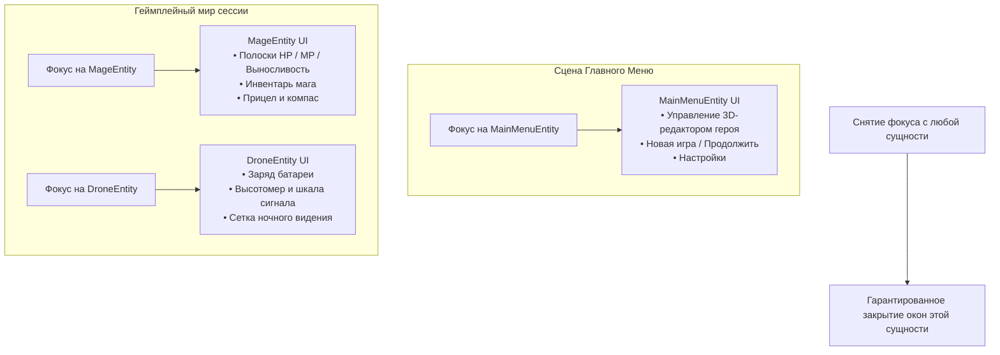

# Архитектурная спецификация: Децентрализация UI и Фокус Сущностей (Entity UI & Focus Architecture)

**Изначальный авторский замысел:**
> Пауза — это системный стейт сессии (наряду с игрой и загрузкой), а не сущность. Это жизненный цикл уже запущенной сессии. Консоль и пауза отрабатываются прямо в сессии, потому что они не сериализуются и не имеют отношения к игровому процессу и сущностям.
> Катсцена, главное меню, персонаж и т.д. — это сериализуемая часть мира (главное меню будет отдельной сценой с сущностями и редактором персонажа).
> `UIGlobalState` не уничтожается полностью, а перерабатывается (с него снимается большая часть ответственности за игровой UI).
> **Напрямую UI из персонажа или глобальной сессии не управляется!**
> UI главного меню управляется из сущности главного меню, и именно она управляет видимостью своего окна в сцене меню.
> Когда фокус на персонаже — открыт UI персонажа любой сложности (HUD, инвентарь). Когда фокус уходит — UI возвращается в дефолтный вид / закрывается. Когда фокус на сущности главного меню — открывается UI меню.

---

## 1. Системный жизненный цикл Сессии vs Сериализуемый Мир Сущностей

Архитектура строго разделяет **несериализуемый жизненный цикл приложения/сессии** и **сериализуемый мир сущностей**:

```
┌─────────────────────────────────────────────────────────────────────────────┐
│ 1. ЖИЗНЕННЫЙ ЦИКЛ СЕССИИ (Несериализуемый системный уровень)                │
│ • LoadingState   — загрузка мира, ожидание готовности                       │
│ • GameplayState  — активный игровой цикл мира                              │
│ • PauseState     — системная пауза (стопорит LocalGameTime и физику)        │
│                                                                             │
│ * Системная пауза и консоль отрабатывают прямо здесь, так как они не        │
│   сериализуются и не имеют отношения к игровому процессу сущностей.         │
└──────────────────────────────────────┬──────────────────────────────────────┘
                                       │ передает фокус управления (Focus)
                                       ▼
┌─────────────────────────────────────────────────────────────────────────────┐
│ 2. МИР СУЩНОСТЕЙ И СЦЕН (Сериализуемый уровень)                             │
│ • Сущность Главного Меню  ───> Сцена Меню: 3D-превью, редактор героя, UI     │
│ • Сущность Персонажа/Мага ───> Игровой мир: HUD, Инвентарь, Древо прокачки  │
│ • Сущность Дрона          ───> Игровой мир: Визор дрона, батарея, помехи    │
│ • Сущность Катсцены       ───> Сцена/Квест: Таймлайн, режиссерские камеры   │
└─────────────────────────────────────────────────────────────────────────────┘
```

---

## 2. Роль `UIGlobalState` после переработки

`UIGlobalState` **не уничтожается полностью**, а освобождается от несвойственных ему задач:
* **Что уходит из `UIGlobalState`:** Убираются флаги видимости игровых окон (`MainMenu`, `InventoryOpen`, `DialogueOpen`), прямой спавн VRM и ручное переключение интерфейсов персонажей.
* **Что остаётся в `UIGlobalState`:** Высокоуровневые системные сервисы приложения (например, вызов отладочной консоли `Console`, глобальный статус готовности систем или оверлей системной паузы).
* **Главный принцип:** Ни персонаж, ни сессия напрямую через булевы флаги в `UIGlobalState` игровым UI больше не управляют.

---

## 3. Принцип "UI привязан к активной сущности" (Entity-Driven UI)

Каждый игровой UI принадлежит той сущности, в которой сейчас находится фокус:



---

## 4. Контракт UI компонента сущности (`IEntityUI`)

Сущности, обладающие своим интерфейсом в сцене/мире, реализуют компонент `IEntityUI`:

```csharp
public interface IEntityUI
{
    /// <summary>
    /// Вызывается, когда сущность получает фокус ввода.
    /// Сущность активирует свой HUD / отображает базовые интерфейсы.
    /// </summary>
    void OnFocusGained();

    /// <summary>
    /// Вызывается, когда фокус уходит с сущности (смена тела, выход в меню).
    /// Сущность обязана скрыть весь свой UI и закрыть временные окна (инвентарь).
    /// </summary>
    void OnFocusLost();
}
```

---

## 5. Базовые сценарии переключения фокуса (Пайплайны)

### Ключевое правило передачи контекста
> **Сначала `Entity.Setup(...)` (конфигурация параметров, целей, эффектов), затем чистый `FocusManager.SetFocus(entity)` (без параметров).**
> Сам контракт `IFocusable` / `IEntityUI` остается кристально чистым: `OnFocusGained()` и `OnFocusLost()`.

---

### Сценарий 1: Сцена Главного Меню
1. Главное меню загружается как отдельная сцена с 3D-моделями для превью/кастомизации, камерой и `MainMenuEntity`.
2. При загрузке фокус находится на `MainMenuEntity`.
3. `MainMenuEntity.OnFocusGained()` открывает кнопки меню и связывает UI с 3D-редактором персонажа.
4. При нажатии "Старт игры": загружается игровой мир, вызывается `SetFocus(playerEntity)`.
5. `MainMenuEntity.OnFocusLost()` закрывает интерфейс меню.
6. `PlayerEntity.OnFocusGained()` активирует игровой HUD персонажа.

---

### Сценарий 2: Вселение в чужое тело (Possession)
1. **Опрос цели:** `target.CanBePossessed()`.
2. **Конфигурация цели:** Навешиваем на цель эффект/компонент `target.AddEffect(new PossessionEffect(duration: 30f, originalBodyId: "player"))`.
3. **Чистая смена фокуса:** `FocusManager.SetFocus(target)`.
   * Старое тело: скрывает свой UI, впадает в кому (или защитную турель).
   * Цель: активирует свой HUD (полоски здоровья, слоты действий под это существо).
4. **Возврат по таймеру:** Когда таймер эффекта на цели истечет — сам `PossessionEffect` вызывает `FocusManager.SetFocus(originalBody)`.

---

### Сценарий 3: Смерть / Потеря сознания игрока
1. Здоровье тела `<= 0`.
2. Состояние тела переходит в «умер / без сознания» (анимация, ragdoll, расчленение или сожжение по типу урона).
3. Умирающее тело конфигурирует сущность смерти: `deathEntity.Setup(targetBody: this, initialCameraPose: currentCamera)`.
4. **Чистая смена фокуса:** `FocusManager.SetFocus(deathEntity)`.
5. Камера `deathEntity` берет начальный ракурс игрока и следует за телом (даже если его перемещают) либо переходит в режим свободного дрона при вводе игрока.

---

### Сценарий 4: Похищение и Тюрьма (Kidnap & Cutscene)
1. Игрок теряет сознание (отрабатывает сценарий 3, камера `deathEntity` привязана к телу).
2. Монстр подходит, связывает тело и утаскивает его (камера смерти наблюдает за процессом).
3. Затемнение экрана (Fade out).
4. Передача фокуса на катсцену пробуждения в лагере/тюрьме: `FocusManager.SetFocus(prisonWakeUpEntity)`.

---

### Сценарий 5: Запуск Дрона-разведчика
1. Игрок подключается к Дрону (`drone_01`).
2. `MageEntity.OnFocusLost()` скрывает RPG-интерфейс мага.
3. `DroneEntity.OnFocusGained()` активирует интерфейс визора дрона: прицел, дистанция, процент батареи, помехи.

---

## 6. Системная Пауза и Консоль (System Lifecycle)

* **Пауза и консоль — это часть системного жизненного цикла сессии (`GameSession`), а не сущности:**
  1. Они не сериализуются в файлы сохранений мира (`EntitiesData`).
  2. При нажатии `Esc` сессия переходит в `PauseState`, останавливая `LocalGameTime` и физику мира.
  3. Во время паузы отображается системный оверлей сессии ("Продолжить", "Сохранить", "Выйти").
  4. Активная сущность не сбрасывает свое внутреннее состояние: при возврате в `GameplayState` симуляция и UI активной сущности бесшовно продолжают работу.
