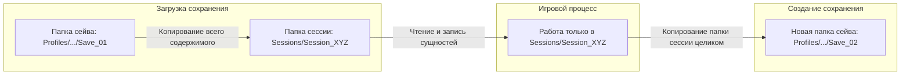

# Подсистема: Сессия, Профили и Сохранения (Session Architecture)

**Файл в коде:** [GameSession.cs](file:///D:/unity/LunaticMagicV3/Assets/Scripts/Game/Session/GameSession.cs#L207-L212)  
**Папка документации:** `Assets/Scripts/md/2026_11_10/Session/`

---

## 1. Концепция изолированной песочницы Сессии

Каждая запущенная игра работает в изолированной директории:

$$\text{Sessions}/\{\text{SessionId}\}/$$

* При старте сессии генерируется уникальный `SessionId` и создаётся папка сессии. Старые заброшенные сессии автоматически очищаются.
* **Сущности содержатся внутри сессии:** поддиректория `Sessions/{SessionId}/Entities/` содержит отдельные `.json` файлы для каждой сущности мира.
* **В рантайме вся работа с файлами ведётся исключительно внутри папки текущей сессии.**

---

## 2. Жизненный цикл Сохранений (Копирование папок)

1. **Загрузка сейва:**  
   Данные из папки сейва копируются в `SessionPath`. Сессия загружает `GameSessionData` из `SessionPath/GameSessionData.json`.
2. **Создание сохранения:**  
   Создаётся новая папка сейва `SavePath` в профиле. Текущие активные сущности сбрасывают свои компоненты в файлы внутри папки сессии, после чего вся папка `SessionPath` копируется в `SavePath`.

---

## 3. Данные Сессии (`GameSessionData`)

При старте сессии сразу загружаются общие данные сессии:
* `LocalGameTimeData` — игровое время, календарь, тики.
* `StoryStateData` — системные флаги спавна и этапов сюжета.
* `EntitiesData` — облегчённый список ВСЕХ сущностей мира (их `EntityId`, `SpawnerId`, флаг `IsConfigured`), без загрузки тяжелых компонентов самих сущностей.

---

## 4. Системный жизненный цикл (Не сериализуется)

* **Loading:** состояние загрузки ресурсов и синхронизации мира.
* **Pause:** системная пауза сессии. Замораживает ход `LocalGameTime` и тики физики мира. Не является сущностью и не сохраняется в файл.
