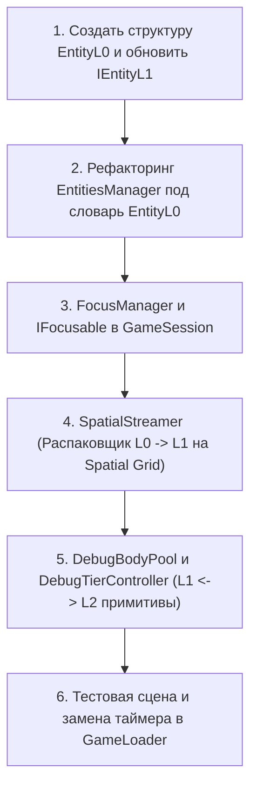

# Архитектурный План: Сущности L0–L1, Стриминг и Дебаг-представление L2

**Проект:** LunaticMagicV3  
**Папка документации:** `Assets/Scripts/md/2026_11_19/`  
**Файл плана:** `01_Entities_L0_L1_Streaming_Plan.md`  
**Дата обновления:** 20 ноября 2026  
**Цель документа:** Детальное планирование фундамента системы сущностей: хранение реестра L0 в `EntitiesManager`, распаковка в чистый C# рантайм L1, пространственный стриминг (L0 $\rightarrow$ L1), разделение ответственности между стримингом и системой среднего уровня, а также отладочная визуализация тел L2 на примитивах.

---

## 1. Разделение зон ответственности (Низкий vs Средний уровень)

> [!IMPORTANT]
> **Фундаментальное правило стриминга:**  
> Задача низкоуровневого стриминга — **ИСКЛЮЧИТЕЛЬНО РАСПАКОВКА (L0 $\rightarrow$ L1)**.  
> Стриминг существует только потому, что процессор не может каждый кадр перебирать 10 000 сущностей из словаря сессии для проверки дистанции.  
> Как только сущность распакована в оперативную память (L1) — **низкоуровневый стриминг больше не имеет к ней никакого отношения**.

```
┌─────────────────────────────────────────────────────────────────────────────┐
│ 1. НИЗКИЙ УРОВЕНЬ: РЕЕСТР И СТРИМИНГ (L0 ──> L1)                            │
│                                                                             │
│   • Хранит большой словарь всех сущностей сессии:                           │
│     Dictionary<string, EntityL0> _entitiesL0 (~10 000 записей).             │
│   • Стриминг (Spatial Grid / CullingGroup):                                 │
│     - Быстро находит спящие EntityL0 в радиусе внимания игрока.             │
│     - Вызывает EntitiesManager.Activate(entityId) для распаковки (L0 -> L1).│
│   ⛔ НЕ ЗАНИМАЕТСЯ:                                                         │
│     - Выгрузкой сущностей обратно на диск (L1 -> L0).                       │
│     - Включением коллайдеров, физики и визуала (L2 - L4).                   │
└──────────────────────────────────────┬──────────────────────────────────────┘
                                       │ Распакована в память (L1)
                                       ▼
┌─────────────────────────────────────────────────────────────────────────────┐
│ 2. СРЕДНИЙ УРОВЕНЬ: УПРАВЛЕНИЕ ЖИЗНЕННЫМ ЦИКЛОМ И ТИРАМИ                    │
│                                                                             │
│   • Управляет уровнями материализации активной сущности:                    │
│     - L1 (Данные) ⇄ L2 (Коллайдер / Примитив)                               │
│     - L2 ⇄ L3 (Активная физика)                                             │
│     - L3 ⇄ L4 (Визуальная модель VRM)                                       │
│   • Игрок отошел дальше 200 м:                                              │
│     - Сущность сворачивает L4 -> L3 -> L2 -> L1.                            │
│     - Сущность ОСТАЕТСЯ в оперативной памяти (L1).                          │
│   • Принятие решения о выгрузке (L1 ──> L0):                                │
│     - Действует по своей собственной логике (A-Life завершил задачу,        │
│       нет боя/квеста, превышена квота памяти активных сущностей сессии,     │
│       плановая очистка локации).                                            │
│     - Вызывает EntitiesManager.Deactivate(entityId) для записи в JSON.      │
└─────────────────────────────────────────────────────────────────────────────┘
```

---

## 2. Менеджер сущностей (`EntitiesManager`) и словарь `EntityL0`

### 2.1. Структура `EntityL0` (Легковесный дескриптор спящей сущности)
Для 10 000 сущностей в C# словарь `Dictionary<string, EntityL0>` занимает всего ~1-2 МБ оперативной памяти, что абсолютно ничтожно для современного ПК.

Поворот (`Quaternion`) исключён из `EntityL0`, так как для стриминга и пространственного обнаружения ориентация в пространстве не имеет значения (поворот хранится в детальном сейве сущности):

```csharp
[Serializable]
public struct EntityL0
{
    // --- Основные поля для стриминга и позиционирования ---
    public string EntityId;         // Уникальный ID сущности ("player_main", "goblin_042")
    public string LocationId;       // Идентификатор локации ("Forest1", "Dungeon01")
    public Vector3 LocalPosition;   // Координаты внутри локации
    public float Radius;            // Радиус/габариты (для детекции стримингом)

    // --- Поля для быстрых операций, проверок и шаблонов ---
    public string TemplateId;       // Ссылка на Blueprint/Шаблон ("goblin_scout", "player_mage")
    public string SpawnerId;        // Ссылка на спавнер (null для уникальных NPC)
    public bool IsPersistent;       // true: сюжетный/именной NPC, сундук; false: временный моб
    public bool IsConfigured;       // Пройдена ли первичная инициализация (Setup)
}
```

### 2.2. Словари и устройство `EntitiesManager`
```csharp
public class EntitiesManager : IDisposable
{
    // 1. Полный плоский реестр всех существующих сущностей мира в L0
    // До 10 000 штук живут здесь постоянно во время сессии
    private readonly Dictionary<string, EntityL0> _entitiesL0 = new(10000);

    // 2. Только активные в данный момент сущности в оперативной памяти L1
    // Единовременно здесь находится ~100–150 сущностей
    private readonly Dictionary<string, EntityL1> _activeEntitiesL1 = new(256);

    // 3. Быстрый индекс для спавнеров (spawnerId -> список entityId)
    private readonly Dictionary<string, HashSet<string>> _spawnerMap = new();

    public IReadOnlyDictionary<string, EntityL0> EntitiesL0 => _entitiesL0;
    public IReadOnlyDictionary<string, EntityL1> ActiveEntitiesL1 => _activeEntitiesL1;

    // --- API Низкого уровня (L0 <-> L1) ---

    // Регистрация спящей сущности в общем реестре
    public void RegisterL0(EntityL0 descriptor);

    // Распаковка: чтение JSON из Sessions/{id}/Entities/{id}.json в память (L0 -> L1)
    public EntityL1 Activate(string entityId);

    // Заморозка: сохранение состояния L1 в JSON и удаление из памяти (L1 -> L0)
    // ВЫЗЫВАЕТСЯ СИСТЕМОЙ СРЕДНЕГО УРОВНЯ, А НЕ СТРИМИНГОМ!
    public void Deactivate(string entityId);

    // Прямой доступ к активной сущности или дескриптору
    public EntityL1 GetActive(string entityId);
    public bool TryGetL0(string entityId, out EntityL0 descriptor);

    // Обновление пространственных координат (когда тело двигалось в L1/L2)
    public void UpdateL0Position(string entityId, Vector3 newPosition);

    // Сериализация реестра в сейв сессии
    public EntitiesData Save();
    public void Load(EntitiesData data);
}
```

---

## 3. Контракт сущности (`EntityL1`) и система Фокуса

### 3.1. Размороженное состояние: класс `EntityL1`
`EntityL1` — это чистый C# объект. Он не наследуется от `MonoBehaviour` и не создает `GameObject` в сцене Unity.

```csharp
public class EntityL1 : IDisposable
{
    public string EntityId { get; }
    public string TemplateId { get; }

    // Физический скафандр (координаты, локомоция, ссылка на отладочный L2-примитив)
    public BodyComponent Body { get; set; }

    // Контейнер логических компонентов (Health, Stats, Inventory, Quests, AI)
    private readonly Dictionary<Type, IEntityComponent> _components = new();

    public T GetComponent<T>() where T : class, IEntityComponent;
    public void AddComponent(IEntityComponent component);
    public void RemoveComponent<T>() where T : IEntityComponent;

    // Загрузка/сохранение детального состояния сущности (JSON песочницы сессии)
    public void Load(EntitySaveData data);
    public EntitySaveData Save();

    // Симуляционные такты (вызываются EntitiesManager только пока сущность в L1)
    public void FixedUpdate();
    public void Update();
    public void LateUpdate();
    public void PauseUpdate();

    public void Dispose();
}
```

### 3.2. Компонент Тела: `BodyComponent`
Отделяет личность сущности от физического пространства:
```csharp
public class BodyComponent
{
    public string BodyId { get; set; }
    public string LocationId { get; set; }
    public Vector3 Position { get; set; }
    public Quaternion Rotation { get; set; }

    // Ссылка на активное физическое представление (на L2 это дебаг-куб/капсула)
    public DebugBodyView DebugView { get; set; }

    public bool HasPhysicalBody => DebugView != null;
}
```

### 3.3. Контракт Фокуса (`IFocusable`) и `FocusManager`
* **Децентрализованный плоский фокус:** В `GameSession` нет стека фокуса (`FocusStack`). Есть только одно поле `CurrentFocus`.
* **Контракт `IFocusable`:**
  ```csharp
  public interface IFocusable
  {
      string EntityId { get; }
      IReadOnlyReactiveProperty<CursorStateMode> CursorMode { get; }

      void OnFocusGained();
      void OnFocusLost();
  }
  ```
* **Класс `FocusManager`:**
  ```csharp
  public class FocusManager : IDisposable
  {
      private readonly ReactiveProperty<IFocusable> _currentFocus = new();
      public IReadOnlyReactiveProperty<IFocusable> CurrentFocus => _currentFocus;
      public string PrimaryEntityId { get; private set; }

      public void SetPrimaryEntity(string entityId) => PrimaryEntityId = entityId;

      public void SetFocus(IFocusable newFocus)
      {
          if (_currentFocus.Value == newFocus) return;

          _currentFocus.Value?.OnFocusLost();
          _currentFocus.Value = newFocus;
          newFocus?.OnFocusGained();
      }
  }
  ```

---

## 4. Стриминг система (Распаковщик L0 $\rightarrow$ L1)

### 4.1. Назначение и Архитектура
Поскольку в `_entitiesL0` находится ~10 000 сущностей, стриминг работает как высокопроизводительный фильтр.
В проекте реализованы **два взаимозаменяемых стримера** под единым контрактом [IEntitiesStreamer.cs](file:///D:/unity/LunaticMagicV3/Assets/Scripts/Entities/Streaming/IEntitiesStreamer.cs):

1. **Основной: `CullingGroupStreamer` (Нативный C++ SIMD в ядре Unity):**
   * Работает на базе нативного Unity `CullingGroup`.
   * Плоский непрерывный массив `BoundingSphere[]` (1:1 соответствует координатам `LocalPosition` и `Radius` из `EntityL0`).
   * **Паттерн Muted Sphere (Заглушение при L1):**
     * При распаковке в L1 сфера уносится за 20 км (`(0, -999999, 0)`) с радиусом 0.
     * C++ ядро считает сферу бесконечно далекой и полностью прекращает слать события `onStateChanged`.
     * При возврате в L0 (засыпание) сфере возвращаются её честные координаты и радиус через `UnmuteL0`.
   * **Паттерн Free-List (Пул свободных слотов `_freeSlots`):**
     * При полном удалении неуникальной сущности (убит моб, собран лут) её индекс возвращается в стек свободных слотов `_freeSlots`.
     * При спавне новой сущности слот забирается из пула (`_freeSlots.Pop()`) без расширения массива и без перемешивания элементов.
   * **Перезагрузка сессии:** при загрузке сохранения `Clear()` выполняет `cullingGroup.Dispose()` и пересоздает чистый `CullingGroup`, исключая призрачные сферы из прошлой сессии.
   * Событийная модель: ядро C++ само эмиттит `onStateChanged`, когда точка фокуса входит в сферу.

2. **Запасной: `SpatialGridStreamer` (Управляемый чистый C#):**
   * Работает на базе 2D пространственной хэш-сетки [SpatialHashGrid.cs](file:///D:/unity/LunaticMagicV3/Assets/Scripts/Entities/Streaming/SpatialHashGrid.cs) с ячейками $100 \times 100$ м.
   * Независим от графического пайплайна и движковых компонентов Unity.
   * Опрашивает соседние ячейки вокруг точки фокуса по таймеру (раз в 0.25 сек).

3. **Мгновенное переключение без правок кода:**
   * В `EntitiesManager` реализован метод `SetStreamer(StreamerType type)` (`StreamerType.CullingGroup` или `StreamerType.SpatialGrid`). По умолчанию активен нативный `CullingGroup`.

4. **Распаковка:**
   * Как только сущность попадает в радиус пробуждения:
     ```csharp
     EntitiesManager.Activate(entityId); // L0 -> L1
     ```
   * Сущность распакована в оперативную память. **На этом задача стриминга для данной сущности завершена.** Стример НЕ выгружает сущности обратно — выгрузкой управляет средний уровень.

---

## 5. Упрощенная система среднего уровня (Дебаг L1 $\leftrightarrow$ L2)

Для быстрой проверки перемещения, физики и визуального контроля стриминга создаётся легковесный стенд:

```
┌─────────────────────────────────────────────────────────────────────────────┐
│                       ДЕБАГ-СТЕНД: ТЕЛО С КОЛЛАЙДЕРОМ                       │
├─────────────────────────────────────────────────────────────────────────────┤
│ 1. Окружение: Плоский пол (Unity Plane 500x500м с коллизией).               │
│                                                                             │
│ 2. Дебаг-пул примитивов (DebugBodyPool):                                    │
│    • Игрок (Фокус): Синяя капсула + CharacterController + маркер взгляда    │
│    • NPC / Мобы:    Красные/зеленые капсулы + CapsuleCollider (isKinematic) │
│    • Предметы/Луты: Желтые кубы + BoxCollider                               │
│                                                                             │
│ 3. Контроллер среднего уровня (DebugTierController):                        │
│    • Следит за активными L1 сущностями.                                     │
│    • Дистанция < 100м: выдает примитив из пула (L1 -> L2).                  │
│    • Дистанция > 120м: забирает примитив обратно в пул (L2 -> L1).          │
│    • Дистанция > 300м + сущность не в бою: решает вызвать Deactivate()     │
│      (L1 -> L0 с сохранением в JSON).                                       │
│                                                                             │
│ 4. Надписи над головой (Debug Gizmos / Text):                               │
│    • Показывает: EntityId, текущий уровень [L1]/[L2], дистанцию до игрока.  │
└─────────────────────────────────────────────────────────────────────────────┘
```

---

## 6. План реализации по шагам



1. **Шаг 1: Контракты и структуры данных**
   * Создать `EntityL0.cs` (`EntityId`, `LocationId`, `LocalPosition`, `Radius`, `TemplateId`, `SpawnerId`, `IsPersistent`, `IsConfigured`).
   * Создать `EntityL1.cs` и `BodyComponent.cs`.
   * Переработать `IEntityComponent.cs` под сохранение/загрузку данных.

2. **Шаг 2: Реализация `EntitiesManager`**
   * Заменить `_entities` на `Dictionary<string, EntityL0> _entitiesL0`.
   * Реализовать `_activeEntitiesL1: Dictionary<string, EntityL1>`.
   * Реализовать методы `RegisterL0`, `Activate(id)` (чтение JSON) и `Deactivate(id)` (запись JSON в песочницу сессии).

3. **Шаг 3: Система Фокуса (`FocusManager`)**
   * Добавить `FocusManager` в сессию `GameSession`.
   * Реализовать интерфейс `IFocusable`.
   * Подготовить отладочный компонент `DebugFocusable` на игроке.

4. **Шаг 4: Пространственный стриминг (Распаковщик L0 $\rightarrow$ L1)**
   * Реализовать `SpatialStreamer` на базе 2D Spatial Hash Grid ($100 \times 100$ м).
   * Добавить опрос ячеек вокруг точки фокуса с интервалом 0.3 сек.
   * При приближении к спящей сущности — вызывать `EntitiesManager.Activate(id)`.

5. **Шаг 5: Дебаг-представление среднего уровня (L1 $\leftrightarrow$ L2)**
   * Создать `DebugBodyPool` (пул синих/красных капсул и кубов с коллайдерами).
   * Создать простой `DebugTierController`: при приближении к L1 сущности цеплять к ее `BodyComponent` примитив из пула (L2), при удалении — возвращать в пул (L1).
   * Реализовать логику выгрузки L1 $\rightarrow$ L0 при удалении на большую дистанцию.

6. **Шаг 6: Интеграция с `GameLoader` и тест**
   * Сгенерировать тестовую сетку из 300–500 спящих `EntityL0` на плоскости $500 \times 500$ м.
   * Заменить таймер в `GameLoader.cs` на распаковку стартовых сущностей.
   * Запустить сессию: убедиться, что игрок двигается на капсуле, а сущности впереди материализуются в L1 и L2, сзади возвращаются в L1, а затем выгружаются средним уровнем в L0.
