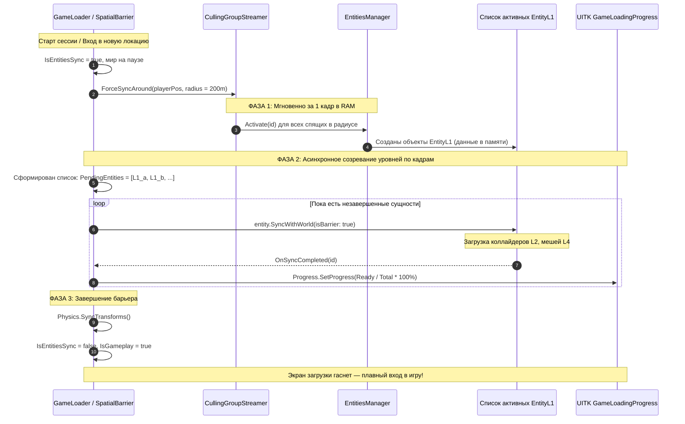

# Архитектура: Локации, Запекание Сущностей и Пространственный Барьер

**Проект:** LunaticMagicV3  
**Папка документации:** `Assets/Scripts/md/2026_11_19/`  
**Файл спецификации:** `02_Locations_And_Sync_Barrier.md`  
**Дата создания:** 20 ноября 2026

---

## 1. Концепция Локаций и Запекание Сущностей (Baking Pipeline)

### 1.1. Зачем нужны локации
1. **Решение проблемы плавающей запятой (`float precision`):**  
   Вместо размещения локаций на одной сцене в 100 км друг от друга (где на координатах $>10\,000$ м вертексы дрожат, а лучи PhysX проваливаются сквозь коллизии), каждая локация имеет **свой собственный локальный нуль координат `(0, 0, 0)`**.
   Позиция любой сущности в мире всегда выражается кортежем:
   $$\mathbf{P}_{\text{world}} = \langle \text{LocationId}, \mathbf{P}_{\text{local}} \rangle$$
2. **Удобство разработки (Unity Editor):**  
   В редакторе каждая локация — это отдельная сцена (`Loc_Forest.unity`, `Loc_Dungeon.unity`, `Loc_Castle.unity`). Левел-дизайнеры работают независимо, запекают свет и строят NavMesh в чистом локальном пространстве без конфликтов в Git.

### 1.2. Конвейер запекания (Baking Pipeline)
В рантайме игра не загружает сцены целиком старым способом Unity. Сцена локации в редакторе — это просто «сборочный цех»:
* Редакторский скрипт сканирует сцену локации, извлекает параметры всех расставленных объектов и **запекает их в список структур `EntityL0`**:
  * `EntityId`, `LocationId`, `LocalPosition`, `Radius`, `TemplateId`, `SpawnerId`, `IsPersistent`.
* Запеченные данные сохраняются в базу мира (JSON или ScriptableObject каталоги).
* **Террейн — это тоже сущность:** Террейн локации оформляется как полноценная сущность с большим радиусом интереса (`Radius = 1500–2000 м`), гарантируя, что земля материализуется первой.
* **При старте новой игры:** Все запеченные `EntityL0` со **всех** локаций мира единовременно регистрируются в [EntitiesManager.cs](file:///D:/unity/LunaticMagicV3/Assets/Scripts/Entities/EntitiesManager.cs). Для 10 000 сущностей это занимает всего ~1–2 МБ памяти в RAM.
* **Следствие:** Открытие любой локации или переход в подземелье — это **просто перенос фокуса на новую точку $\langle LocationId, \mathbf{P}_{\text{local}} \rangle$**, вокруг которой автоматически начинает работать стриминг и синхронизация!

---

## 2. Смена Локации: Подход через Автосейв-Переход (Save $\rightarrow$ Load)

Ваша идея использовать цикл сохранения и загрузки при смене крупной локации — это классический и очень надежный паттерн RPG (используемый, например, в Skyrim, Fallout и Ведьмаке):

```
┌─────────────────────────────────────────────────────────────────────────────┐
│                 ПАЙПЛАЙН ПЕРЕХОДА (SAVE ──> LOAD CYCLE)                     │
├─────────────────────────────────────────────────────────────────────────────┤
│ 1. Сущность Перехода (TransitionEntity — Дверь / Ворота / Портал):          │
│    • При взаимодействии берет фокус на себя: FocusManager.SetFocus(door).   │
│    • Ввод игрока перехвачен, включается мини-катсцена (персонаж входит).    │
│    • Экран начинает плавно темнеть (Fade Out).                              │
├─────────────────────────────────────────────────────────────────────────────┤
│ 2. Обновление координат игрока:                                             │
│    • Сущность игрока (L1) телепортируется:                                  │
│      player.Body.LocationId = targetLocationId;                             │
│      player.Body.Position = targetSpawnPoint;                               │
├─────────────────────────────────────────────────────────────────────────────┤
│ 3. Сохранение Сессии (Автосейв при переходе):                               │
│    • GameSession.CreateSave(GameSaveTypes.Auto, "Переход: " + locationId).  │
│    • Состояние всех активных сущностей атомарно сбрасывается в JSON.        │
│    • Игрок получает бесплатный надежный чекпоинт перед новой локацией!      │
├─────────────────────────────────────────────────────────────────────────────┤
│ 4. Перезагрузка Сессии (Чистый старт):                                      │
│    • Старая сессия закрывается (Dispose), нативный CullingGroup очищается.  │
│    • Открывается сессия из свежего сейва.                                   │
│    • Фокус сразу стоит на игроке (он уже на новых координатах).             │
│    • Запускается стандартный экран загрузки (InitialLoading) и Барьер.      │
└─────────────────────────────────────────────────────────────────────────────┘
```

### Почему этот подход превосходен:
1. **Единый конвейер кода:** Не нужно писать отдельную сложную логику «очистить половину памяти, а половину оставить». Работает тот же проверенный код, что и при старте новой игры или F9.
2. **Гарантированная чистота памяти:** Вся память, старые меши и коллайдеры предыдущей локации гарантированно освобождаются.
3. **Бесплатный автосейв:** Игрок защищен от вылетов или гибели сразу после перехода.
4. **CullingGroup создается с нуля:** За 1 миллисекунду создается кристально чистый массив сфер новой сессии без необходимости вычищать старые индексы.

> [!NOTE]
> Для микро-переходов (например, вход в маленькую палатку или сарай внутри той же локации) можно использовать быстрый пространственный скачок без сохранения сессии, так как террейн и окружение остаются общими.

---

## 3. Архитектура Пространственного Барьера (Spatial Sync Barrier)

Барьер синхронизации — это замена таймера в [GameLoader.cs](file:///D:/unity/LunaticMagicV3/Assets/Scripts/Game/Session/Loading/GameLoader.cs).

### 3.1. Фундаментальный принцип: Синхронный L0 $\rightarrow$ L1 vs Асинхронный L1 $\rightarrow$ L2..L4

> [!IMPORTANT]
> **Золотое правило Барьера:**  
> 1. **Переход L0 $\rightarrow$ L1 ВСЕГДА СИНХРОННЫЙ (за 1 кадр).**  
>    В оперативной памяти создаются чистые C# объекты `EntityL1` (статы, инвентарь, квесты). Никаких `GameObject`, мешей и коллайдеров тут нет, поэтому создание даже 150 сущностей в RAM занимает доли миллисекунды.  
> 2. **Переходы L1 $\rightarrow$ L2 $\rightarrow$ L3 $\rightarrow$ L4 — АСИНХРОННЫЕ ПО КАДРАМ.**  
>    Кадры Unity продолжают идти (чтобы UITK плавно анимировал ползунок прогресса и крутилку загрузки), но игра стоит на паузе (`Time.timeScale = 0`).



---

## 4. Архитектурный Принцип «Матрёшки» (Изоляция Уровней)

> **«Каждый уровень самостоятельный и ему всё равно, какая матрёшка подуровней внутри».**

Координатор стриминга и Барьер общаются только с **`EntityL1`**. Что происходит внутри сущности — это её личное дело:
* `L1` отвечает за данные и командует своему телу: *«Подготовься к физическому присутствию»*.
* `L2` (тело) выделяет коллайдер и командует визуалу: *«Подгрузи 3D модель»*.
* `L4` (визуал) берет модель из пула или Addressables.

```
┌─────────────────────────────────────────────────────────────────────────────┐
│                                 EntityL1                                    │
│   • Чистые данные (HP, инвентарь, квесты)                                   │
│   • Метод: SyncWithWorld(context, onComplete)                               │
│                                                                             │
│   ┌─────────────────────────────────────────────────────────────────────┐   │
│   │                         BodyComponent (L2)                          │   │
│   │   • Легковесный GameObject, коллайдер, isKinematic = true           │   │
│   │                                                                     │   │
│   │   ┌─────────────────────────────────────────────────────────────┐   │   │
│   │   │                     Locomotion (L3)                         │   │   │
│   │   │   • NavMeshAgent, Rigidbody, CharacterController            │   │   │
│   │   │                                                             │   │   │
│   │   │   ┌─────────────────────────────────────────────────────┐   │   │   │
│   │   │   │                  VisualPresentation (L4)            │   │   │   │
│   │   │   │   • VRM 1.0 модель, Animator, MToon, SpringBones    │   │   │   │
│   │   │   └─────────────────────────────────────────────────────┘   │   │   │
│   │   └─────────────────────────────────────────────────────────────┘   │   │
│   └─────────────────────────────────────────────────────────────────────┘   │
└─────────────────────────────────────────────────────────────────────────────┘
```

### Разделение на два режима работы «Матрёшки»:

| Параметр | Режим Барьера (`EntitiesSync` / Загрузка) | Режим Свободного Бега (Геймплей) |
| :--- | :--- | :--- |
| **Цель** | Исключить падение сквозь пол и Т-позы | Исключить микрофризы кадров при беге |
| **Поведение L1** | Ждёт подтверждения готовности от L2 | Создается мгновенно в RAM за 1 кадр |
| **Поведение L2 (Коллайдер)** | Спавнится и ждёт готовности визуала L4 | Спавнится **в текущем кадре** (твердое тело) |
| **Поведение L4 (Визуал)** | Загружается до открытия экрана | Уходит в **фоновую асинхронную подгрузку** |
| **Результат для игрока** | Экран открывается, когда мир на 100% готов | Плавные 60+ FPS, модельки подгружаются незаметно |

---

## 5. Программный Контракт Барьера готовности

Вместо таймера [GameLoader.cs](file:///D:/unity/LunaticMagicV3/Assets/Scripts/Game/Session/Loading/GameLoader.cs) получает честный координатор:

```csharp
namespace Entities.Sync
{
    public class WorldSyncContext
    {
        public Vector3 FocusPosition;
        public bool IsBarrierMode; // true: ждать L4 визуал; false: только L2 коллайдер
    }

    public interface ISpatialSyncEntity
    {
        string EntityId { get; }
        
        // Команда сущности привести свои уровни (L2-L4) в соответствие с контекстом
        void SyncWithWorld(WorldSyncContext context, Action onCompleted);
    }
}
```

### Логика счетчика (Countdown Latch) в `GameLoader`:
```csharp
public class SpatialSyncBarrier : IDisposable
{
    private int _pendingCount;
    private int _totalCount;

    public void ExecuteBarrier(
        List<EntityL1> entitiesToSync, 
        GameLoadingProgress progress, 
        Action onAllCompleted)
    {
        _totalCount = entitiesToSync.Count;
        _pendingCount = _totalCount;

        if (_totalCount == 0)
        {
            progress.SetProgress(100f);
            onAllCompleted?.Invoke();
            return;
        }

        var context = new WorldSyncContext { IsBarrierMode = true };

        foreach (var entity in entitiesToSync)
        {
            entity.SyncWithWorld(context, () =>
            {
                _pendingCount--;
                float currentPercent = (float)(_totalCount - _pendingCount) / _totalCount * 100f;
                progress.SetProgress(currentPercent);

                if (_pendingCount <= 0)
                {
                    // Синхронизация физического пространства перед запуском
                    Physics.SyncTransforms();
                    onAllCompleted?.Invoke();
                }
            });
        }
    }
}
```

---

## 6. Итоги и Выводы для Кодовой Базы

1. **Локации не разнесены на 100 км**, а живут каждая в своем локальном нуле `(0, 0, 0)`.
2. **Все сущности всех локаций запекаются в редакторе** и загружаются в общий реестр `_entitiesL0` при старте мира.
3. **Смена локации через `Save -> Load`** — это чистый, элегантный путь: игрок переносится на координаты новой локации $\rightarrow$ создается автосейв $\rightarrow$ чистый перезапуск сессии с автоматическим созданием нового `CullingGroup` и прогресс-баром.
4. **`GameLoader` избавляется от таймера:** прогресс-бар честно отображает соотношение созревших сущностей к общему числу сущностей стартовой зоны.
