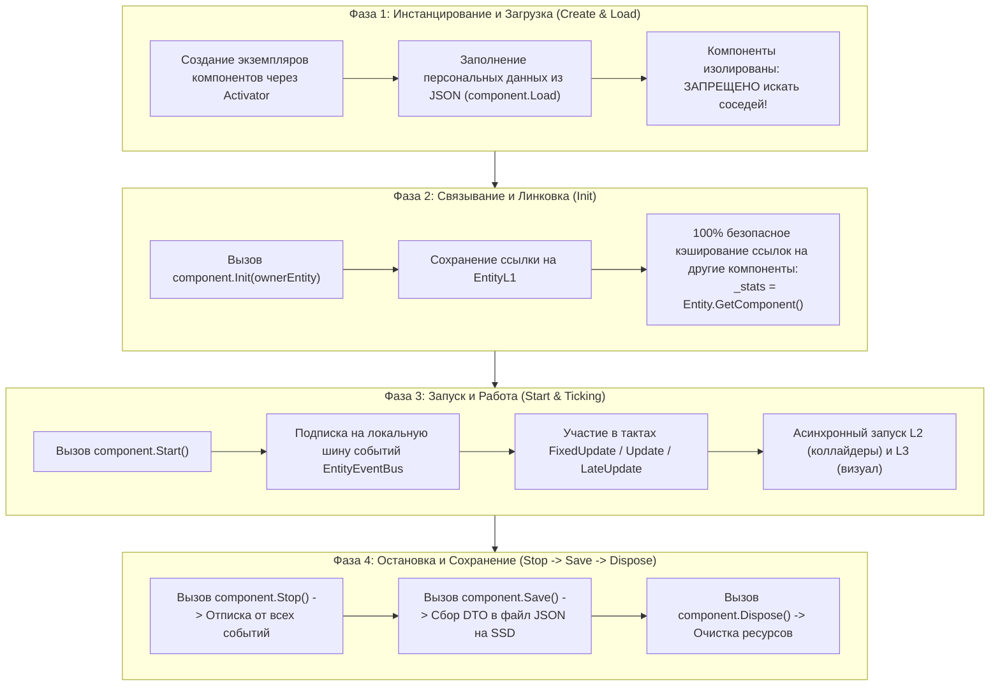
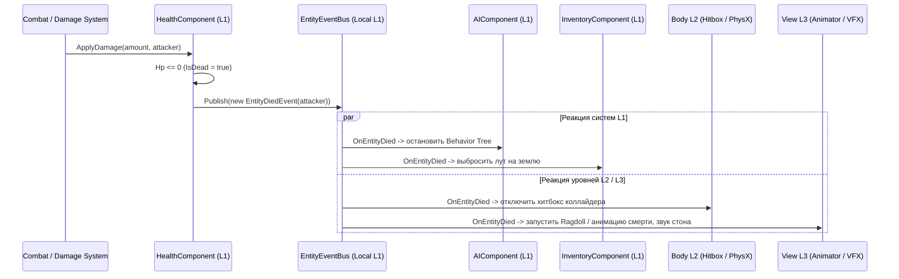

# Архитектура: Компоненты Уровня L1, Жизненный Цикл и Взаимодействие

**Проект:** LunaticMagicV3  
**Папка документации:** `Assets/Scripts/md/2026_11_19/`  
**Файл спецификации:** `03_Components_L1_Lifecycle_And_Phases.md`  
**Дата создания:** 20 ноября 2026  

---

## 1. Концепция Компонентов и Преодоление Кризиса Сложности

### 1.1. Почему разработка компонентов часто заходит в тупик
В классическом подходе Unity на базе `MonoBehaviour` или непродуманных самописных ECS разработчик неизбежно сталкивается с тремя фундаментальными проблемами («ловушками»):
1. **Каша уровней в одном классе:** Попытка поместить в один компонент (например, `HealthComponent`) одновременно логику здоровья (чистый C#), коллайдер хитбокса (Unity Physics) и полоску HP с анимацией получения урона (Unity UI / Animator).
2. **Ад порядка инициализации (`Initialization Hell`):** Компонент `CombatComponent` в своем методе запуска пытается вызвать `Entity.GetComponent<StatsComponent>()`, но компонент `StatsComponent` из JSON файла на диске ещё даже не создан или ещё не заполнил свои поля.
3. **Спагетти взаимных связей:** Если каждый компонент напрямую знает и дергает методы всех остальных компонентов, проект превращается в запутанный монолит: изменение одного поля ломает пять других систем.

### 1.2. Базовые принципы подсистемы компонентов в LunaticMagicV3
* **Хранение данных на диске (SSD Sandbox):**
  * Общий реестр спящих сущностей хранится в `EntitiesL0` внутри файла сессии.
  * Персональные данные каждой сущности уровня **L1** хранятся в **отдельном JSON-файле на диске** в папке сессии (`Entities/{EntityId}.json`).
  * Для современного SSD наличие до 10 000 файлов не создает проблем с I/O, а в памяти одновременно активно находится лишь 100–300 бодрствующих сущностей.
* **Четкое разделение ответственности по уровням:**
  * **L1 (Логика и состояние):** Чистый C#, память RAM. Никаких `GameObject`, `Transform`, `MonoBehaviour`. Высокая скорость выполнения, возможность симуляции в фоне (A-Life).
  * **L2 (Физический каркас):** Коллайдеры, хитбоксы, `CharacterController`, препятствия `NavMeshObstacle`. Обязательный уровень мира — без него игра сломается (провал сквозь пол, хождение сквозь стены).
  * **L3 (Визуальное представление):** Меши, текстуры, `Animator`, аудио, системы частиц. Опциональный уровень: если визуал не успел прогрузиться за 1 кадр при беге по миру, игра не падает, а продолжает нормально работать.

---

## 2. Иерархия Сущности: Принцип Матрёшки (L1 $\rightarrow$ L2 $\rightarrow$ L3)

> [!IMPORTANT]
> **Компоненты сущности живут на уровне L1.**
> Не нужно плодить для каждого компонента свои личные L2 и L3!
> У сущности есть **ОДНО физическое тело L2** и **ОДНО визуальное представление L3**, управляемые через `BodyComponent`. Компоненты L1 лишь читают данные этого тела или отдают ему команды.

```
┌────────────────────────────────────────────────────────────────────────┐
│  L1: EntityL1 (Мозг, Данные и Логика в RAM, Чистый C#)                │
│  ├─ BodyComponent      (Координаты, поворот, ссылки на L2 и L3)        │
│  ├─ HealthComponent    (CurrentHp: 100, MaxHp: 100)                    │
│  ├─ StatsComponent     (AttackPower: 25, Armor: 10, Speed: 6.5)        │
│  ├─ InventoryComponent (Items: [Sword_01, HealthPotion_x3])            │
│  ├─ AIComponent        (CurrentState: Patrol, TargetEntityId: null)    │
│  └─ EntityEventBus     (Локальная шина сигналов сущности)              │
└───────────────────────────────────┬────────────────────────────────────┘
                                    │ await при спавне / входе в мир
┌───────────────────────────────────▼────────────────────────────────────┐
│  L2: Physical Body (Каркас коллизий в сцене Unity)                     │
│  ├─ CharacterController / Rigidbody (физическое перемещение)           │
│  ├─ Hitbox Receiver (коллайдеры, принимающие удары и выстрелы)         │
│  └─ NavMeshObstacle (взаимодействие с поиском путей)                   │
└───────────────────────────────────┬────────────────────────────────────┘
                                    │ await при загрузке ИЛИ фоновый Task
┌───────────────────────────────────▼────────────────────────────────────┐
│  L3: Visual Presentation (Оболочка рендеринга в сцене Unity)           │
│  ├─ MeshRenderer / SkinnedMeshRenderer (3D-модель)                     │
│  ├─ Animator (воспроизведение анимаций бега, атаки, получения урона)   │
│  ├─ AudioSource (шаги, звуки оружия, реплики)                          │
│  └─ VFX Emitter (частицы крови, искры магии)                           │
└────────────────────────────────────────────────────────────────────────┘
```

---

## 3. Детерминированный Жизненный Цикл: Правило 4-х Фаз

Чтобы гарантировать отсутствие ошибок порядка загрузки (`NullReferenceException`), жизненный цикл любого компонента L1 строго разделен на **четыре изолированные фазы**:



### 3.1. Фаза 1: Инстанцирование и Загрузка Данных (`Create & Load`)
* **Что происходит:**
  1. Читается персональный JSON-файл сущности: `SaveData.Load<EntitySaveData>(folder, entityId)`.
  2. Для каждого типа компонента создается чистый C# объект через фабрику или рефлексию:
     `var comp = (IEntityComponent)Activator.CreateInstance(type);`
  3. В компонент передаются только его собственные сохраненные данные:
     `comp.Load(compData);`
  4. Компонент добавляется в словарь `EntityL1._components[type] = comp;`.
* **Железное правило Фазы 1:**
  > [!CAUTION]
  > В методе `Load()` **категорически запрещено** вызывать `GetComponent` или пытаться взаимодействовать с другими компонентами. Соседние компоненты в этот момент могут ещё не существовать!

### 3.2. Фаза 2: Связывание Зависимостей (`Init(EntityL1 owner)`)
* **Что происходит:**
  После того как ВСЕ компоненты сущности созданы и распаковали свои данные из JSON, `EntityL1` пробегает по всем компонентам и вызывает:
  `component.Init(this);`
* **Преимущества:**
  * Каждый компонент получает ссылку на своего владельца `EntityL1`.
  * **Гарантия целостности:** Любой компонент теперь может безопасно найти соседа:
    ```csharp
    public void Init(EntityL1 owner)
    {
        Entity = owner;
        _stats = owner.GetComponent<StatsComponent>(); // ГАРАНТИРОВАННО СУЩЕСТВУЕТ!
        _body = owner.Body;
    }
    ```
  * Никаких проверок `if (_stats == null)` во время геймплея.

### 3.3. Фаза 3: Активация и Выполнение (`Start()`)
* **Что происходит:**
  Сущность переходит в активное состояние и вызывает у всех компонентов `Start()`.
* **Действия в `Start()`:**
  * Подписка на локальную шину событий: `Entity.Events.Subscribe<TakeDamageEvent>(OnDamageReceived);`.
  * Инициализация внутренних таймеров и стейт-машин (для AI).
  * Если компонент требует покадрового обновления — он регистрируется в оптимизированных списках сущности (`IFixedUpdateComponent`, `IUpdateComponent`).

### 3.4. Фаза 4: Заморозка и Сериализация (`Stop() $\rightarrow$ Save() $\rightarrow$ Dispose()`)
Когда сущность удаляется или замораживается обратно в **L0**:
1. **`Stop()`:** Компонент отписывается от событий шины и внешних систем. Исключаются утечки памяти и вызовы на мертвых объектах.
2. **`Save()`:** Компонент формирует свой легкий DTO-объект состояния:
   ```csharp
   public object Save() => new HealthSaveData { CurrentHp = _currentHp };
   ```
   Собранные данные атомарно записываются в файл `{EntityId}.json` на SSD.
3. **`Dispose()`:** Освобождение ресурсов, сброс ссылок, возврат объектов в пулы.

---

## 4. Взаимодействие Компонентов: Архитектура Без Спагетти

Чтобы компоненты не запутывались во взаимных вызовах, взаимодействие строго разделено на **три канонических паттерна**:

| Паттерн | Назначение | Пример использования | Правило |
|---|---|---|---|
| **1. Прямой Read-Only запрос** | Быстрое получение справочных данных | `float speed = _stats.MovementSpeed;` | **Только чтение!** Запрещено напрямую мутировать поля чужого компонента (`_stats.Hp -= 10` — табу). |
| **2. Семантическая Команда** | Запрос на осмысленное действие над компонентом | `_health.ApplyDamage(15f, attackerEntity);` | Компонент сам инкапсулирует правила (учет брони, щитов, неуязвимости). |
| **3. Локальная Шина Событий** | Оповещение нескольких независимых систем о свершившемся факте | `Entity.Events.Publish(new EntityDiedEvent());` | **Полная развязка!** Источник события не знает, кто и как на него отреагирует. |

### 4.1. Разбор кейса: Гибель Сущности через Локальную Шину Событий
Представим, что у моба закончилось здоровье. Как это отрабатывает без спагетти-кода:



**Результат:**
* `HealthComponent` содержит всего ~40 строк кода. Он **ничего не знает** про анимации, звуки, лут и искусственный интеллект.
* Если завтра в игру добавится ачивка «Убийца гоблинов» — мы просто подпишем `QuestTrackerComponent` на `EntityDiedEvent`, не трогая код здоровья!

---

## 5. Взаимодействие Уровней: Как L1 управляет L2 и L3

### 5.1. Модель управления
* **L1 никогда не ссылается на типы Unity Scene:** В коде компонентов L1 нет `UnityEngine.GameObject`, `Transform`, `Animator`, `AudioSource`.
* Для связи с физикой и визуалом используется фасад **`BodyComponent`** и абстрактные интерфейсы представлений:
  * `IEntityL2` — физическое тело (установка координат, импульсы, включение/выключение хитбокса).
  * `IEntityL3` — визуальное тело (команды аниматора, триггеры эффектов).

### 5.2. Обратная связь: Как физика L2 сообщает об ударе в логику L1
На физическом префабе в сцене висит легковесный Unity-скрипт `HitboxReceiver` (MonoBehaviour):
```csharp
public class HitboxReceiver : MonoBehaviour
{
    private EntityL1 _owner;

    public void Bind(EntityL1 owner) => _owner = owner;

    // Вызывается PhysX движка Unity
    public void TakeHit(DamageHit hit)
    {
        // Простой проброс события в чистый C# мозг сущности:
        _owner?.GetComponent<HealthComponent>()?.ApplyDamage(hit.Damage, hit.AttackerId);
    }
}
```

---

## 6. Базовый Кодовый Контракт (Спецификация)

### 6.1. Интерфейс `IEntityComponent`
```csharp
namespace Entities
{
    public interface IEntityComponent : IDisposable
    {
        // Фаза 1: Загрузка личного состояния из JSON
        void Load(object data);

        // Фаза 2: Привязка к сущности и безопасный поиск соседей
        void Init(EntityL1 owner);

        // Фаза 3: Активация, подписка на события шины
        void Start();

        // Фаза 4: Остановка, отписка от событий
        void Stop();

        // Фаза 4: Сериализация состояния для записи на SSD
        object Save();
    }
}
```

### 6.2. Базовый абстрактный класс `EntityComponentBase`
```csharp
namespace Entities
{
    public abstract class EntityComponentBase : IEntityComponent
    {
        public EntityL1 Entity { get; private set; }
        public bool IsStarted { get; private set; }

        public virtual void Load(object data) { }

        public virtual void Init(EntityL1 owner)
        {
            Entity = owner;
        }

        public virtual void Start()
        {
            IsStarted = true;
        }

        public virtual void Stop()
        {
            IsStarted = false;
        }

        public virtual object Save() => null;

        public virtual void Dispose()
        {
            if (IsStarted) Stop();
            Entity = null;
        }
    }
}
```

### 6.3. Локальная Шина Событий `EntityEventBus`
```csharp
using System;
using System.Collections.Generic;

namespace Entities
{
    public class EntityEventBus
    {
        private readonly Dictionary<Type, List<Delegate>> _subscribers = new();

        public void Subscribe<T>(Action<T> handler)
        {
            var type = typeof(T);
            if (!_subscribers.TryGetValue(type, out var list))
            {
                list = new List<Delegate>();
                _subscribers[type] = list;
            }
            list.Add(handler);
        }

        public void Unsubscribe<T>(Action<T> handler)
        {
            if (_subscribers.TryGetValue(typeof(T), out var list))
            {
                list.Remove(handler);
            }
        }

        public void Publish<T>(T eventData)
        {
            if (_subscribers.TryGetValue(typeof(T), out var list))
            {
                for (int i = list.Count - 1; i >= 0; i--)
                {
                    ((Action<T>)list[i]).Invoke(eventData);
                }
            }
        }

        public void Clear()
        {
            _subscribers.Clear();
        }
    }
}
```

---

## 7. Резюме архитектурных правил для разработчика

1. **Один компонент — один аспект логики:** Не объединять характеристики, лут и здоровье в один супер-класс.
2. **Никакого Unity-визуала в L1:** Все 3D-модели, звуки и анимации живут на уровне L3 и просто слушают события L1.
3. **Строго соблюдать 4 фазы:**
   * Не искать соседей в `Load()` (Фаза 1).
   * Искать соседей только в `Init()` (Фаза 2).
   * Подписываться на события только в `Start()` (Фаза 3).
   * Отписываться от событий в `Stop()` (Фаза 4).
4. **Общение через события:** Если событие касается нескольких систем (смерть, смена уровня, прыжок, получение урона) — отправлять его через `Entity.Events.Publish(...)`, а не вызывать каждый компонент вручную.
