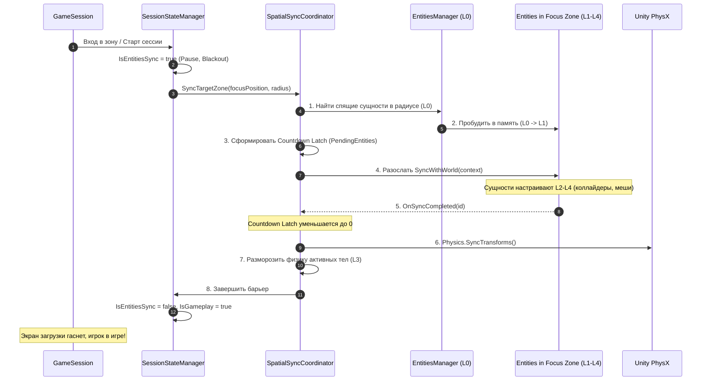
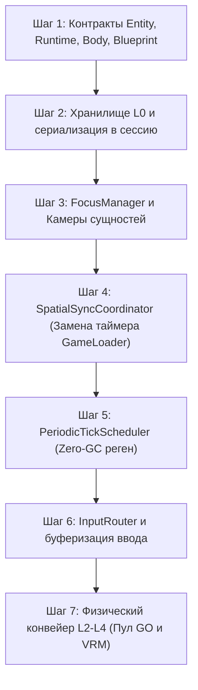

# Архитектурный План: Система Сущностей и Пространственный Барьер (EntitySystemPlan.md)

**Проект:** LunaticMagicV3  
**Папка документации:** `Assets/Scripts/md/2026_11_19/`  
**Дата создания:** 19 ноября 2026  
**Контекст задачи:** Сессия игры стабилизирована ([GameSession.cs](file:///D:/unity/LunaticMagicV3/Assets/Scripts/Game/Session/GameSession.cs), [SessionStateManager.cs](file:///D:/unity/LunaticMagicV3/Assets/Scripts/Game/Session/SM/SessionStateManager.cs)). В [GameLoader.cs](file:///D:/unity/LunaticMagicV3/Assets/Scripts/Game/Session/Loading/GameLoader.cs) сейчас работает UniRx-таймер, эмулирующий процесс загрузки и синхронизации. Цель данного документа — зафиксировать полную концепцию целевой системы сущностей, восстановить все запланированные механики (L0–L4, разделение Сущность/Тело, Вселение, Фокус, Камеры) и сформировать конкретный план замены таймера-эмулятора на реальный **Барьер Пространственной Синхронизации (Spatial Sync Barrier)**.

---

## 1. Архитектурные столпы целевой системы

Старая архитектура (`Assets/Scripts/OldScripts/Entities_1` и `Entities_2`) страдала от взрыва классов (`EntityGivi : EntityGoblin : Entity`), рефлексии на старте (`Assembly.GetExecutingAssembly()`), жесткого привязывания личности к физическому префабу Unity и спайков нагрузки при одновременных тиках.

Целевая система строится на 6 фундаментальных правилах:

1. **Сущность (`EntityRuntime`) — чистый C# объект в оперативной памяти (L1).** В ней нет `MonoBehaviour`, нет тяжелых коллайдеров и нет мешей.
2. **Разделение Сущности (Личность, Прогресс, Разум) и Тела (Физический костюм):** Сущность надевает Тело (`BodyComponent`). Координаты в пространстве принадлежат Телу, а не разуму. Это открывает механику Вселения (`Possession`).
3. **Пять ступеней материализации (L0 $\rightarrow$ L4):** Диск $\rightarrow$ RAM Данные $\rightarrow$ Kinematic Body $\rightarrow$ Dynamic PhysX $\rightarrow$ 3D/VRM Визуал.
4. **Децентрализованный плоский Фокус (Flat Focus):** В сессии нет стеков фокуса (`FocusStack`) и нет сессионного контроллера игрока. Есть плоский указатель `CurrentFocus`. Камеры принадлежат сущностям (`EntityCameraRig`), а не глобальному менеджеру.
5. **Барьер Пространственной Синхронизации (Spatial Sync Barrier):** Реальная замена таймера `GameLoader` — опрос готовности сущностей в радиусе внимания при входе в мир, смене локации или телепорте (> 200м).
6. **Zero-GC распределение периодических тиков (Timing Wheel):** Регенерация характеристик (HP, мана, стамина) и редкие проверки ИИ распределяются по кольцевому буферу с фазовым сдвигом, исключая фризы на фиксированных кадрах.

---

## 2. Пять уровней существования Сущности (L0 – L4)

```
┌─────────────────────────────────────────────────────────────────────────────┐
│ УРОВЕНЬ 0 (L0): Спящая на диске (Dormant Registry)                          │
│   • Легковесная запись в реестре сессии: EntityId, TemplateId, координаты,  │
│     виртуальный радиус BoundingRadius, LocationId.                          │
│   • Детальное состояние лежит в файле: Sessions/{id}/Entities/{EntityId}.json│
│   • Затраты RAM: ~64 байта. GameObject в сцене ОТСУТСТВУЕТ.                 │
└──────────────────────────────────────┬──────────────────────────────────────┘
                                       │ Стриминг по дистанции ИЛИ прямое обращение
                                       ▼ (НИЗКИЙ УРОВЕНЬ / EntitiesManager)
┌─────────────────────────────────────────────────────────────────────────────┐
│ УРОВЕНЬ 1 (L1): Данные и Виртуальная симуляция (Pure C# Data & A-Life)      │
│   • Экземпляр EntityRuntime в памяти RAM.                                   │
│   • Активны: HealthComponent, StatsComponent, InventoryComponent,           │
│     квестовые флаги, диалоги, расписание A-Life.                            │
│   • Сущность можно убить скриптом, изменить её вещи, опросить статус.       │
│   • GameObject в сцене ОТСУТСТВУЕТ, PhysX не нагружается.                   │
└──────────────────────────────────────┬──────────────────────────────────────┘
                                       │ Вход в зону физического тела (~100-150м)
                                       ▼ (ВЫСОКИЙ УРОВЕНЬ / Macro Systems)
┌─────────────────────────────────────────────────────────────────────────────┐
│ УРОВЕНЬ 2 (L2): Замороженное физическое тело (isKinematic = true)           │
│   • Легковесный GameObject из пула с Collider (Capsule/Box).                │
│   • Rigidbody.isKinematic = true. Гравитация не считается.                  │
│   • Тело занимает место в пространстве, доступно для лучей (Raycast)        │
│     и триггеров. Гарантирует твердую опору под ногами других акторов.       │
│   • Золотое правило: BoundingSize < (R_spawn - R_unfreeze)                  │
└──────────────────────────────────────┬──────────────────────────────────────┘
                                       │ Вход в зону активного боя/движения (~50м)
                                       ▼
┌─────────────────────────────────────────────────────────────────────────────┐
│ УРОВЕНЬ 3 (L3): Размороженная активная физика (isKinematic = false)         │
│   • Rigidbody.isKinematic = false / активен CharacterController.            │
│   • Включается NavMeshAgent, локомоция, гравитация, импульсы ударов,        │
│     физическое расталкивание (Avoidance), при смерти — рэгдолл (Ragdoll).   │
└──────────────────────────────────────┬──────────────────────────────────────┘
                                       │ Вход в зону прямой видимости (~30-40м)
                                       ▼
┌─────────────────────────────────────────────────────────────────────────────┐
│ УРОВЕНЬ 4 (L4): Визуальное представление (3D / VRM Model)                   │
│   • Дочерний визуал, подцепляемый за 1 кадр из Model Staging Room / Пула.   │
│   • VRM 1.0 модель, MToon шейдеры, Animator со стейт-машиной,               │
│     SpringBones (динамика волос и одежды), точки крепления оружия, HUD.     │
└─────────────────────────────────────────────────────────────────────────────┘
```

---

## 3. Разделение: Сущность (`Entity`) vs Тело (`BodyComponent`)

Сущность не является 3D-моделькой. Сущность — это актор логики.

```
┌─────────────────────────────────────────────────────────────────────────────┐
│                             СУЩНОСТЬ (Entity)                               │
│  "Разум, Личность, Сюжетный прогресс, Навыки"                               │
│                                                                             │
│  • EntityId ("player_main", "npc_givi")                                     │
│  • TemplateId ("mage_hero", "goblin_warrior")                               │
│  • Brain (PlayerBrain / AIBrain / ComaBrain)                                │
│  • Quests & Dialogue State (Пройденные этапы, отношения фракций)            │
│  • Attributes & RPG Stats (Базовые характеристики, уровень)                 │
│  • CurrentBody (Ссылка на надетое в данный момент тело)                     │
│  • OriginalBodyId (Ссылка на родное физическое тело)                        │
└──────────────────────────────────────┬──────────────────────────────────────┘
                                       │ надевает / управляет
                                       ▼
┌─────────────────────────────────────────────────────────────────────────────┐
│                          ТЕЛО (BodyComponent)                               │
│  "Физический костюм / Скафандр в мире Unity"                                │
│                                                                             │
│  • BodyId ("body_player_01", "body_goblin_15")                              │
│  • Spatial Coordinates: LocationId + LocalPosition + LocalRotation          │
│  • LocomotionController (Исполнитель физического шага, прыжка, плавания)   │
│  • PhysicsView (Ссылка на GameObject сцены при L2/L3)                       │
│  • VisualPresentation (Ссылка на VRM-модель при L4)                         │
│  • EntityCameraRig (Внутренние ракурсы камеры для глаз/плеча)               │
│  • BodyInventory (Надетая броня, оружие в слотах рук)                       │
└─────────────────────────────────────────────────────────────────────────────┘
```

### Механика Вселения (Possession Pipeline):
1. **Каст заклинания:** Игрок в теле Мага (`PrimaryEntity`) применяет способность вселения на целевого Гоблина (`PossessedEntity`).
2. **Засыпание Мага:** На сущность мага вешается `ComaBrain` (тело мага замирает в Idle, падает на колени или садится в медитацию).
3. **Переключение ввода и камеры:**
   - На тело гоблина вешается временный `PossessionComponent(ReturnEntityId = "player_main")`.
   - Штатный `AIBrain` гоблина деактивируется.
   - Сессия переключает фокус: `FocusManager.SetFocus(goblilnEntity)`.
   - Камера снапится на риг гоблина (низкий рост 80 см, специфический FOV).
   - Ввод игрока теперь транслируется в локомоцию гоблина.
4. **Два сценария смерти/выхода:**
   - *Погиб гоблин (HP $\le$ 0):* Это НЕ поражение игрока. Гоблин падает в рэгдолл, `PossessionComponent` вызывает возврат: `SetFocus("player_main")`. Маг просыпается (снимается `ComaBrain`), камера возвращается к магу.
   - *Погибло тело мага в кустах:* Патруль нашел тело спящего мага и убил его. Вселение аварийно рвется, фокус переводится на `DeathEntity` $\rightarrow$ экран поражения и быстрой загрузки F9.

---

## 4. Архитектура Фокуса и Камер (`FocusManager` & `IFocusable`)

### 4.1. Отказ от стеков фокуса (Flat Focus)
В сессии **нет стека фокуса (`FocusStack`)**. Стек хрупок: если сущность в глубине стека была выгружена стримингом или убита, стек начинает ссылаться на битый указатель (`null`).
* Вместо стека сессия хранит **один плоский указатель**:
  ```csharp
  public IFocusable CurrentFocus { get; }
  public void SetFocus(IFocusable newFocus);
  ```
* Если сущности нужно знать, куда вернуть управление (катсцена, вселение), она сохраняет строковый `ReturnEntityId`.

### 4.2. Жизненный цикл смены фокуса
При вызове `SetFocus(newFocus)`:
1. `oldFocus?.OnFocusLost()`:
   - Скрывает свой специфичный HUD/окна.
   - Отключает свой `EntityCameraRig`.
   - Сбрасывает удержания клавиш и буфер ввода (Anti-Sticking).
2. `CurrentFocus = newFocus`.
3. `newFocus?.OnFocusGained()`:
   - Активирует свой `EntityCameraRig` (главная камера `Camera.main` плавно или мгновенно привязывается к новому ригу).
   - Показывает свой геймплейный HUD (через UITK `GameScreenComponent`).
   - Начинает получать поток ввода от `InputRouter`.
   - Задает сессии требуемый режим курсора (`CursorMode`).

### 4.3. Камеры — Внутреннее дело сущности
В игре нет глобального контроллера камер со свитчами видов под каждого моба.
* В сцене есть ровно **один физический сенсор** `Camera.main` (для исключения лишних проходов рендера).
* Каждая сущность несёт свой `EntityCameraRig`:
  * Точка глаз (1st person).
  * Плечо/Spring-Arm (3rd person).
  * Ограничения угла обзора, FOV, сглаживание тряски.
* Физическая камера в `LateUpdate` просто копирует положение и параметры активного рига сущности в фокусе.

### 4.4. Служебные сущности: `DeathEntity` и `CutsceneEntity`
* **`DeathEntity` (Сущность Смерти):**
  * Спавнится/активируется при гибели истинного тела игрока (`PrimaryEntity`).
  * Получает фокус: `SetFocus(DeathEntity)`.
  * Несет орбитальную камеру вокруг погибшего тела.
  * Блокирует WASD, слушает клавиши `F9` (QuickLoad), `Space` (Респаун) и `Esc`.
  * Выводит посмертный экран через UITK.
* **`CutsceneEntity` (Сущность Катсцены):**
  * Режиссерская сущность. Хранит `ReturnEntityId`.
  * Имеет либо кинематографические рельсы (сплайн движения камеры, глушит ввод игрока), либо режим свободной камеры (FreeCam) для осмотра.
  * По завершении ролика сама вызывает `SetFocus(ReturnEntityId)`.

---

## 5. Замена таймера `GameLoader`: Барьер Пространственной Синхронизации

В файле [GameLoader.cs](file:///D:/unity/LunaticMagicV3/Assets/Scripts/Game/Session/Loading/GameLoader.cs) сейчас находится временная заглушка:
```csharp
_timerSubscription = Observable.Interval(TimeSpan.FromMilliseconds(20), Scheduler.MainThreadIgnoreTimeScale)
    .Take(100)
    ...
```

### 5.1. Что должен делать честный `SpatialSyncCoordinator`
Барьер синхронизации активируется в 3-х случаях:
1. **Первичный вход в игру (Старт сессии / загрузка сохранения):**
   Сессия находится в `SessionInitialLoadingState` (мир на паузе, экран загрузки с прогресс-баром).
2. **Смена локации (Дверь, портал, подземелье):**
   Сессия переходит в `SessionEntitiesSyncState` (мир на паузе, экран затемнения).
3. **Прыжок фокуса за кадр > 200 метров (Телепорт, далёкое вселение):**
   Сессия переходит в `SessionEntitiesSyncState` (экран затемнения).



### 5.2. Контракт сущности для барьера: `ISpatialSyncEntity`
```csharp
public interface ISpatialSyncEntity
{
    string EntityId { get; }
    void SyncWithWorld(WorldSyncContext context);
    event Action<string> OnSyncCompleted;
}

public class WorldSyncContext
{
    public Vector3 FocusPosition;
    public float DistanceToFocus;
    public bool ForceInstant;
}
```

---

## 6. Распределение тиков: `PeriodicTickScheduler` (Zero-GC Timing Wheel)

Согласно исследованию в [planFU.md](file:///D:/unity/LunaticMagicV3/Assets/Scripts/md/2026_11_19/planFU.md), одновременный вызов тиков регенерации (HP, мана, стамина, ИИ) на фиксированных кадрах приводит к жестким пикам нагрузки CPU (спайкам) и синхронному дерганию шкал интерфейса.

В целевой системе внедряется **Колесо Времени на 1024 слота** (`WheelSize = 1024`, битовая маска `& 1023`):
* **При спавне сущности (Фазовый сдвиг):** Первый запуск каждой шкалы раскидывается на случайную дельту `Random(1, BaseTicks)`. Даже если заспавнить 500 гоблинов в один кадр, их задачи равномерно распределятся по всем 1024 корзинам.
* **При каждом срабатывании (Джиттер):** Задача перекладывает себя вперед на `BaseTicks + Random(-Jitter, +Jitter)`. Пики размываются в абсолютно ровный "белый шум" нагрузки.
* **Zero-GC:** Задачи хранятся в плоском массиве структур `ScheduledTask[]` с индексами `NextTask`/`PrevTask`. Добавление, удаление при смерти NPC и исполнение происходят за $O(1)$ без аллокаций памяти.

---

## 7. Ввод и Буферизация: `InputRouter` & `InputBuffer`

Согласно правилам из [InputPlan.md](file:///D:/unity/LunaticMagicV3/Assets/Scripts/md/2026_11_19/InputPlan.md):
1. **Аппаратный драйвер (`InputLayer`):** Генерирует сырые события клавиш.
2. **Сессионный роутер и буфер (`InputRouter` / `InputBuffer`):**
   - Накапливает нажатия с временем жизни (окно буферизации ~150-200 мс).
   - Привязан строго к `CurrentFocus`.
   - **Защита от залипаний (Anti-Sticking):** При смене фокуса или паузе сессии буфер мгновенно сбрасывает все удержания (Hold) и таймеры.
3. **Потребление (Consumption):** Стейт-машина сущности при срабатывании перехода явно вызывает `buffer.Consume(ActionType)`, обнуляя импульс, чтобы одно нажатие не сработало дважды.

---

## 8. Пошаговая дорожная карта реализации (Roadmap)

Переход от текущего состояния к целевой системе сущностей разбивается на последовательные шаги:



### Шаг 1. Контракты Entity, Runtime, BodyComponent и Blueprints
* Спроектировать и реализовать структуру `EntityBlueprint` (шаблон статов, компонентов и визуала).
* Разделить сущность и тело: внедрить `BodyComponent` в `Assets/Scripts/Entities/`.
* Обновить `IEntity`, `IEntityRuntime`, `IEntityComponent` под работу с `BodyComponent`.

### Шаг 2. Хранилище L0 и сериализация в сессию
* Доработать `EntitiesManager`:
  * Легковесный реестр L0 с координатами и виртуальным радиусом.
  * Реализовать сохранение/загрузку JSON-файлов сущностей в `Sessions/{SessionId}/Entities/{EntityId}.json`.
  * Убедиться, что при создании сейва папка сущностей корректно переносится в профиль.

### Шаг 3. FocusManager и Камеры сущностей
* Создать `FocusManager` в `Assets/Scripts/Game/Session/`:
  * Плоский указатель `CurrentFocus`.
  * Контракт `IFocusable` (`OnFocusGained`, `OnFocusLost`, `CursorMode`, `CameraRig`).
* Связать с [CursorState.cs](file:///D:/unity/LunaticMagicV3/Assets/Scripts/Game/Session/Cursor/CursorState.cs).
* Создать базовый `EntityCameraRig` и логику слежения физической `Camera.main`.

### Шаг 4. Барьер пространственной синхронизации (`SpatialSyncCoordinator`)
* Создать интерфейс `ISpatialSyncEntity`.
* Реализовать `SpatialSyncCoordinator` внутри сессии:
  * Поиск спящих L0 сущностей в радиусе спавна.
  * Пробуждение L0 $\rightarrow$ L1.
  * Рассылка команды `SyncWithWorld` и сбор ответов `OnSyncCompleted`.
  * Вызов `Physics.SyncTransforms()`.
* **Переписать [GameLoader.cs](file:///D:/unity/LunaticMagicV3/Assets/Scripts/Game/Session/Loading/GameLoader.cs):**
  * Заменить UniRx-таймер на запуск `SpatialSyncCoordinator`.
  * По завершению барьера переключать флаги `IsEntitiesSync = false`, `IsGameplay = true`, `IsSessionInitLoading = false`.

### Шаг 5. Планировщик периодических тиков (`PeriodicTickScheduler`)
* Перенести алгоритм Hashed Timing Wheel из [planFU.md](file:///D:/unity/LunaticMagicV3/Assets/Scripts/md/2026_11_19/planFU.md) в продакшн-код сессии.
* Подключить `PeriodicTickScheduler` к жизненному циклу `GameSession.FixedUpdate()`.
* Подготовить компоненты регенерации характеристик (`HealthComponent`, `StatsComponent`), использующие планировщик.

### Шаг 6. Маршрутизатор и буфер ввода (`InputRouter`)
* Реализовать архитектуру из [InputPlan.md](file:///D:/unity/LunaticMagicV3/Assets/Scripts/md/2026_11_19/InputPlan.md).
* Связать аппаратный `InputController` с `InputRouter`.
* Обеспечить сброс буфера (Anti-Sticking) при вызовах `FocusManager.SetFocus()` и переходе в меню паузы.

### Шаг 7. Физический и визуальный конвейер L2 $\rightarrow$ L3 $\rightarrow$ L4
* Создать пул легковесных `GameObject` с коллайдерами для уровня L2 (isKinematic = true).
* Подключить активацию `CharacterController` / `NavMeshAgent` для уровня L3 (isKinematic = false).
* Интегрировать `VrmFileManager` и Staging Room для быстрого монтирования 3D-моделей на уровне L4.
